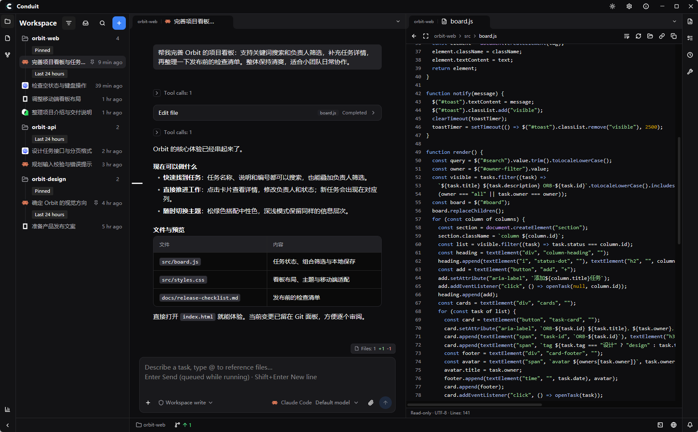
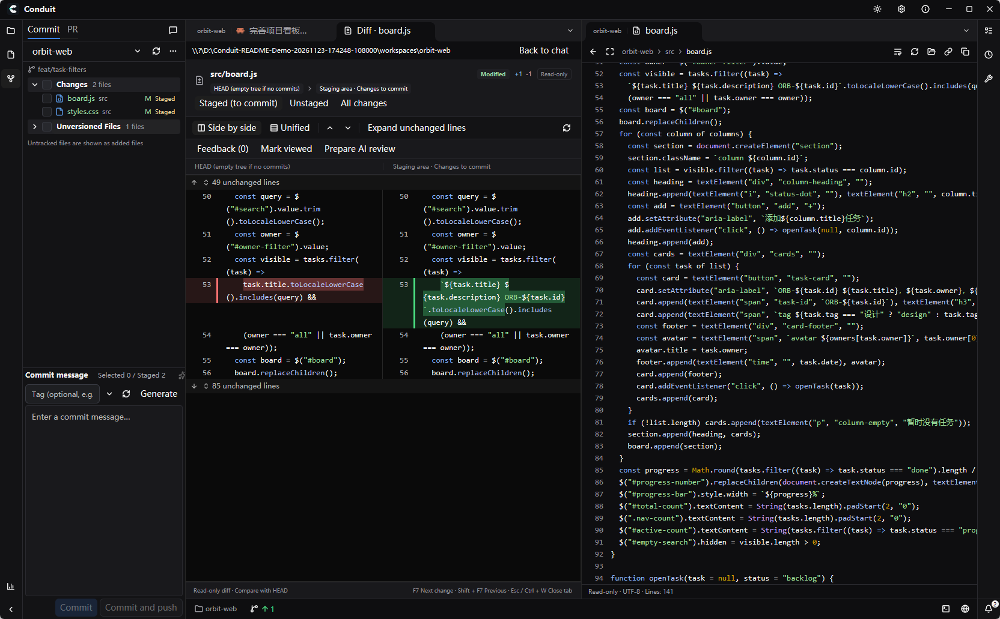
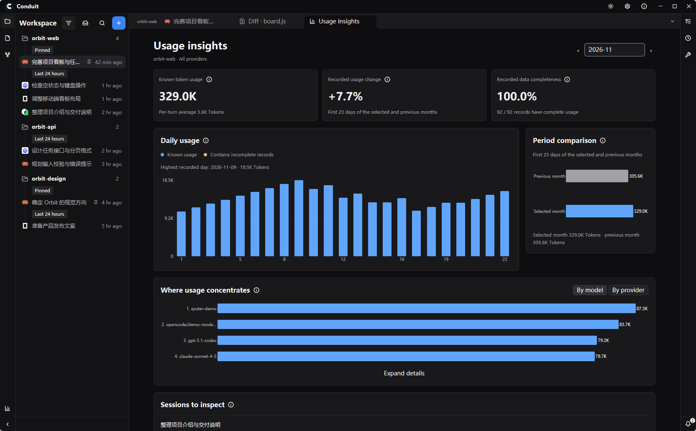

<p align="center">
  
</p>

<h1 align="center">Conduit</h1>

<p align="center">
  A native Windows workspace for AI coding agents.<br>
  Conversations, files, Git, and a terminal — together in one app.
</p>

<p align="center">
  <strong>English</strong> · <a href="README.zh-CN.md">简体中文</a>
</p>

<p align="center">
  <a href="https://github.com/Leo-Lee-j/conduit/releases"></a>
  <a href="https://github.com/Leo-Lee-j/conduit/actions/workflows/ci.yml"></a>
  
</p>

<p align="center">
  <a href="https://github.com/Leo-Lee-j/conduit/releases/latest"><strong>Download for Windows</strong></a> ·
  <a href="docs/usage.md">User guide (中文)</a> ·
  <a href="https://github.com/Leo-Lee-j/conduit/issues">Report an issue</a> ·
  <a href="CONTRIBUTING.md">Contribute</a>
</p>

Conduit brings **Claude Code, Codex, OpenCode, and Qoder CLI** into a shared desktop workspace. Organize conversations and tasks by project, follow agents and subagents, review code beside a conversation, and take changes through Git and pull request review.

Conduit is under active development and currently supports **Windows x64**. The interface supports **English and 简体中文**, switchable in **Settings → General → Language**. New installations default to English; older configurations without a language setting retain Chinese. Most detailed guides are currently in Chinese.



The native workspace, showing the fictional Orbit demo project. Conversations, tool records, and usage figures in these screenshots are seeded examples, not model performance or billing results. See the [screenshot demo guide (中文)](examples/screenshot-demo/README.md).

## Why Conduit?

- **Choose your agent.** Use Claude Code, Codex, OpenCode, or Qoder CLI, with streaming replies, tool approvals, cancellation, and per-session model settings.
- **Keep conversations organized.** Run sessions in parallel, search history, pin or archive conversations, and queue follow-up messages. Existing Claude Code, Codex, and OpenCode terminal history is imported by workspace and can be resumed.
- **Follow subagents.** Open child conversations and return to the parent without losing your place. Codex supports targeted input and interruption; OpenCode supports continuing an idle child after the parent connection closes. Claude child history is read-only; Qoder child history and controls are not yet integrated. See the [subagent guide (中文)](docs/design/subagent-conversations.md) for the supported scope.
- **Review what changed.** Open files across the full content area or beside a conversation, with syntax highlighting, search, Markdown outlines, and Mermaid diagrams. Visible files refresh when they change on disk. Inspect unified or side-by-side diffs from a conversation turn; file and diff previews remain read-only.
- **Take changes through Git and review.** Stage selected files, manage branches and worktrees, generate commit messages, commit, and push. Inspect GitHub PRs or GitLab MRs, follow CI checks and review discussions, and turn failed checks into repair tasks. Commits include only the staged changes in the files you select.
- **Carry context between tasks.** Track goals and acceptance checklists, reuse session templates, prepare editable handoffs between engines, and fork Codex conversations from recorded completed turns. Save individual file checkpoints and collect artifact paths or service links. Scheduled tasks use read-only sessions while Conduit is running.
- **Understand recorded usage.** Inspect daily Token trends, aligned period comparisons, model and provider rankings, and sessions that need attention. Set monthly workspace Token reminders; missing usage stays unknown, and the figures do not represent billing or subscription quotas.
- **Manage AI connections.** Check and update supported CLI installations, configure Claude/Codex model services, and import services from cc-switch. Discover and install Skills, add MCP definitions, and test MCP connections in Settings; availability depends on the selected engine.
- **Keep a terminal nearby.** Use workspace terminal tabs with PowerShell, cmd, or WSL/SSH connections. Remote terminal connections do not move the file tree, Git, or agent execution out of the local workspace.
- **Make the workspace yours.** Customize themes, fonts, backgrounds, and keyboard shortcuts. Follow approvals and completed tasks in the notification center, install file icon themes, enable the optional desktop pet, and install app updates from within Conduit.

<details>
<summary>More screenshots: Git review and usage insights</summary>

**Git review.** Compare staged changes side by side while keeping source code open for reference.



**Usage insights.** Daily trends, aligned period comparisons, and model rankings, illustrated with synthetic usage records.



</details>

## Get started

### What you need

- **Windows x64** for the current desktop release.
- At least one supported CLI — **Claude Code, Codex, OpenCode, or Qoder CLI** — installed and authenticated. Confirm it works in a terminal first.
- **Git** installed if you want to use the Git features.

Conduit uses the selected CLI's authentication and execution capabilities. It does not include a model service; model access and usage are handled through your configured CLI and provider.

### Install and start a conversation

1. Download `Conduit-<version>-windows-x64-setup.exe` from [GitHub Releases](https://github.com/Leo-Lee-j/conduit/releases/latest) and run the installer.
2. Open Conduit and add a local project folder as a workspace.
3. Select an engine, model service, and model as supported by that CLI. Open Settings with **Ctrl+,** to choose a CLI path or configure your connections.
4. Describe your task and press **Enter**. Use **Shift+Enter** for a new line, type **@** to attach a workspace file, or add attachments by dragging files or pasting images.

Review requested tool actions as they appear, inspect the resulting changes, and use the Git panel when you are ready to commit. See the [user guide (中文)](docs/usage.md) for configuration and daily workflows.

## Your workspace and data

Release builds store conversation history, tool output, and settings locally in `%LOCALAPPDATA%\Conduit`; debug builds use `%LOCALAPPDATA%\Conduit-dev`. Set `CONDUIT_DATA_DIR` to use a different application data directory. The selected CLI handles coding-agent model requests. Conduit also makes network requests for model discovery, extension catalogs, PR/CI features, backgrounds, and updates; the optional desktop pet calls your configured model API directly. Local storage does not mean that model execution is offline.

Sessions can run concurrently. Sessions in the same folder share its files; use separate Git worktrees when tasks need isolated working copies.

## Plugins and optional remote access

The [plugin catalog](docs/plugins/github-catalog.md) supports GitHub discovery and local installation of **file icon themes**, including the bundled Outline Icons. The desktop pet is a built-in native feature. External Shell plugins remain experimental and are not available for production installation.

**Mobile Web control is an opt-in source-build preview.** The standard installer is built without the `remote` feature. To try it from a configured development environment:

```powershell
cargo run --locked --features remote --bin conduit
```

Enable Web control in **Settings → General**, pair a browser, and share one selected workspace. The preview supports text conversations, stopping a turn, session management, and supported approvals or questions. Use a trusted LAN (unencrypted HTTP) or Tailscale Serve with HTTPS. Pairing is required again after restarting Conduit; see the [Web control preview guide (中文)](docs/design/mobile-remote-preview.md) for setup and limitations.

## Documentation

The English and [Chinese](README.zh-CN.md) project pages cover the same essentials. Most detailed guides are currently in Chinese; plugin catalog and icon theme guides are available in both languages.

| Guide | What you will find |
| --- | --- |
| [User guide](docs/usage.md) | Setup, conversations, shortcuts, and updates |
| [Settings and AI connections](docs/settings.md) | CLI paths, model providers, Skills, and MCP |
| [Sessions and storage](docs/sessions.md) | Concurrency, queued messages, native history, and recovery |
| [Subagent conversations](docs/design/subagent-conversations.md) | Child history, navigation, and controls by engine |
| [Project workflows and usage](docs/project-tools.md) | Tasks, templates, handoffs, PR/CI, usage insights, and automation |
| [Plugins and icon themes](docs/plugins/github-catalog.md) | GitHub discovery, installation, and official plugins |
| [Files and previews](docs/files.md) | File references, search, Markdown, and Mermaid |
| [Content panes and live previews](docs/design/content-panes-and-live-preview.md) | File layout, refresh, change markers, and implementation boundaries |
| [Git workflows](docs/git.md) | Staging, commits, branches, and recovery |
| [Integrated terminal](docs/terminal.md) | Workspace shells and terminal behavior |
| [Web control preview](docs/design/mobile-remote-preview.md) | Opt-in build, browser pairing, and mobile access |
| [All documentation](docs/README.md) | User guides, architecture, development, and releases |

## Contributing

Bug reports, documentation improvements, and pull requests are welcome. [Open an issue](https://github.com/Leo-Lee-j/conduit/issues) with your Conduit version, steps to reproduce, and expected and actual behavior. Discuss substantial features or architecture changes before implementing them.

To build from source, follow [CONTRIBUTING.md](CONTRIBUTING.md) for the Windows Rust toolchain, build commands, and required checks. The [architecture guide](docs/architecture.md) describes how the project fits together.

## Acknowledgements

Built with **Rust**, **GPUI**, and [GPUI Kit](https://github.com/longbridge/gpui-kit). Thanks to the projects behind Claude Code, Codex, OpenCode, and Qoder CLI, and to [LobeHub Icons](https://github.com/lobehub/lobe-icons) for the engine and model marks.

See [application icon generation](assets/app-icons/README.md) and [third-party icon attribution](assets/icons/README.md) for asset details.

## Friends

- [Linux DO](https://linux.do/)

## License

Conduit is licensed under the **GNU General Public License v3.0 only (GPL-3.0-only)**. See [LICENSE](LICENSE) for the full license and [NOTICE](NOTICE) for copyright and source attribution, including the attribution-preservation term permitted by GPLv3 section 7(b).

- **Commercial use is allowed.** You may use, modify, and sell copies of Conduit under these terms.
- **Distributed modifications remain open source.** If you distribute a modified version, you must license the covered work under GPLv3 and provide recipients with its complete Corresponding Source, including your changes, as required by the GPL.
- **Preserve copyright and licensing notices.** Retain the original copyright, license, and warranty notices, include the license, and prominently mark modified versions with the relevant modification dates.
- **Credit the original project.** Preserve the Conduit name, original author attribution, and original repository address from [NOTICE](NOTICE): [Leo-Lee-j/conduit](https://github.com/Leo-Lee-j/conduit).

Private modifications that you do not distribute do not have to be published. A link to the original repository does not replace the obligation to provide the Corresponding Source for your distributed version. This is a summary; [LICENSE](LICENSE) and [NOTICE](NOTICE) govern.

Third-party dependencies and assets retain their own licenses and notices. See the [icon assets](assets/icons/README.md) for third-party icon attribution.
