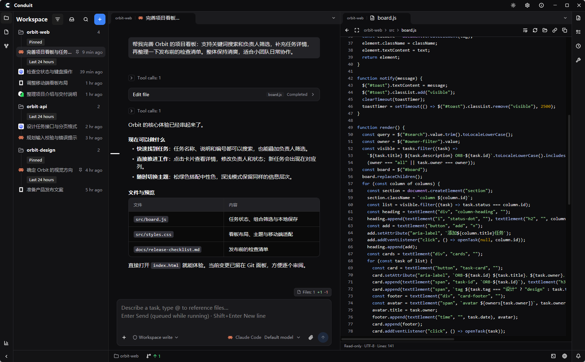
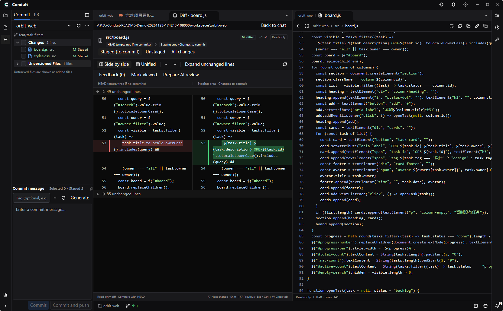
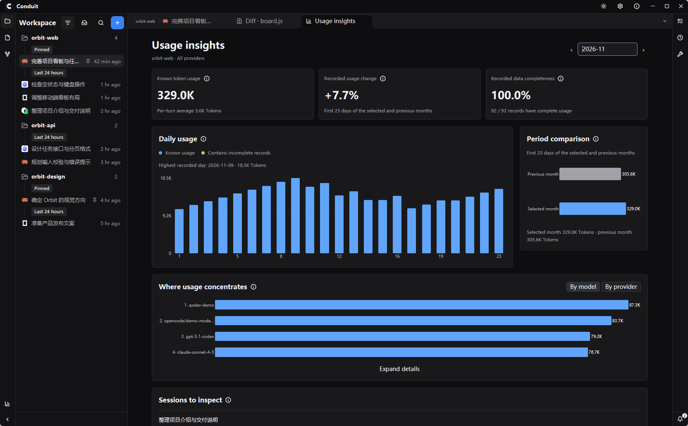

<p align="center">
  
</p>

<h1 align="center">Conduit</h1>

<p align="center">
  面向 AI 编程助手的 Windows 原生工作台。<br>
  在同一个应用中管理对话、文件、Git 与终端。
</p>

<p align="center">
  <a href="README.md">English</a> · <strong>简体中文</strong>
</p>

<p align="center">
  <a href="https://github.com/Leo-Lee-j/conduit/releases"></a>
  <a href="https://github.com/Leo-Lee-j/conduit/actions/workflows/ci.yml"></a>
  
</p>

<p align="center">
  <a href="https://leo-lee-j.github.io/conduit/zh-cn/">产品网站</a> ·
  <a href="https://github.com/Leo-Lee-j/conduit/releases/latest"><strong>下载 Windows 版</strong></a> ·
  <a href="docs/usage.md">使用指南</a> ·
  <a href="https://github.com/Leo-Lee-j/conduit/issues">反馈问题</a> ·
  <a href="CONTRIBUTING.zh-CN.md">参与贡献</a>
</p>

Conduit 将 **Claude Code、Codex、OpenCode 和 Qoder CLI** 带入同一个桌面工作区。按项目组织对话与任务，跟进主代理和子代理，在对话旁检查代码，再完成 Git 提交与合并请求审查。

项目正在持续开发，目前支持 **Windows x64**。应用界面支持 **English 与简体中文**，可在 **设置 → 通用 → 语言** 中即时切换。新安装默认英文；缺少语言设置的旧配置继续使用中文。大部分详细指南目前以中文维护。



原生工作台实拍，使用虚构的 Orbit 演示项目。截图中的对话、工具记录和用量均为预置示例，不代表模型性能或账单结果。复用方法见[截图演示指南](examples/screenshot-demo/README.md)。

## 为什么使用 Conduit？

- **自由选择编程助手。** 使用 Claude Code、Codex、OpenCode 或 Qoder CLI，支持流式回复、工具审批、取消任务，以及按会话选择模型。
- **让对话井然有序。** 并行运行多个会话，搜索历史，置顶或归档对话，并排队后续消息。已有的 Claude Code、Codex 和 OpenCode 终端历史会按工作区导入，可继续原生会话。
- **跟进子代理。** 打开子会话，再返回主会话，保留原来的阅读位置。Codex 支持定向追加消息和中断；OpenCode 支持父连接释放后的空闲子会话续聊。Claude 子历史只读，Qoder 子历史与控制尚未接入。各引擎范围见[子代理指南](docs/design/subagent-conversations.md)。
- **看清每一次修改。** 文件可占满内容区或在对话旁预览，支持语法高亮、查找、Markdown 大纲与 Mermaid 图表。可见文件随磁盘修改自动刷新；按轮次查看统一或并排 Diff。文件与 Diff 预览仍为只读。
- **完成 Git 与审查流程。** 勾选文件暂存、管理分支与 worktree、生成提交说明、提交与推送。查看 GitHub PR 或 GitLab MR、跟进 CI 和审查讨论，将失败检查转为修复任务。提交只包含所选文件中已暂存的修改。
- **在任务之间延续上下文。** 管理目标与验收清单、复用会话模板、准备跨引擎的可编辑交接，并从已记录的完成轮次创建 Codex 原生会话分支。保存单文件检查点，收藏产物路径与服务链接；应用运行期间可调度只读自动任务。
- **了解已记录的用量。** 查看每日 Token 趋势、等天数同期对比、模型与服务商排行，以及需要检查的会话。设置工作区月度 Token 提醒；缺失用量保留为未知，统计不代表账单或订阅额度。
- **管理 AI 连接。** 检查和更新受支持的 CLI 安装，配置 Claude/Codex 模型服务，导入 cc-switch 服务。在设置中发现与安装 Skills、添加 MCP 定义并测试连接；可用操作取决于所选引擎。
- **随时使用终端。** 按工作区管理 PowerShell、cmd 或 WSL/SSH 终端连接。远程终端连接不会把文件树、Git 或代理执行迁移到远程工作区。
- **调整为自己的使用习惯。** 自定义主题、字体、背景和快捷键，通过通知中心跟进审批与任务结果，安装文件图标主题、开启可选桌面宠物，并在应用内安装更新。

<details>
<summary>更多截图：Git 审阅与用量洞察</summary>

**Git 审阅。** 并排比较已暂存的修改，同时保留源代码作为参考。



**用量洞察。** 使用虚构用量记录展示每日趋势、等天数同期对比和模型排行。



</details>

## 开始使用

### 准备条件

- 当前桌面版需要 **Windows x64**。
- 安装并登录至少一个受支持的 CLI：**Claude Code、Codex、OpenCode 或 Qoder CLI**，先确认它可以在终端中正常运行。
- 如需使用 Git 功能，请在本机安装 **Git**。

Conduit 复用所选 CLI 的认证与执行能力，不自带模型服务。模型访问与用量由你配置的 CLI 和模型服务商处理。

### 安装并开始对话

1. 在 [GitHub Releases](https://github.com/Leo-Lee-j/conduit/releases/latest) 下载 `Conduit-<version>-windows-x64-setup.exe`，运行安装包。
2. 打开 Conduit，将本地项目文件夹添加为工作区。
3. 按所选 CLI 的能力选择引擎、模型服务与模型。按 **Ctrl+,** 打开设置，指定 CLI 路径或配置连接。
4. 输入任务，按 **Enter** 发送；使用 **Shift+Enter** 换行，输入 **@** 引用工作区文件，也可拖入文件或粘贴图片添加附件。

按提示处理工具审批，检查任务产生的修改，准备好后在 Git 面板中提交。配置方法与日常操作见[使用指南](docs/usage.md)。

## 工作区与数据

发布构建将对话历史、工具输出和设置保存在本地 `%LOCALAPPDATA%\Conduit`，调试构建使用 `%LOCALAPPDATA%\Conduit-dev`；可通过 `CONDUIT_DATA_DIR` 指定其他应用数据目录。编程助手的模型请求由所选 CLI 处理。模型目录、扩展目录、PR/CI、背景与更新等功能也会发起网络请求，可选桌面宠物直接调用你配置的模型 API。本地保存数据不代表模型离线运行。

多个会话可以并行执行。同一文件夹中的会话共享工作区文件；需要隔离任务时，请使用不同的 Git worktree。

## 插件与可选远控

[插件目录](docs/plugins/github-catalog.zh-CN.md)支持从 GitHub 发现或从本地安装**文件图标主题**，包括随应用附带的 Outline Icons。桌面宠物是内置原生功能；外部 Shell 插件仍处于实验阶段，尚未开放生产安装。

**手机 Web 远控是需要显式启用的源码构建试用功能。** 标准安装包构建未启用 `remote`。准备好开发环境后，可用以下命令试用：

```powershell
cargo run --locked --features remote --bin conduit
```

在 **设置 → 通用** 中开启 Web 远控、配对浏览器，并共享一个选定工作区。试用版支持文本对话、停止本轮、会话管理，以及已支持的审批或问答。使用可信局域网（未加密 HTTP），或通过 Tailscale Serve 使用 HTTPS。重启 Conduit 后需重新配对；配置与限制见 [Web 远控试用指南](docs/design/mobile-remote-preview.md)。

## 文档

[英文首页](README.md)与本页提供相同的核心信息。大部分详细指南目前以中文维护，插件目录与图标主题指南提供中英文版本。

| 指南 | 内容 |
| --- | --- |
| [使用指南](docs/usage.md) | 配置、对话、快捷键与更新 |
| [设置与 AI 连接](docs/settings.md) | CLI 路径、模型服务、Skills 与 MCP |
| [会话与存储](docs/sessions.md) | 并发、排队消息、原生历史与恢复 |
| [子代理会话](docs/design/subagent-conversations.md) | 子历史、导航与各引擎控制范围 |
| [项目工作流与用量](docs/project-tools.md) | 任务、模板、交接、PR/CI、用量洞察与自动任务 |
| [插件与图标主题](docs/plugins/github-catalog.zh-CN.md) | GitHub 发现、安装与官方插件 |
| [文件与内容预览](docs/files.md) | 文件引用、搜索、Markdown 与 Mermaid |
| [内容分栏与实时预览](docs/design/content-panes-and-live-preview.md) | 文件布局、刷新、修改提示与实现边界 |
| [Git 工作流](docs/git.md) | 暂存、提交、分支与失败恢复 |
| [集成终端](docs/terminal.md) | 工作区 Shell 与终端行为 |
| [Web 远控试用](docs/design/mobile-remote-preview.md) | 可选构建、浏览器配对与手机连接 |
| [完整文档](docs/README.md) | 使用指南、架构、开发与发布 |

## 参与贡献

欢迎反馈问题、改进文档或提交 Pull Request。[提交 Issue](https://github.com/Leo-Lee-j/conduit/issues) 时，请附上 Conduit 版本、复现步骤、预期结果与实际行为。较大的功能或架构调整，请先讨论范围。

如需从源码构建，请参考 [贡献指南](CONTRIBUTING.zh-CN.md) 中的 Windows Rust 开发环境、构建命令与必要检查。[架构文档](docs/architecture.md)介绍了项目的模块与协作方式。

## 致谢

Conduit 使用 **Rust**、**GPUI** 和 [GPUI Kit](https://github.com/longbridge/gpui-kit) 构建。感谢 Claude Code、Codex、OpenCode、Qoder CLI 背后的项目，以及提供引擎与模型标志的 [LobeHub Icons](https://github.com/lobehub/lobe-icons)。

资源说明见[应用图标生成](assets/app-icons/README.md)与[第三方图标来源](assets/icons/README.md)。

## 友情链接

- [Linux DO](https://linux.do/)

## 许可证

Conduit 采用 **GNU 通用公共许可证第 3 版（仅此版本，GPL-3.0-only）**。完整许可证见 [LICENSE](LICENSE)；版权与项目来源声明见 [NOTICE](NOTICE)，其中包含 GPLv3 第 7(b) 条允许的署名保留要求。

- **允许商业使用。** 你可以在遵守许可条款的前提下使用、修改和销售 Conduit 的副本。
- **分发修改版时保持开源。** 如果分发修改后的版本，必须继续按 GPLv3 授权受该许可证覆盖的作品，并按 GPL 要求向接收者提供包含修改的完整对应源代码。
- **保留版权和许可声明。** 必须保留原有版权、许可证及免责声明，附带许可证，并显著注明版本已修改及相关修改日期。
- **注明项目来源。** 必须保留 [NOTICE](NOTICE) 中的 Conduit 项目名称、原作者署名和原始仓库地址：[Leo-Lee-j/conduit](https://github.com/Leo-Lee-j/conduit)。

仅供自己使用、未对外分发的修改无需公开。原始仓库链接不能替代你所分发版本的完整对应源代码。以上为摘要，具体以 [LICENSE](LICENSE) 和 [NOTICE](NOTICE) 为准。

第三方依赖和资源保留各自的许可证与声明。第三方图标的来源与许可说明见[图标资源](assets/icons/README.md)。
