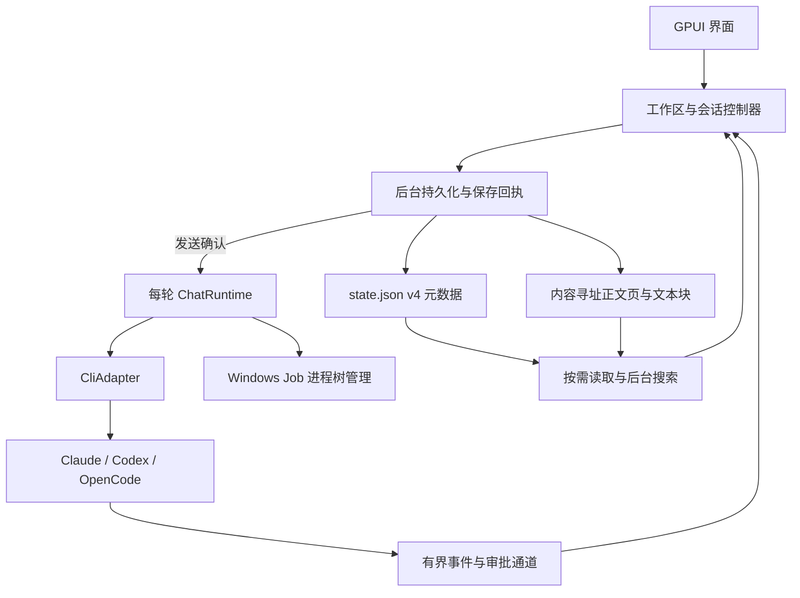

# 架构

Conduit 是 Windows x64 原生 AI 编程工作台，使用 Rust、GPUI 和 GPUI Kit。它按本地工作区组织 Claude Code、Codex 和 OpenCode 的对话、文件、终端与 Git 操作，复用各 CLI 的认证、模型调用和工具执行。

## 产品边界

- 工作区组织目录与会话；会话固定引擎和原生上下文，不在续接失败时静默创建新上下文。
- 不提供独立模型登录或计费服务。应用中的权限模式控制协议授权，不等同操作系统文件沙箱。
- 文件预览和 Diff 为只读；需要编辑时使用外部编辑器或 CLI 工具。
- 并发会话共享实际文件。需要文件隔离时使用不同 Git worktree。
- 正式构建提供原生贡献机制；外部 Shell 插件仍处开发验证阶段，见[插件状态](plugins/README.md)。

## 模块职责

所有源码路径相对于 `src/`。

| 模块 | 职责 |
| --- | --- |
| `main.rs`、`app.rs`、`app/` | 窗口、应用状态、聊天、文件、Git、设置和更新界面 |
| `engines.rs`、`cli_adapter.rs`、`cli_adapter/`、`protocol/` | 引擎注册、启动描述、协议、审批和原生会话身份 |
| `chat_runtime.rs`、`child.rs`、`event_queue.rs` | 后台执行、stdio、背压、取消和 Windows Job 进程树清理 |
| `cli.rs`、`models.rs`、`providers.rs`、`ccs.rs`、`extensions/` | CLI 定位与更新、模型、服务路由及扩展配置 |
| `domain.rs`、`store.rs`、`persistence.rs`、`transcript/` | 会话元数据、保存回执、正文分块及恢复 |
| `history/`、`app/search.rs` | 原生历史索引、后台导入和跨冷会话搜索 |
| `git/`、`workspace_files.rs`、`app/file_preview/` | Git 查询与操作、文件树及有界预览 |
| `terminal/`、`app/terminal/` | ConPTY、终端解析、工作区终端和输入渲染 |
| `notifications/`、`app/notifications/` | 有界通知历史、Toast、业务导航和审批绑定 |
| `plugins/`、`app/plugin_ui/` | 贡献注册、命令校验、实例和界面容器 |
| `update/`、`bin/conduit-updater.rs`、`bin/release-manifest.rs` | 更新检查、验签、安装交接和发布签名 |

`app/` 通过 `impl ConduitApp` 扩展同一应用状态。更新协议和原生贡献模型导出到库 crate，供助手、发布工具或实验原型复用。`src/legacy/` 是早期终端原型，不参与产品构建。

## 主要数据流

发送先取得磁盘保存回执，再允许启动 CLI；UI 合并流式事件，后台执行网络、目录扫描、Git 和安装等待。取消请求与进程清理分别有状态，只有确认进程树退出后才释放相应运行。详细规则见[会话与存储](sessions.md)和[CLI 适配器](cli-adapters.md)。

## 界面边界

左侧提供工作区、文件、变更与分支导航；主区用标签承载聊天、文件、Diff 和设置；右侧承载工具详情、通知或扩展视图；终端位于主区下方。后台事件不会擅自替换当前标签或输入焦点。

侧栏使用可变行高虚拟列表与按工作区缓存的摘要，按稳定会话 ID 保持滚动锚点。正文与元数据分离，虚拟化和正文驻留分别受控。Markdown 与 Mermaid 在原生界面渲染，见[文件与内容预览](files.md)。

普通退出和更新重启保存草稿、附件与选择位置；后台结果应用前检查工作区、会话和请求身份。统一操作通知保留来源，详见[通知中心](notifications.md)。

## 构建与分发

依赖由 `Cargo.lock` 和 GPUI Kit 固定 revision 锁定。`build.rs` 设置主程序图标、版本资源和栈预留，并为更新助手嵌入 `asInvoker` 权限声明。NSIS 按当前用户安装，安装目录与数据目录分离。

开发入口见[参与贡献](../CONTRIBUTING.md)，验证方式见[测试与验收](testing.md)，签名发布和失败恢复见[发布与更新](releasing.md)。
