# CLI 适配层与接入契约

日期：2026-11-06。状态：本阶段实施与回归完成。

## 目标

在 AI 设置注册表的基础上，让新增 CLI 只需注册元数据并实现独立运行时适配器，即可复用进程管理、取消、保存确认、审批票据和聊天事件处理。Provider 的持久化值继续兼容历史会话。此阶段提供编译期 Rust 接口，动态插件加载、任意 CLI 自动识别和新传输协议不在本阶段范围。

## 职责

图源：[cli-adapter.mmd](diagrams/cli-adapter.mmd)。

| 组件 | 职责 |
| --- | --- |
| EngineDescriptor | 稳定 ID、显示与诊断元数据、能力、适配器工厂 |
| AdapterRequest | 工作目录、提示词、原生会话 ID、模型、权限、推理配置、路由、辅助任务模式 |
| CliAdapter | 生成启动描述、解释协议、报告握手状态、审批响应、取消消息、可选旁路通信 |
| LaunchSpec | 参数、子进程环境、首次输入方式、成功退出是否可以作为完成依据 |
| ChatRuntime | 保存确认后启动、stdio、消息边界、队列背压、审批票据、取消与超时、进程树清理 |
| Protocol | 现有三种 CLI 的经过回归验证的 wire 解析后端，后续可按引擎继续拆分 |

运行时通过 `Box<dyn CliAdapter>` 调用注册表提供的工厂结果。新增实现不需要加入 Protocol 的 Provider 分支。现有 Claude / Codex 通过标准 stdio 后端接入；OpenCode 使用自己的适配器处理启动准备、ACP 问答旁路与辅助文本任务。

## 契约与生命周期

1. 工厂只组装内存状态。等待会话保存确认期间，不创建进程、临时目录或通信端点。
2. 保存成功且任务未取消后，调用 `launch()`；适配器在此准备资源并返回最终参数与环境。运行时不检查或改写 `--port` 等引擎参数。
3. 首次输入明确区分 JSON 消息与写入文本后关闭 stdin。完成依据独立声明为协议完成事件或成功退出，避免从引擎名称推断。
4. `accept()` 将消息转换为统一 Step；`startup_pending()` 由适配器报告，运行时不猜测 JSON 字段的握手含义。可选 `poll()` 返回旁路消息，`route_response()` 决定响应走 stdio 还是原生旁路。
5. 自动权限决策与问题答案验证继续使用已有策略。审批票据生成、撤销、防重复提交留在运行时。
6. 取消后不发送新的配置/提示词请求；支持软取消的适配器先发取消消息，最多等待 750ms，再进入统一进程树清理。
7. 运行时持有适配器直到进程树确认退出，包括启动失败、异常和清理超时恢复。随后释放适配器临时资源，最后发送 Finished。

所有环境和凭据仅传给该子进程；启动描述不派生 Debug，也不写入日志。旁路通信必须有界，适配器不能自行接管主 CLI 的进程所有权。

`Step` 的 `done/error` 表示协议完成或失败；`Finished`、`CleanupBlocked` 和本地审批票据的解析结果由运行时生成，适配器不能自行发送这些宿主事件。原生会话 ID 必须与续接目标一致，不能在恢复失败后静默新建会话。辅助任务必须禁止工具授权，权限切换也不能解除该限制。

实现入口：

- [cli_adapter.rs](../src/cli_adapter.rs)：输入、启动描述、完成策略和 trait。
- [engines.rs](../src/engines.rs)：每个引擎的工厂注册。
- [builtin.rs](../src/cli_adapter/builtin.rs)：现有协议后端的标准 stdio 接入。
- [opencode.rs](../src/cli_adapter/opencode.rs)：使用旁路通信的实例。
- [adapter_tests.rs](../src/chat_runtime/adapter_tests.rs)：完全独立于 Provider / Protocol 的可运行适配器夹具，可作为新实现的测试结构参考。

## 新 CLI 接入步骤

1. 增加稳定 Provider 标识、枚举列表和 EngineDescriptor 注册项；将工厂指向新模块。
2. 新模块实现 CliAdapter：launch、accept、握手状态、审批/答案处理与权限切换；按需实现取消和旁路通信。模型选择、工作目录、续接失败和辅助任务约束必须有确定行为。
3. 验证旧配置加载与新引擎管理。模型目录和 Skills/MCP 的原生格式仍需提供各自发现/编辑实现；当前的 Provider 存储、历史导入、服务路由和引擎特有 UI 也仍有穷尽分支。这些由编译器提示逐项接入，不能宣称整款应用仅改两处即可支持完整新引擎。
4. 添加离线协议夹具，覆盖握手、流式事件、完成、准确续接、审批、取消和异常。运行真实 CLI 付费调用仍按现有约定显式启用。

## 验收

- 现有三种 CLI 的协议和运行时回归通过。
- 用一个没有 Provider 枚举项、没有 Protocol 实现的测试适配器跑通通用运行时，证明扩展边界实际生效。
- 验证保存门禁、启动前取消、启动失败、进程清理和适配器资源释放顺序。
- 验证 OpenCode 的最终端口参数、原生问答桥接和辅助任务输入/完成策略。
- 通过格式检查、Clippy、构建及相关设置/启动 UI 回归；记录未执行或已知阻塞的测试。

## 实施与验证记录

已实现注册工厂、统一启动描述与运行时 trait。聊天、排队任务和文本辅助任务经由同一适配器入口；运行循环不再创建 OpenCode 问答桥或改写引擎参数。现有三种 CLI 复用原来的 Protocol 后端，新增 CLI 可提供完全独立的实现。握手完成由协议后端识别，非初始化请求的响应不会解除启动超时检查。

适配器资源现在保留到进程清理完成后释放。新增 8 项回归覆盖独立于 Provider / Protocol 的测试 CLI、保存门禁、启动失败、审批响应路由、取消/异常清理、stdin EOF 和完成策略、原生会话校验、OpenCode 参数/资源以及本地 HTTP 问答。这些测试不使用模型账户。

验证结果：

- `cargo build --locked --bin conduit`：通过。
- `cargo clippy --locked --all-targets --features ui-tests -- -D warnings`：通过。
- `cargo fmt --all --check`、`git diff --check`：通过。
- `cargo test --locked --features ui-tests -- --test-threads=1 --skip native_cache_survives_restart_expires_daily_and_manual_refresh_bypasses_it`：库 33 项、主程序 558 项、发布工具 1 项通过，共 592 项；0 失败，16 项按约定忽略，1 项排除。主程序回归约 371 秒，包含设置、队列、保存确认、协议和进程生命周期测试。
- 排除项为上一阶段已记录停滞的 OpenCode 模型缓存用例，本阶段没有修复或计入通过；真实 CLI / 模型调用测试未启用，未进行真实桌面视觉验收。
- 架构图使用 `creating-mermaid-diagrams` 技能流程生成，Mermaid 经渲染服务验证并导出 SVG，源码和导出文件均随文档保存。

当前边界：这是应用内编译期 Rust 接口；已有 Protocol 的内部拆分、模型/扩展发现注册化和动态加载仍是独立后续工作。新增 CLI 的通用运行循环无需新增 Provider 分支，但完整产品接入仍需处理原生配置格式与历史兼容。
