# CLI 适配器

## 目标

引擎注册表和编译期 Rust 适配接口共享进程管理、取消、保存确认、审批票据和聊天事件处理。完整接入还涉及模型、扩展配置、历史和界面能力；接口不提供任意 CLI 自动识别或动态运行时加载。

## 职责

图源：[cli-adapter.mmd](diagrams/cli-adapter.mmd)。

| 组件 | 职责 |
| --- | --- |
| EngineDescriptor | 稳定 ID、显示与诊断元数据、能力、适配器工厂 |
| AdapterRequest | 工作目录、提示词、原生会话 ID、模型、权限、推理配置、路由、辅助任务模式 |
| CliAdapter | 生成启动描述、解释协议、报告握手状态、审批响应、取消消息、可选旁路通信 |
| LaunchSpec | 参数、子进程环境、首次输入方式、成功退出是否可以作为完成依据 |
| ChatRuntime | 保存确认后启动、stdio、消息边界、队列背压、审批票据、取消与超时、进程树清理 |
| Protocol | Claude / Codex / OpenCode 的 wire 解析后端，后续可按引擎继续拆分 |

运行时通过 `Box<dyn CliAdapter>` 调用注册表提供的工厂结果。新增实现不需要加入 Protocol 的 Provider 分支。现有 Claude / Codex 通过标准 stdio 后端接入；OpenCode 使用自己的适配器处理启动准备、ACP 问答旁路与辅助文本任务；Qoder 使用独立 ACP 适配器。

## 契约与生命周期

1. 工厂只组装内存状态。等待会话保存确认期间，不创建进程、临时目录或通信端点。
2. 保存成功且任务未取消后，调用 `launch()`；适配器在此准备资源并返回最终参数与环境。运行时不检查或改写 `--port` 等引擎参数。
3. 首次输入明确区分 JSON 消息与写入文本后关闭 stdin。完成依据独立声明为协议完成事件或成功退出，避免从引擎名称推断。
4. `accept()` 将消息转换为统一 Step；`startup_pending()` 由适配器报告，运行时不猜测 JSON 字段的握手含义。可选 `poll()` 返回旁路消息，`route_response()` 决定响应走 stdio 还是原生旁路。
5. 自动权限决策与问题答案验证继续使用已有策略。审批票据生成、撤销、防重复提交留在运行时。
6. 取消后不发送新的配置/提示词请求；支持软取消的适配器先发取消消息，最多等待 750ms，再进入统一进程树清理。
7. 运行时持有适配器直到进程树确认退出，包括启动失败、异常和清理超时恢复。随后释放适配器临时资源，最后发送 Finished。

所有环境和凭据仅传给该子进程；启动描述不派生 Debug，也不写入日志。旁路通信必须有界，适配器不能自行接管主 CLI 的进程所有权。

`Step` 的 `done/error` 表示协议完成或失败；`Finished`、`CleanupBlocked` 和本地审批票据的解析结果由运行时生成，适配器不能自行发送这些宿主事件。原生会话 ID 必须与续接目标一致，不能在恢复失败后静默新建会话。辅助任务必须禁止工具授权，权限切换也不能解除该限制。

实现入口：

- [cli_adapter.rs](../src/cli_adapter.rs)：输入、启动描述、完成策略和 trait。
- [engines.rs](../src/engines.rs)：每个引擎的工厂注册。
- [builtin.rs](../src/cli_adapter/builtin.rs)：现有协议后端的标准 stdio 接入。
- [opencode.rs](../src/cli_adapter/opencode.rs)：使用旁路通信的实例。
- [adapter_tests.rs](../src/chat_runtime/adapter_tests.rs)：完全独立于 Provider / Protocol 的可运行适配器夹具，可作为新实现的测试结构参考。

## 新 CLI 接入步骤

1. 增加稳定 Provider 标识、枚举列表和 EngineDescriptor 注册项；将工厂指向新模块。
2. 新模块实现 CliAdapter：launch、accept、握手状态、审批/答案处理与权限切换；按需实现取消和旁路通信。模型选择、工作目录、续接失败和辅助任务约束必须有确定行为。
3. 验证旧配置加载与新引擎管理。模型目录和 Skills/MCP 的原生格式仍需提供各自发现/编辑实现；当前的 Provider 存储、历史导入、服务路由和引擎特有 UI 也仍有穷尽分支。这些由编译器提示逐项接入，不能宣称整款应用仅改两处即可支持完整新引擎。
4. 添加离线协议夹具，覆盖握手、流式事件、完成、准确续接、审批、取消和异常。运行真实 CLI 付费调用仍按现有约定显式启用。

## 当前引擎协议

| 引擎 | 对话入口 | 特有约束 |
| --- | --- | --- |
| Claude Code | stream-json 与 stdio 控制协议 | 认证与原生扩展由 CLI 管理；文本辅助任务禁止工具授权 |
| Codex | `app-server --stdio` | 显式 Provider / 模型同时传入进程配置和会话请求，恢复时不能误用继承的其他路由 |
| OpenCode | ACP | 原生模型/档位与会话身份；用户问答通过适配器旁路通信 |
| Qoder CLI | `qodercli --acp` | 原生认证、动态模型/档位、工具审批与表单问答；纯文本辅助任务禁用工具 |

应用权限约束只针对 CLI 实际支持并上报的请求；经过批准的命令仍可能访问工作区外文件，不将“工作区内修改”描述为文件系统沙箱。

## OpenCode

普通对话使用 ACP 新建/恢复会话，核对恢复目标并避免把回放内容重复追加。模型 ID 使用 `provider/model`，动态思考档位从原生配置目录读取；不支持的档位应拒绝，不能默默改用其他设置。

- 允许/拒绝根据 ACP option 的 `kind` 选择实际 `optionId`。应用审批票据、工具 ID 和 RPC ID 分别管理；未知反向请求返回明确错误。
- 用户问答通过 `OpenCodeAdapter` 的旁路轮询与响应处理，按原生会话过滤，取消后撤销待答请求。它不复用工具审批的“允许/拒绝”按钮。
- 取消先发 `session/cancel`，最多等待 750 ms，再进入统一 Job 清理。适配器与旁路资源保留到进程树确认退出。
- 自动命名和 Git 说明使用 `opencode run --pure --format json` 文本任务。内容经 stdin 发送，任务禁用工具，使用独立临时历史目录，清理后删除；模型错误直接报告，不自动换模型。
- 模型目录按工作区和 CLI 路径缓存到 `opencode-models/`，有效期 24 小时，手动刷新绕过缓存；不缓存原始凭据。
- OpenCode 使用原生 Provider 配置，没有 Conduit 自定义 Provider / CCS 桥接。终端历史从本地 SQLite 数据库按工作区导入，应用内会话和导入会话都可以按原生 ID 续接。

## Qoder CLI

核心 ACP 接入以 Qoder CLI 1.1.85 的协议返回值为依据。先在终端完成 `qodercli login`，再从引擎选择器选择 Qoder CLI；路径支持设置页、`CONDUIT_QODER_PATH` 与 PATH。npm 启动器可按原 prefix 更新，独立安装暂由用户通过原生渠道更新。

- 初始化后由 CLI 恢复原生登录态；未登录时提示先登录，不自动打开认证浏览器。新会话使用 `session/new`，已有会话优先 `session/resume`，不支持时使用 `session/load`。恢复失败不会静默新建，历史回放不重复追加。
- 模型和 `reasoning_effort` 从会话的 `configOptions` 获取。首次可使用 CLI 默认模型，连接后显示会话目录；显式指定的模型或档位不可用时直接报错。切换模型清除旧档位。ACP 公共类型与 OpenCode 共享，磁盘仍保留原有 `opencode` 字段，兼容旧会话。
- 只读模式只启用 `Read,Grep,Glob`，禁用 MCP；普通模式通过 `permissions.ask=["*"]` 将工具调用交给应用审批；完全访问模式自动批准工具请求。所有模式禁用 hooks。权限约束依赖 CLI 的工具策略，不构成文件系统沙箱。
- 标题与 Git 说明等纯文本辅助任务使用同一 ACP 流程，但禁用全部工具、MCP 与 hooks；切换完全访问也不能解除限制。提示词通过 stdin 的两段文本发送，避免被当成 `/allow` 等原生命令执行。
- 工具审批按 `kind` 选择真实 `optionId`。表单问答支持字符串、布尔/数值及单选/多选，校验数值、长度和数量限制；显示的字段需逐一填写。不支持的格式、正则等约束明确拒绝。取消后沿用运行时的软取消与进程树清理。
- 保留公开回复、工具、计划、用量和会话配置；不展示 `agent_thought_chunk`。Skills/MCP 的发现与编辑、终端历史自动导入、Conduit 自定义 Provider / CCS 路由暂未接入，相关配置仍由原生 CLI 管理。

实现见 [qoder.rs](../src/cli_adapter/qoder.rs)，协议回归见 [qoder/tests.rs](../src/cli_adapter/qoder/tests.rs)，跨进程回归见 [adapter_tests.rs](../src/chat_runtime/adapter_tests.rs)。

## 验证边界

离线夹具覆盖握手、流式事件、准确续接、完成、审批、问答、辅助任务、取消与进程清理。独立测试适配器证明通用运行时不依赖已有 Provider 分支。

真实安装的 OpenCode 可以结合隔离的本地模拟 HTTP/SSE 端点验证协议和本地工具路径，不调用真实账户；这仍不等于服务商认证、计费模型或长时间桌面验收。显式集成测试和常规命令见[测试与验收](testing.md)。

Qoder 的离线协议和跨进程夹具覆盖恢复、审批、表单、取消与辅助任务限制；隔离 CLI 探测覆盖初始化、建会话、恢复会话、权限模式切换及未登录错误。未将这些检查等同于已登录模型端到端验收。
