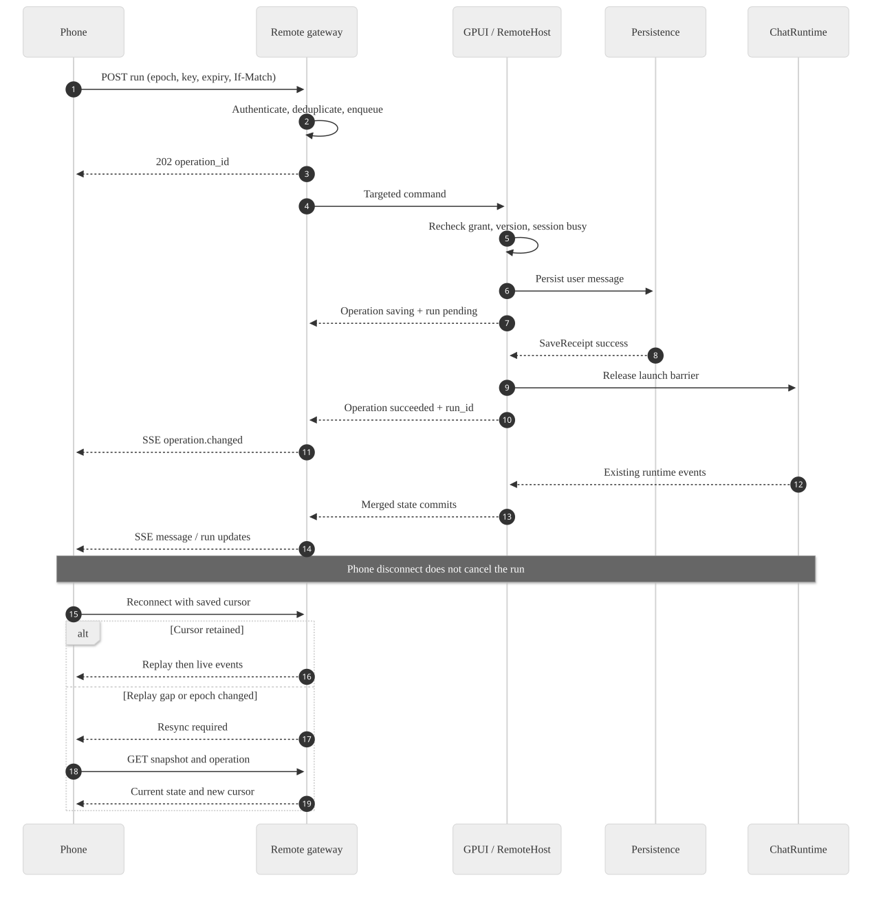

# 手机远程控制设计

状态：设计基线 v0.1，尚未实现。日期：2026-11-18。需求：通过外网，用手机控制这台 Windows 电脑上的 Conduit，并修改应用配置。本文是开发依据，不表示已有远程入口，也不表示完成联网或安全验收。

协议草案见 [OpenAPI](mobile-remote-control.openapi.json)，架构源文件见 [Mermaid](../diagrams/mobile-session-control.mmd)。现有行为以[架构](../architecture.md)、[会话与存储](../sessions.md)和[设置](../settings.md)为准。

## 1. 设计决策

| 决策 | 本版选择 | 原因与适用边界 |
| --- | --- | --- |
| 手机入口 | 响应式 Web，具备 PWA 安装入口 | 同时覆盖 iOS / Android；通知和后台保活单独验收，不依赖它们完成控制 |
| 外网接入 | 首版使用 Tailscale Serve 的 tailnet 内 HTTPS；服务仅绑定 loopback | 手机与电脑需要加入可互通的 tailnet；无需在家庭路由器开放端口。不能将 Serve 与面向公网的 Funnel 混用 |
| 应用协议 | 同源 REST 命令 / 查询 + SSE 状态订阅 | 借鉴 HAPI 的恢复契约；命令与流式显示分开，便于确认、去重和重连 |
| 执行所有者 | 现有 Conduit 进程 | 桌面与手机共享会话、运行和持久化；手机断线不取消任务 |
| 线程边界 | 有界命令桥接入 GPUI；网络侧只持有经过裁剪的状态投影 | 不跨线程共享 GPUI Entity，不增加原始运行队列消费者 |
| 配置保存 | 桌面和手机调用同一套配置服务；成功须有保存回执 | 避免两套校验、两份设置和“收到请求即已保存” |
| 后续产品接入 | 独立评估扫码配对与托管中继 | 保留业务命令边界；中继身份、部署、端到端加密和恢复机制另立设计，不计入首版 |

首版要求电脑在线、未休眠、Conduit 正在运行。正常退出仍遵循现有取消与清理流程。独立 daemon、远程桌面和电脑唤醒不在本版交付范围。

## 2. 首版功能与页面

| 区域 | 首版交付 | 边界 |
| --- | --- | --- |
| 会话 | 已授权工作区列表、会话列表、历史、新建、发送文本、流式回复、运行状态、取消 | 只使用电脑已经登记的工作区，不接受任意工作目录或可执行路径 |
| 审批与提问 | 按运行身份允许 / 拒绝；支持已映射的文本、单选、多选问题 | 未映射的引擎表单明确标为需在电脑完成，保留待处理状态 |
| 会话设置 | 模型、权限、推理档位；返回可选能力和实际应用值 | 仅对后续轮次生效；不改写当前运行的路由快照；不能改已有会话的引擎身份 |
| 默认设置 | 各引擎新会话服务与模型、默认权限、自动命名、应用语言 | 不批量改写已有会话；手机自身语言 / 主题是设备偏好 |
| 模型服务 | 本地服务新增、编辑、删除；地址、模型目录、API Key 或环境变量名 | CCS / 原生 CLI 来源只读；删除继续检查引用；不返回已保存的密钥 |
| 远控管理 | 电脑端启停、连接状态、扫码配对、设备列表和撤销 | 监听地址、接入源、设备授权和远控开关仅由电脑端管理 |

手机导航为“会话 / 待处理 / 设置”。会话页顶部持续显示电脑连接状态和当前工作区；取消、审批不依赖当前选中的聊天。编辑配置时保留未提交表单，冲突后展示新值并让用户重新提交。断线保留草稿与待确认发送，恢复后先查询原请求结果。

本版不开放任意 shell、终端输入、文件写入、Git 写操作、CLI 安装更新、原生登录、Skills / MCP 来源编辑。它们各有独立的执行和配置边界，后续按明确命令逐项扩展。

## 3. 架构与代码接缝

网络服务使用独立线程上的 Tokio / Axum runtime；GPUI 主线程继续拥有业务状态。新增依赖在实施时选定兼容版本并写入 Cargo.lock。本版不改变主程序的运行时入口。手机前端采用 TypeScript / React / Vite，构建静态资源后嵌入程序；离线缓存只缓存应用外壳，认证、配置、历史和 SSE 均不进入 Service Worker 缓存。

建议新增模块如下，均为待实现的路径：

| 模块 | 职责 |
| --- | --- |
| `src/remote/{server,auth,api,projection,replay,operations}.rs` | HTTP 生命周期、设备会话、DTO、投影、事件回放和请求记录；不直接操作 Store |
| `src/app/remote.rs` | GPUI 命令接收、执行前复核、调用现有业务方法、发布状态提交 |
| `src/app/config_service.rs` | 提取桌面和远程共用的配置校验、引用检查、修改与保存回执 |
| `src/remote/access_store.rs` | 独立访问元数据文件的唯一写入者；不存聊天或业务设置 |
| `web/remote/` | 手机界面、API 客户端、订阅恢复、设备草稿、安装入口 |

远控依赖先置于可选 Cargo `remote` feature；开发期默认不启用。正式构建是否默认包含，在接入、体积和验收通过后确定。启用 feature 也不会自动监听网络。

### 3.1 已确认的入口及必要改造

| 当前入口 | 复用方式 / 必须补齐的行为 |
| --- | --- |
| [`start_turn`](../../src/app/runtime.rs) | 指定工作区和会话，复用忙碌、路由、正文加载及发送检查；返回会话 ID 时仍可能在等待保存，不能据此报告发送成功 |
| [`prepare_session`](../../src/app/sessions.rs) | 当前会读取桌面临时选择。提取接受显式 `NewSessionOptions` 的公共构造入口，手机和自动任务不读取桌面 composer |
| [`poll_pending_sends`](../../src/app/runtime/saves.rs) | 保存回执成功、放行运行后再完成远程发送操作；保存失败沿用现有回滚行为 |
| [`submit_approval`](../../src/app/runtime.rs) 与[通知审批](../../src/app/notifications/approvals.rs) | 先验证运行对象身份及精确票据，再调用现有入口；补充可供 API 使用的明确结果，不能通过界面提示字符串判断成功 |
| [`ActiveRun::cancel`](../../src/app/state.rs) | 提取指定会话 / 运行的取消入口，沿用进程树清理；“取消已请求”与“进程已退出”分别发布 |
| [`poll_streams`](../../src/app/stream_events.rs) | 在合并状态之后发布远程提交；不得让 HTTP 侧抢读 [`Receiver`](../../src/event_queue.rs) |
| [`ProviderEditor::save`](../../src/app/settings/models.rs)、[`set_service_default`](../../src/app/settings/services.rs) | 提取 UI 无关 DTO 和校验；现有 `persist()` 成功只代表提交，远程完成须等待 `persist_confirmed()` 对应的 SaveReceipt |
| [`credentials`](../../src/providers/credentials.rs) | 在电脑端执行 DPAPI 加密；Remote DTO 与日志都不序列化 protected_api_key 或解密值 |

业务命令由 `RemoteHost` 接缝分发，例如 `CreateSession`、`StartTurn`、`CancelRun`、`DecideApproval`、`AnswerQuestion`、`PatchSessionConfig`、`CommitProvider`。调用时携带目标、设备、授权版本、请求身份与回执通道。网络线程不得创建第二个 CLI 执行所有者。

命令桥使用可跨执行器唤醒的有界异步通道，GPUI 通过 `cx.spawn` 持有弱应用实体消费；执行时才短暂进入实体 update。不能仅靠窗口重绘或用户点击触发 poll；最小化、窗口失焦、网络线程结束和应用关闭都必须在 M0 验证。单个命令不持有 GPUI 锁等待磁盘、网络或子进程。

桌面点击、远程命令、自动任务及延迟后台结果所引起的变化都必须发布到同一投影；仅在远程 HTTP 成功时发布事件会漏掉桌面修改。命令执行不改变桌面标签、选择、输入框、焦点或滚动位置。

### 3.2 身份

- `host_epoch`：每次控制服务启动生成的随机身份；服务停用再启用也更换。绑定请求、ETag、游标与运行映射，防止重启前的页面操作新状态。
- `workspace_id`：为 Workspace 新增可选持久化身份字段，首次启用远控时补齐并等待保存。对外不传数组下标或作为目标的路径；删除后同路径重新添加生成新身份。旧版本若丢弃该字段，再启用时旧授权不自动匹配新身份。
- `session_id`：现有 u64 会话 ID 对外编码为字符串，避免 JavaScript 数值精度丢失。
- `run_id`：绑定实际 ChatRuntime 对象的随机身份，不使用可重复的原生会话 ID 或票据字符串。远控在本地任务运行中开启时，也要为现有运行建立映射。
- `approval_id` / `question_id`：绑定当前 run 和精确待处理请求的远程句柄，内部映射到原生协议票据。
- `version`：资源自己的不透明版本，含 epoch；不直接使用正文每次更新都会改变的全局保存 revision 作为配置版本。

新身份字段采用兼容默认值。开启远控前必须完成工作区身份初始化和保存；只读实例不能生成授权或接受业务写命令。实施时同步更新 Workspace 构造和存储往返用例。

## 4. 外网接入、配对和撤销

电脑端流程：开启远控 → 检查 Tailscale 与 HTTPS 接入 → 选择授权工作区和配置权限 → 显示限时二维码 → 手机配对。设置页展示“服务未启动 / 本地已启动 / 外网入口就绪 / 接入异常”，不把 saved enabled 当作实际监听状态。

非敏感启停配置保存在唯一的 `Store.remote_control` 资源中，候选字段为 enabled、mode、loopback_port、public_origin；缺失时 enabled=false，只允许电脑端修改。开启先等待该配置的保存回执，再启动监听；启动失败保留诊断而不声称远控可用。端口被占用则报错，不自动换端口导致 Serve 转发到错误服务。关闭先停止入口再保存 enabled=false；保存失败明确提示“当前已停止，但下次启动设置未保存”。启动恢复只读取此资源，设备访问文件不保存第二份 enabled。

首版由用户安装、登录并配置 Tailscale Serve，Conduit 检查本地监听和已配置入口，展示诊断与官方操作说明。Serve 使用该 tailnet 的 HTTPS 域名转发至专用 loopback 端口，不能由手机直接访问 loopback，也不开放 `0.0.0.0`。启动不自动安装 Tailscale、不代改其 ACL。

1. 电脑本地动作生成 256-bit 随机一次性配对秘密，120 秒失效。二维码中的秘密放在 URL fragment；网页读取后立即清除地址栏 fragment，再通过 HTTPS POST `/auth/pair` 交换。查询串、日志和埋点不记录秘密。
2. 配对秘密在内存中关联授权工作区及 `read`、`control`、`configure` scopes；二维码创建时由电脑用户明确选择。配置写入需要 `configure`，不会由“在同一 tailnet”自动获得。
3. 服务端原子消费秘密，保存设备令牌摘要和授权，再返回 HttpOnly / Secure / SameSite=Strict、Path=/ 的 `__Host-conduit_remote` cookie。有效期候选为绝对 30 天、闲置 7 天；每次请求复核。配对响应丢失且 cookie 未到达时需要新二维码，不重新接受已经消费的秘密。
4. 手机调用 `/auth/session` 取得自己的授权、服务器时间和 CSRF token；token 只驻留页面内存。写请求必须具备 cookie、精确 Origin 和 `X-CSRF-Token`，不能用 URL 携带长期访问令牌。
5. 电脑撤销设备或收紧工作区授权后，增加授权版本、关闭其 SSE、清除投影权限；尚未执行的命令在 GPUI 侧复核时拒绝。运行中的本地任务继续遵循其生命周期，撤销访问不隐式取消任务。

`read` / `control` 受授权工作区约束。`configure` 是主机级配置权限，可以影响其他会话使用的全局默认和服务；电脑授权页必须说明这一影响。仅有 read 的设备只能看到所授权工作区所需的裁剪目录，完整配置和服务清单要求 configure。

服务配置固定的 `public_origin` 和 Host 白名单；不信任任意 Forwarded / X-Forwarded-Host，也不以 loopback 来源绕过认证。开发环境 HTTP 仅绑定 loopback，用独立非 Secure 开发 cookie；生产 cookie 不降级。CORS 默认关闭，跨源网页不能调用控制接口。

访问元数据保存在数据目录内单独的 `remote-control.json`，仅保存设备令牌摘要、安装身份、授权和到期时间，由专用后台写入者原子保存。配对秘密和 CSRF 会话状态不落盘；设备撤销在内存中立即生效，写盘失败则停用整个远控服务，重新启用前要求写盘成功，避免重启恢复已撤销授权。文件不存在、损坏或回退到不支持的格式时，远控保持关闭并要求重新配对。所有路径遵循 `CONDUIT_DATA_DIR`。

关闭远控会停止接收、使本轮 epoch 失效并拒绝未执行的网络命令；不取消已由 Conduit 接管的会话运行。服务线程退出或 UI 桥失联时关闭入口，不能继续用旧投影接受写命令。

## 5. 命令契约与确认

HTTP 根路径为 `/api/remote/v1`，版本能力由 `/system` 返回。完整路由、请求及响应结构见 [OpenAPI 草案](mobile-remote-control.openapi.json)。配对、认证、快照、SSE 和所有写接口统一使用 `Cache-Control: no-store`。

| 接口组 | 主要行为 |
| --- | --- |
| `/auth/pair`、`/auth/session`、`/auth/logout` | 一次性配对、读取当前授权、注销 |
| `/system`、`/catalog` | epoch、时间、限制、引擎 / 服务 / 模型与可用配置能力 |
| `/snapshot`、`/events` | 指定工作区 / 会话的初始投影和对应 SSE 订阅 |
| `/workspaces`、`/workspaces/{id}/sessions` | 有界列表与分页；授权范围内的资源 |
| `/sessions`、`/sessions/{id}/messages` | 创建空会话、分页历史；正文未就绪时返回可重试的加载状态 |
| `/sessions/{id}/messages/{message_id}` 及其 `/content` | 单条消息及绑定版本的正文分块 |
| `/sessions/{id}/runs` 及运行下的 `/cancel`、`/approvals/.../decision`、`/questions/.../answer` | 发送、精确取消、审批和问题回答 |
| `/sessions/{id}/config`、`/settings/app`、`/settings/defaults/{engine}`、`/providers` | 分资源配置读写 |
| `/operations/{id}` | 查询已接收业务命令的执行及保存结果 |

### 5.1 接收、执行、保存与运行结果

业务写请求采用 `202 Accepted` + `operation_id`。202 仅表示命令已进入有界队列，不表示落盘、CLI 已启动或模型任务完成。操作状态为 `queued → applying → saving → succeeded / failed`；无需保存的命令可跳过 saving。HTTP 连接断开不撤销已接收命令。

- 发送：沿用“保存用户消息 → 收到 SaveReceipt → 放行 ChatRuntime”。命令 succeeded 表示消息保存成功且启动闸门已释放，返回 `run_id`；CLI 后续启动失败仍通过 run 状态报告。
- 取消：命令 succeeded 表示对指定运行发出取消请求；run 先进入 cancelling，实际进程树退出后才进入 cancelled。
- 审批：命令 succeeded 表示精确票据已提交给当前运行；不表示工具已执行成功。桌面和手机同时决策时只允许第一次有效提交，另一方得到冲突。
- 配置：命令 succeeded 必须对应修改快照的保存回执成功。失败返回 applied / saved，不能把排队成功当成保存成功。

所有业务写请求携带 `Idempotency-Key`、`X-Conduit-Epoch`、`X-Conduit-Request-Expires` 和 CSRF token。Expires 为基于 `/system` 时间计算的 Unix 秒，首次接收须在未来 10 分钟以内。GET 和注销不要求这些业务命令头。

同一设备、epoch 和 key 的请求，先复核认证，再查记录：方法、目标、正文、If-Match 和 Expires 相同则返回原 operation；不同则返回 409 `idempotency_conflict`。请求摘要使用进程内随机密钥的 HMAC，不持久化或记录含密钥的正文。重复查询先于到期检查；因此超时重试仍可拿到已接收结果。

请求记录在本轮服务内保留至少 24 小时，未完成项不淘汰；到达容量后拒绝新命令，不能提前丢掉记录。记录过期后，原 Expires 已过期，旧请求仍不能重新执行。重启或重新启用产生新 epoch；旧请求返回 409 `epoch_changed`，手机重新取快照并显示“结果待核对”，不自动换 key 重发。此方案不承诺跨进程崩溃的 exactly-once 执行，也不在重启后自动恢复请求队列。

GPUI 消费时再次核对设备撤销、授权版本、目标归属、epoch、资源版本、运行身份、可写与关闭状态。执行仍以现有业务检查为准，不能只在 HTTP 入队前校验。

### 5.2 资源版本与错误

配置查询返回强 ETag；PATCH、DELETE 和发送消息必须带对应配置的 `If-Match`。发送校验会话配置版本，防止页面展示的模型 / 权限已被桌面修改。两个设备同时发送时，GPUI 顺序检查 session_busy，只接受一个启动。

| HTTP / code | 客户端处理 |
| --- | --- |
| 401 `unauthenticated` | 停止订阅，重新配对 |
| 403 `scope_denied` / `csrf_failed` | 禁止该动作；不要自动升级授权 |
| 404 `not_found` | 目标不存在或不在可见范围，避免泄露其他工作区存在性 |
| 409 `session_busy` / `stale_run` / `approval_resolved` / `epoch_changed` | 刷新对应状态，不自动替换目标重试 |
| 409 `content_changed` | 分块读取的消息已变化，从新版本重新读取 |
| 410 `request_expired` | 仅在未接收过时拒绝过期命令；先核对状态再决定是否新提交 |
| 412 `version_conflict`；428 `version_required` | 刷新资源、保留表单，重新确认修改 |
| 422 `unsupported` / `validation_failed` | 展示字段错误和引擎能力，不静默忽略配置 |
| 429 `rate_limited`；503 `queue_full` / `request_capacity` / `host_unavailable` | 尊重 Retry-After，使用同一 key 查询或重试 |

队列接收后出现的同类错误放在 operation.error 中，并保留对应 http_status；不事后改变已经返回的 202。资源无法保存时，操作失败应明确 `applied: true/false, saved: false`。

## 6. 投影、SSE 与断线恢复

Gateway 侧使用单一串行发布器接收 GPUI 的提交批次：先替换经过脱敏的投影，再分配 seq 并写入回放环。快照和订阅建立使用同一发布器的水位，避免“读完快照、连上 SSE 之间丢事件”。保存状态和 operation 结果在同一提交批次中发布。

首次连接：GET `/snapshot` → 取得 snapshot + cursor → GET `/events?after=cursor`，两者携带相同 workspace_id / session_id 过滤条件。过滤改变、授权版本改变或服务 epoch 改变都要求新快照。分页历史独立读取，SSE 不负责保存全部历史。

游标是不透明的签名值，包含 epoch、seq、订阅过滤指纹和授权版本；服务端还核对当前设备授权，不能以提供有效游标代替认证。恢复仅回放 cursor 之后的事件。回放完成后接续期间积累的新事件，保持顺序；客户端按资源 version 去重，收到未知事件类型时刷新快照。

快照、列表、回放和实时发送都先按当前授权过滤，再序列化。`operation.changed` 只发给创建该操作的设备；全局 `settings.changed` 只发给 configure 设备，会话配置变化只发给有相应工作区读取权的设备。未经授权的资源不通过共享回放环泄露。

事件采用小型完整替换或明确失效通知，不发送原始引擎输出：`session.upsert`、`session.removed`、`message.upsert`、`run.changed`、`approval.changed`、`question.changed`、`settings.changed`、`operation.changed`、`transcript.ready`、`resource.invalidated`、`resync_required`。消息正文预览总预算 8 KiB，超出时保留首尾、标明省略，并提供绑定消息版本的完整分块读取入口；工具输入、详情也受同一预算约束。不得悄悄截断后声称完整。

浏览器使用带同源 cookie 的 fetch 流解析 SSE，并自行管理 after / Last-Event-ID；不要求原生 EventSource 设置自定义请求头。15 秒心跳，45 秒没有任何帧则重连；退避为 1 / 2 / 4 / 8 / 15 秒并加随机抖动。前台恢复后立即复核认证和 epoch，再恢复订阅。手机退到后台可以断流；不承诺后台持续在线。

游标超出回放窗口时返回 409 `replay_gap`；连接中积压或投影重新构建时发送不带新 cursor 的 `resync_required`，随后关闭连接。客户端保留草稿、清除旧水位并取新快照。慢客户端只断开自己的订阅，不阻塞 GPUI、持久化或其他客户端。

候选预算如下，须在 M0 测量后调整并经 `/system` 公布：

| 项目 | 初始预算 / 超限处理 |
| --- | --- |
| 控制命令队列 | 128 项、总正文 4 MiB；保留 16 项给取消 / 审批，不能由普通发送占满 |
| 单设备在途命令 | 16 项；超出返回 429 |
| 请求记录 | 4,096 项 / 24 小时，含已完成项；未完成不淘汰，满后拒绝新写 |
| 回放环 | 2,048 帧且最多 8 MiB，先到先淘汰；大于单帧 64 KiB 则改发资源失效通知 |
| 单订阅积压 | 256 帧或 1 MiB；超限关闭并要求快照 |
| 远程投影缓存 | 总计 16 MiB；仅保留订阅所需预览，历史按需分页，不能复制全部驻留正文 |
| 快照分页租约 | 最多 8 份、总计 8 MiB、30 秒；超限或失效要求重新取快照，不无限保留旧投影 |
| 连接 | 每设备 4 条 SSE，全局 16 条；支持多个浏览器标签 |
| 预览与正文 | 每消息预览 8 KiB；完整正文每块最多 128 KiB，UTF-8 边界由服务端处理 |
| 分页 / 快照 | 默认 50 项、最多 100 项；快照最多 1 MiB，返回 continuation，不静默丢项目 |
| 正文刷新频率 | 合并为约 100 ms 一批；终态与审批及时发布 |

seq 可以因过滤而跳号；不能仅用“不连续”判断丢事件。只在服务端明确报告 replay_gap、客户端解析失败或资源版本无法应用时重新取快照。

## 7. 配置写入的统一语义

配置服务按资源加提交锁，桌面、手机和后台修改共用入口。配置 UI 的表单可以保持编辑，但提交时必须重新检查版本；共享服务先校验、生成新资源版本、应用到现有 Store，再提交带 SaveReceipt 的不可变快照。锁保持到该回执完成，不能等待某个后续全局保存来冒充这次提交完成。

现有持久化不是多资源事务。本版不承诺写失败自动还原整个 Store：若修改已在内存生效而磁盘失败，返回 `applied: true, saved: false`，在桌面与手机同时显示“已应用但未保存”并保留 dirty 状态；继续走已有保存恢复流程。不得用旧 Store 快照覆盖其他并发会话。操作失败后用户可以刷新版本、重试保存或显式改回，不能用同一幂等 key 再执行一次修改。

| 资源 | 可写内容与约束 |
| --- | --- |
| 会话配置 | 当前引擎实际支持的 model / permission / effort。值通过 `/catalog` 获取，按引擎映射；不支持返回 422。当前轮次保持启动时的设置 |
| 新会话默认 | 按引擎设置 channel / model；共享默认选择校验。只影响后续新会话，不读取另一个设备的 composer 临时值 |
| 应用配置 | 首版白名单：language、auto_rename、default_session_permission；其余字段拒绝，禁止整份 Store PATCH |
| 本地模型服务 | name / base_url / models / credential；校验引擎能力、URL、模型和引用。已有服务引擎不可改；删除前再查引用 |
| CCS / 原生来源 | 返回只读原因；继续由原来源管理，不远程改写外部文件 |

API Key 采用显式 `credential.action = keep / set / use_env / clear`。set 的 value 只写入，空字符串不是“保留”；keep 不修改凭据，clear 才删除。普通查询仅返回模式、是否已配置和环境变量名，不返回原值或 DPAPI 密文。原值只允许出现在 set 的 HTTPS 请求体和处理它的短暂内存中；请求体日志、operation 记录、错误、SSE、配置冲突差异和浏览器缓存不得包含提交的密钥。base_url 不允许用户名密码和密钥查询参数。服务当前轮次已捕获的路由不被服务配置编辑追溯改变。

公共 DTO 的引擎、权限和 channel 使用独立的稳定字符串，再映射到现有枚举；不直接改变 Store 的既有序列化值。会话 settings 和完整服务清单的可见范围必须与第 4 节的设备权限一致。

## 8. 分阶段实现与验收

以下均为计划。人日范围沿用评估估算，不是实测排期；按一名熟悉仓库的开发者估计，外部中继、端到端加密、原生手机客户端和 daemon 另算。

| 阶段 | 交付与完成门槛 |
| --- | --- |
| M0：代码接缝验证，约 2–4 人日 | 显式新会话参数、稳定身份、Fake RemoteHost、保存回执和状态发布；两客户端控制同一假运行，不抢读队列、不改变桌面草稿与选择 |
| M1：外网控制闭环 | loopback 服务、Tailscale HTTPS、配对与撤销、列表 / 历史、发送 / 取消 / 审批 / 提问、请求去重、快照和 SSE 恢复；用真实手机外网验证 |
| M2：配置闭环，M0–M2 累计约 10–20 人日 | 共用配置服务、手机设置表单、本地服务与密钥写入、版本冲突和落盘结果；达到用户本次“外网控制并修改配置”的首版目标 |
| M3：分发准备，累计约 20–35 人日 | 打包静态资源、feature / 升级回退、入口诊断、无障碍和浏览器矩阵、泄漏与资源预算检查；本阶段仍使用自备 Tailscale |
| 后续：普通用户接入 | 单独确定中继运营、自托管范围、端到端加密和密钥恢复；验证后再提供无需用户配置网络的配对体验 |

实施 PR 建议依次拆为：身份与业务接缝 → 投影及回放 → HTTP 与配对 → 手机会话控制 → 共用配置服务与手机配置 → 分发。每个 PR 必须有可独立验证的行为，不能把网络服务和新的执行所有者一起引入。

最小验收矩阵：

| 场景 | 必须得到的结果 |
| --- | --- |
| 手机 Wi-Fi 切蜂窝、息屏后恢复 | 原任务继续；连续游标补帧，超窗取快照；草稿不丢 |
| POST 响应丢失、双击、同 key 改正文 | 同请求只产生一个 operation / 一次发送；不同正文冲突 |
| 服务重启、旧页面重发 | epoch 冲突，不能自动启动第二轮 |
| 桌面和两个手机同时审批 / 取消 | 精确运行和票据；只接受一次有效决策；旧票据不能命中新运行 |
| 手机新建会话时桌面有临时模型和草稿 | 使用手机提交的配置；桌面标签、模型临时选择和草稿保持原行为 |
| 保存慢、保存失败、关闭时回执迟到 | 发送不越过闸门；配置不假报保存；迟到结果不写回新 epoch |
| 桌面与手机修改同一服务 | 后提交者版本冲突并保留表单；不能静默覆盖 |
| 撤销设备时有 SSE 和排队写命令 | 立即断开订阅，执行前再次拒绝；撤销落盘失败则远控停止 |
| 跨工作区、伪造 Origin、旧游标 / run_id | 无越权读取与写入，错误不泄露目标存在性 |
| 超长回复、冷历史、多个慢订阅者 | 有界预览 / 分页，慢订阅独立失效；不占满桌面原始事件队列 |
| API Key 设置、错误、重连、浏览器缓存检查 | 仅写端处理原值；普通响应、日志、SSE、缓存均无原值或密文 |
| iOS Safari / 主屏幕、Android Chrome / PWA | 外网发送、输入键盘、审批、设置、重连都实测；后台推送另计 |

测试以假 CLI / 假时钟 / 可控慢磁盘为主，覆盖桥接、去重和故障路径；真实账号验证显式选择，不批量发起模型调用。Rust 变更遵循[核心检查](../../CONTRIBUTING.zh-CN.md)，前端增加类型检查和针对恢复 / 表单冲突的行为测试。上述验收在本文落地时尚未执行。

## 9. 开源参考与尚需验证的边界

本次参考的是 2026-11-18 下载的固定版本文档及源码，属于静态研究，未安装实测；默认分支 commit 不等于已发布版本。协议借鉴不意味着兼容其客户端或可直接复制代码。

| 项目 / 固定 commit 前缀 | 已检查的设计机制 | 本版采纳方式 |
| --- | --- | --- |
| [HAPI](https://github.com/tiann/hapi)，deaaec186908 | `hub/src/sse/sseManager.ts` 的 epoch / seq / replay；`cli/src/agent/sessionConfigRpc.ts` 的会话配置 RPC | 主协议参考；会话设置不等于任意全局配置 |
| [Happy](https://github.com/slopus/happy)，b21a891a192a | original CLI / server 的加密 RPC、版本条件更新、消息 localId；README 的手机配对与同步 | 后续配对 / 中继体验；未审计拆出的新 runtime |
| [CloudCLI](https://github.com/siteboon/claudecodeui)，f86543fad81d | 运行注册表、订阅、seq、活动及最近完成运行的回放 | 运行属于应用，连接只是查看者；以源码修正文档中的旧限制 |
| [AionUi](https://github.com/iOfficeAI/AionUi)，e108b6b56b1a | 桌面 WebUI bridge、共用后端设置和启动恢复 | 开关、实际监听、接入就绪分开；共用配置来源 |
| [TigridenR](https://github.com/Sompote/TigridenR)，a4d5b54bb925 | `RemoteHost`、GUI 线程调度、可选远控模块、loopback + Tailscale | 原生 UI 命令桥；其终端模型和鉴权边界不直接照搬 |
| [CodePilot](https://github.com/op7418/CodePilot)，1ae6d76de699 | 已实现的 IM Bridge / permission broker；移动整体研究文档 | 审批通道参考；不将规划功能计为已交付，BSL 1.1 另行核对 |

HAPI / CloudCLI 为 AGPL-3.0，Happy / TigridenR 为 MIT，AionUi 为 Apache-2.0；本版只记录设计依据，没有引入其源代码。实际复用时核对具体文件、依赖及项目许可要求。

实施前 / M0 要解决的验证点为：GPUI 无活跃窗口时的命令唤醒与退出交接、配置提交锁覆盖现有全部写入口、冷正文加载与大消息分页、各引擎问题表单映射，以及前端静态资源打包。它们有明确阶段归属，不作为当前设计已经解决或当前版本已经支持的能力。

网络行为参考 [Tailscale Serve](https://tailscale.com/kb/1312/serve)、[Axum SSE](https://docs.rs/axum/latest/axum/response/sse/index.html) 与 [HTML SSE 规范](https://html.spec.whatwg.org/multipage/server-sent-events.html)。HTTP / Cookie 的具体实现仍需按最终依赖版本和代理行为验证。
