# Design → Coding → Test：生命周期与预览方案

日期：2026-11-26。状态：方案草案；本文中的新增能力、数据结构和性能门槛均为建议，尚未实现或实测。

建议以同一产品任务贯穿设计、实现和验证。模式决定当前工作视图和默认工作方式；任务保存需求、设计版本、实现记录和验收依据。优先完成 Design 与 Coding 的版本关联，同时为 Test 留出证据接口。

预览技术单独决策：先定义与渲染器无关的作品和版本，再比较外部浏览器与按需 WebView2。原生静态快照可用于列表、历史和并排比较。内嵌预览是否进入正式版，由实机体验和性能测量决定。

已确认的产品约束：若采用 WebView2，Coding 模式不启用 Design 预览运行时及其相关进程。按需初始化与退出 Design 后的资源释放属于实现验收条件，详见 6.2；下述生命周期实现仍为方案，尚未交付。

## 1. 当前基础与缺口

| 当前能力 | 代码或文档依据 | 生命周期方案需要补充的部分 |
| --- | --- | --- |
| 项目任务包含目标、分支标签、关联会话、验收项和状态 | `src/workflow.rs` 的 `WorkItem`、`Criterion` | 稳定验收项 ID、需求修订、阶段关联、设计与实现版本关系 |
| 修改目标或验收项会使验收失效 | `Workflow::save_task` | 保留历史验收及其依据，单独计算它是否适用于当前版本 |
| 按消息边界生成交接文本 | `workflow::handoff`；[项目工具](../project-tools.md) | 结构化交接清单、文件与素材快照、机器可校验的版本引用 |
| 产物包含工作区、标题和文件路径或 URL | `src/artifacts.rs` | 作品身份、入口、关联任务、依赖文件、版本、预览配置 |
| 文件检查点覆盖单个 UTF-8 文件 | `src/checkpoints.rs`；[项目工具](../project-tools.md) | 多文件和二进制资源的完整版本；避免把单文件恢复包装成作品回滚 |
| CLI 执行、保存门控、审批、取消及会话恢复 | `src/cli_adapter.rs`；[架构](../architecture.md) | 阶段上下文编排、版本绑定；继续复用既有执行链路 |
| 原生内容分栏及文件变化刷新 | `src/app/files/panes.rs`；[内容分栏](content-panes-and-live-preview.md) | 可交互网页预览、画面反馈、预览进程和服务生命周期 |
| 任务 worktree 会建立任务副本并清空会话和验收结果 | [项目工具](../project-tools.md) | 明确原任务、设计基线、实现尝试、不同工作目录之间的来源关系 |

当前 `TaskStatus` 是计划、进行中、待审查、完成；当前 `src/task_list.rs` 表示 CLI 返回的执行步骤。新增产品阶段应与这两种概念分别建模。

## 2. 产品组织方式

工作区继续承载真实文件和执行环境。用户在工作区内创建“产品任务”，例如“增加订阅管理页”；同一任务可以有多个设计会话、多个实现尝试，以及后续验证记录。

任务页提供 Design / Coding / Test 阶段入口。切换入口切换视图与关联内容，并按 6.2 管理预览资源；不改变任务完成状态，也不暗中改变运行中 CLI 的目标和上下文。Test 实现前只在文档和数据关系中预留，避免展示不能操作的正式功能。

普通 Coding 会话仍可直接创建，任务关联为可选；已有会话默认保持现有 Coding 行为。设计阶段可以选择合适的 CLI/模型，执行权限仍沿用独立的权限设置。

| 概念 | 负责什么 | 示例 |
| --- | --- | --- |
| 模式 / 阶段 | 当前任务的工作方式、布局和相关操作 | Design、Coding、未来 Test |
| 任务状态 | 任务是否开始、待复核或完成 | Planned / Active / Review / Done |
| 会话运行状态 | CLI 是否执行、等待审批、取消或结束 | 执行中、等待输入 |
| 版本适用性 | 当前实现或证据是否仍对应选定基线 | 跟随 r3；r4 可用；需复核 |

采用阶段化组织，但支持迭代回路：实现可以反馈技术约束，验证可以发现设计遗漏。允许用户从 Coding 开始，再补充 Design；不强制所有任务走完整流程。

[Mermaid 源文件](../diagrams/product-lifecycle-modes.mmd)。图中 Test 为后续能力。

## 3. Design 与 Coding 之间的交接契约

### 3.1 共同的任务依据

需求描述、目标用户、约束和验收项放在任务中。验收项在设计阶段即定义，例如“窄屏下主要操作可见”“无数据时解释下一步”“保存失败保留输入”。视觉稿只是这些要求的一种呈现。

每项验收标准有稳定 ID 和修订号。文本调整可以保留 ID，但产生新修订；删掉后新增的另一项不复用旧身份。历史通过记录绑定当时的修订，不能直接代表修改后的要求已通过。

### 3.2 可变草稿与固定版本

设计草稿允许持续修改。用户执行“确认此版本用于实现”时，生成不可原地改写的 `DesignRevision`，绑定当时的需求修订。

确认版本至少包含：

- 作品入口、完整文件清单、素材、文件内容哈希及可恢复内容。
- 页面/组件稳定 ID、状态、交互说明、响应式约定、设计变量及引用来源。
- 选定视口的截图，截图对应的作品版本、页面状态、字体与渲染环境。
- 所需依赖、锁文件、启动方式，以及模拟数据与真实接口尚未接入的边界。
- 需求与验收项的版本引用、已确认的取舍和仍待确定的问题。

单独记录哈希只能发现变化，不能恢复文件。首版可把确认的文件写入内容寻址存储，再保存清单；禁止仅把会继续变化的路径或开发服务器 URL 当作版本。需要联网资源的快照注明依赖，不能声称完全可复现。

多文件捕获应等待受管理的写入结束，并在发布清单前重新校验；发现外部修改就重试或提示重新确认。先持久化资源，再发布版本引用，防止崩溃后出现指向不完整内容的“已确认版本”。

### 3.3 实现记录明确采用哪个设计

从 Design 点击“开始实现”，创建或选择 `ImplementationAttempt`：绑定任务、需求修订、设计修订，以及目标仓库/工作区/分支或 worktree。

应用组装可检查的交接材料：简明目标、验收项、设计清单、资源位置、现有组件映射、模拟部分和待接入部分。Markdown 负责可读说明，结构化清单负责关系校验；大量资源按需读取，不把全部文件和聊天历史每轮重复塞进提示词。

创建关系并保存成功后，准备 Coding 会话草稿；用户明确执行时才进入现有发送链路。点击阶段标签本身不启动模型，不继承其他会话的未完成工具调用。不同 CLI 的隐藏原生上下文不作为交接契约。

### 3.4 新设计版本如何影响进行中的代码

例：编码正在实现 r3，设计产生 r4，新增加载失败状态并修改主色。

1. r3 仍是当前实现依据；显示“r4 可用”，保留当前任务和运行。
2. 比较 r3/r4 的文件、设计变量、页面/组件 ID 和验收项修订。
3. 给出受影响的组件/文件和依据；只有推断的关联明确标为待复核，缺失映射显示未知。
4. 用户选择采用 r4 后，生成增量实现任务。更新基线前保存关系变更；运行中的一轮继续使用其开始时固定的上下文，新基线从下一轮或新的实现尝试生效。
5. 旧截图、旧实现和旧验收仍可查看，当前适用性改为待复核。

实现过程中发现框架限制时，允许提出设计变更请求，回到 Design 生成后续版本。避免把工程中的临时调整自动回写成已确认设计。

## 4. 从原型到真实代码的连续性

针对已有项目，Design 首先读取现有框架、组件、设计变量和资源。可复用时在同一技术体系中生成或修改组件，减少后续重写。

针对新想法，允许独立的 HTML/CSS/JS 原型。交接时明确它是视觉和交互参考，并标出模拟接口、临时数据、未实现的错误状态。Coding 再按目标项目技术栈实现。

两种路径都保存页面/组件到真实源文件的映射，例如 `subscription-card` → `src/components/SubscriptionCard.tsx`。这是可失效、可重建的导航关系；不能承诺任意 DOM 都能自动准确映射到源码行。

原型修改优先使用独立任务目录或 worktree。工作目录切换和写入范围在会话中可见；CLI 权限配置不能被描述为操作系统级文件隔离。

Design 的历史版本与 Coding 的工作文件分开管理。回看或恢复设计版本生成新草稿，不自动回滚实现目录。把设计修改应用到实现目录时使用差异与现有冲突处理机制。

非 Web 产品同样可以使用需求、素材、交互说明和版本交接；HTML 原型只能作为参考，不能据此承诺生成等价的原生界面源码。

## 5. 为 Test 留出的最小接口

本阶段不设计测试执行器、用例平台或调度系统，只规定后续证据必须能关联：

| 记录 | 最小关联信息 |
| --- | --- |
| 需求/验收修订 | 稳定 ID、修订、文本、适用范围 |
| 设计修订 | 需求修订、作品内容清单、状态与视口 |
| 实现尝试 | 任务、需求/设计修订、关联会话、仓库和执行目录 |
| 实现快照 | 实际文件内容清单；可用时附 commit、分支、未提交修改信息 |
| 验证证据（后续） | 被测实现快照、需求/设计修订、验收项、环境、时间、结果、日志或截图 |

分支名不是稳定的被测版本；有未提交修改时，HEAD 也不能代表被测内容。开发服务器 URL 只是入口，需要关联实际提供内容的构建/文件快照；不能验证时显示“版本未确认”。

区分“AI 已完成一轮”“代码构建通过”“视觉检查通过”“功能验收通过”。测试失败可以回到具体实现尝试；需求或设计问题则回到其对应版本。通过记录在输入变化后保留历史意义，是否仍适用于当前版本另行判断。

## 6. 预览方案比较

以下是方案判断。工程复杂度和运行开销排序尚未通过 Conduit 实机测试验证。

| 方案 | 可以提供的体验 | 体积与运行成本 | 主要代价 | 建议用途 |
| --- | --- | --- | --- | --- |
| 原生图片/文档快照 | 作品库、历史、批注、版本并排 | 可复用原生预览；截图生成器的成本另外统计 | 无真实网页交互；截图更新有延迟 | 默认历史和比较视图 |
| 外部浏览器 | 真实网页交互、响应式验证 | 本方案不捆绑浏览器；浏览器和开发服务器仍消耗资源 | 窗口切换；批注回传需要额外实现 | 首版可用入口、缺少 Runtime 时的回退 |
| 按需 WebView2 Evergreen | 应用内交互预览、元素选取、批注闭环 | Runtime 可共享；启用时产生浏览器进程组 | GPUI 集成、生命周期、焦点与弹层处理 | 候选增强方案，先做原型测量 |
| 随包携带固定浏览器 Runtime | 控制渲染版本，便于受限离线部署 | 增加随包二进制及维护成本 | 更新、安装体积和维护责任更重 | 只有明确离线/版本锁定需求再讨论 |

不建议首版自研 HTML/CSS/JS 渲染器。若改为自定义原生组件描述，需要另建布局、交互和到生产框架的转换规则，首版范围会明显扩大。简单原生线框图可以作为作品类型扩展，不能直接替代网页原型。

### 6.1 必须拆开核算的四项成本

1. Conduit 安装包和安装目录的增量。
2. 用户首次补装 Runtime 的下载量及共享磁盘占用。
3. 预览运行期间的 Conduit、浏览器进程组与开发服务器占用。
4. 作品依赖、截图、历史快照和浏览器缓存的长期磁盘占用。

微软文档说明 Evergreen 与 Fixed Version 是不同分发方式：前者可使用设备已有 Runtime，缺失时补装；引导安装器约 2 MB，但它会下载完整 Runtime。Fixed Version 随应用携带指定版本，文档标注其二进制超过 250 MB。数字不是 Conduit 压缩安装包的实测增量。[M1]

Windows 11 通常随系统提供 Evergreen Runtime，但产品仍需检测缺失情况；Edge 浏览器已安装不等于可以把其 Stable 程序当作生产 WebView2 Runtime。[M1]

WebView2 使用浏览器、渲染和辅助进程。共享 Runtime 文件不能推出运行成本为零；不同用户数据目录会增加进程组，相同环境/目录可共享部分进程。[M2]

### 6.2 已确认的模式隔离约束与拟定实现

- Coding 冷启动不创建 WebView2 Environment、Controller 或隐藏预览，不执行设计预热、浏览器截图、预览服务启动、设计专用文件监听与轮询。Runtime 补装也不进入 Coding 启动路径。[M7]
- 模式是创建预览资源的必要条件。Design 作品列表与已有截图仍使用原生界面；只有 Design 下的实际交互预览或明确的截图请求才取得运行资格。Coding 中查看关联设计只读取版本说明、素材和已有截图；截图缺失或过期时显示状态，不在后台启动浏览器补图。
- 首版同时只保留一个活动交互预览；多方案比较使用静态快照。截图优先复用当前控件，其他短时截图任务串行运行，纳入同一个资源所有者和退出流程。
- 从 Design 切回 Coding 时立即发起关闭和资源清理，不安排为快速返回而保留浏览器的空闲宽限期。暂停仅适用于仍在 Design 内的短暂隐藏或最小化；`TrySuspend` 是尽力而为，不能作为退出 Design 的完成条件。[M3]
- 保存应用掌握的草稿、批注、选定作品/版本、视口等可恢复状态后关闭预览。任意网页的未提交表单状态不保证恢复；需要持久化的设计编辑应持续回传宿主，不能只留在页面内存里。
- 使用 Design 专属、能确认应用实例归属的用户数据目录；同一实例的作品复用环境，不为每件作品建立永久环境。首版不与其他运行实例共用浏览器进程组，以便独立验收退出。共享 Runtime 安装文件不意味着必须共享运行环境。[M1][M2][M4]
- 开发服务器与浏览器分别管理。切回 Coding 时停止 Design 预览运行时独占启动的服务和辅助进程，释放预览专用的连接、文件监听、定时器、截图队列与缓存。Coding 会话、终端和用户自己启动的服务保持独立归属。
- Runtime 缺失或预览失败时提供外部浏览器入口，作品、版本关联和 Coding 仍可使用。

模式与会话分别建模：保留一个 Design 会话、收到后台 CLI 完成事件或恢复历史标签，都不能在 Coding 模式重新取得预览运行资格。首版运行资格由应用统一管理，不能只根据某个聊天输入框的焦点判断。未来若支持多个独立模式窗口，应明确全局资源所有者；仍有 Design 窗口运行时不能宣称整个应用已达到纯 Coding 的进程边界。

| 场景 | 浏览器与预览服务策略 | 保留的上下文 |
| --- | --- | --- |
| 启动应用并使用 Coding | 不初始化，不预热，不补装 Runtime | 任务、设计版本关联、按需加载的原生参考资料 |
| Design 中查看作品列表或历史截图 | 无需启动浏览器 | 作品元数据与有界图片缓存 |
| Design 中打开交互预览 | 按需创建单个活动预览及其所需服务 | 当前作品和可恢复状态 |
| 仍在 Design，窗口短暂不可见 | 可尝试暂停；长期不可见时按策略销毁 | 可恢复状态 |
| Design 切回 Coding | 立即关闭，异步核对所属进程退出；清理完成后所属预览进程为 0 | 持久化设计内容、版本关联、用户正在查看的原生参考资料 |
| 再次进入 Design 并打开预览 | 完成上次清理后重新初始化 | 从已保存状态恢复，接受重新加载延迟 |

#### 6.2.1 关闭与异步竞态

退出 Design 先撤销运行资格并递增请求代际，拒绝新建、刷新、截图和自动重启；取消未开始任务，关闭桥接连接并撤销预览专用监听。已发出的 WebView2 创建回调不假定能取消：若在 Coding 中或旧代际返回，立即关闭返回的控件，不导航、不重新挂载，也不触发服务重启。

显式调用 `ICoreWebView2Controller::Close`，释放控件与页面相关引用，避免回调形成引用环。保留仅用于清理的环境事件订阅，直到核对 `BrowserProcessExited` 或可靠的退出状态，再移除订阅并释放剩余引用。微软文档说明 `Close` 清理控件；浏览器进程组的实际退出另有 `BrowserProcessExited` 事件，不能把关闭调用返回当作所有进程已经消失。[M8][M9]

Coding 界面可以先可用，资源状态在清理结束前保持“释放中”。“所属预览进程为 0”是清理完成后的硬条件，不承诺点击切换的同一瞬间成立。清理须有明确超时和诊断；上限由原型测量确定。超时不能标为成功，不能自动重启旧预览；再次打开预览也须协调未完成的关闭，避免叠加两套进程。

跟踪应用持有的环境、进程身份和服务句柄。禁止按 `msedgewebview2.exe` 名称批量结束进程；如需终止兜底，必须能证明进程专属于本次预览。系统其他应用、共享 Runtime 更新服务、用户外部浏览器及 Coding CLI 自行启动的工具不属于 Design 运行时的关闭范围。外部浏览器回退不承诺能代用户关闭已打开的标签页。

#### 6.2.2 资源预算与上下文保留

Coding 稳态要求 Design 控件、所属浏览器进程、独占预览服务、活动截图任务和预览专用监听/定时器均为 0。允许保留任务关系、文件快照和按需展示的参考图片；它们不能持有浏览器或启动钩子。

图片解码、纹理、页面消息队列、文件事件和磁盘缓存分别设有界预算；后台事件合并，队列采用背压，预览卸载时释放不再展示的大图和纹理。多个修订共享相同内容的快照，避免随模式切换重复拷贝。具体字节与频率预算在原型阶段测量后固定。

“Coding 不启用设计预览”不等于新增功能没有任何包体、元数据或磁盘占用，也不承诺进程主内存逐字节回到原值。验收分开记录浏览器进程归零、主进程驻留/提交量、GPU 资源与缓存预算，避免用暂停成功或对象计数替代实际资源测量。

静态截图如果通过浏览器生成，也受相同模式限制并计入成本；不允许用后台截图辅助进程绕过 Coding 的隔离约束。外部浏览器方案需要测整机增量，不能仅凭 Conduit 主进程数字判断性能更好。

### 6.3 对两种交互预览保持相同的数据协议

先只设计必要操作：打开指定作品版本、刷新、截取指定状态、接收选择/批注、关闭。返回值带任务、作品、修订和请求代际；旧页面的异步结果不能改写新任务。

反馈数据包含页面/组件身份、视口、矩形位置、可用的 DOM 信息、截图引用和作品修订。缺少 DOM/源码定位能力时保留区域批注，不伪装成精确组件定位。

外部浏览器首版可直接打开预览。需要自动刷新或反馈回传时，在应用自己提供的原型中注入脚本，使用限定本机的会话通道；这属于新增工作，不能宣称现有“打开链接”已具备。任意第三方站点不自动获得桥接权限。

内嵌方案也只允许预览来源发送有限的反馈消息。浏览器消息不能直接执行任意宿主命令；对外链接、文件导航和权限分别处理。这里的目标是避免把渲染区域变成第二套不受约束的工具执行入口。[M5]

GPUI 集成原型需要验证 HWND/合成承载方式、resize、DPI、多屏、中文 IME、快捷键、焦点、剪贴板、拖放、弹层遮挡、模态窗口和崩溃恢复。先核对当前 vendor/GPUI 能力，再决定具体承载实现。

## 7. 性能验证与选择条件

沿用[性能文档](../performance.md)的测量规则。固定源码、Release profile、依赖、机器、电源状态、Runtime 版本和页面夹具；分别测冷启动与热启动，记录原始数据，平衡 A/B 顺序。

对照至少包括当前原生版本、静态快照版本、外部浏览器版本、按需 WebView2 版本。页面夹具覆盖静态页面、真实组件与交互、包含图片字体的页面、持续更新页面。安装体积测试同时覆盖“已有 Runtime”和“缺少 Runtime”环境。

| 场景 | 核对指标 |
| --- | --- |
| 冷启动，只使用 Coding，或恢复曾用过 Design 的任务 | 首窗和首输入时延；初始化调用、所属浏览器/辅助进程和预览服务均为 0；不启动自动补图 |
| 查看作品列表与历史 | 缩略图加载时延、缓存上限、是否隐式启动渲染服务 |
| 第一次打开交互预览 | 到首次可见且可交互的时间、启动峰值、Runtime/服务初始化耗时 |
| 预览可见且 AI 持续修改文件 | 输入/滚动 p95、CPU、GPU、全进程 private commit、私有工作集、刷新次数 |
| Design 切回 Coding | 关闭与实际退出分别计时，记录所属进程/服务归零、监听和队列释放及资源回收曲线 |
| Design 内最小化及关闭预览 | 暂停、销毁分别观察；隐藏后是否仍不断刷新或发送消息 |
| 初始化/截图/刷新过程中切回 Coding | 延迟回调不复活控件、不重新启动服务；Coding 文件变更和 CLI 完成事件不补图 |
| 反复开关 20 次、切换多个任务 | 资源增长趋势、残留进程、旧请求和旧批注是否串入其他任务 |
| 缺少 Runtime、无网络或页面失败 | 安装体积、实际补装量、错误恢复、外部预览回退 |

进程归属同时记录 WebView2 的进程信息与应用启动的服务；不能只采样主进程或简单按进程名称累加。外部浏览器使用隔离的测试配置，另测已有浏览器情况下的增量。共享工作集不能直接求和当作物理内存净增量。[M2][M6]

建议的初始准入条件如下，数值属于待实验校准的目标：

- 只使用 Coding 时，创建的 WebView2 预览进程数为 0；同机首窗和输入 p95 回退以 5% 为初始告警线，同时报告绝对毫秒值和重复测量波动。
- Design → Coding 清理完成后，6.2 列出的所属预览资源计数为 0；“从未启用”和“启用后退出”分别验收。还须覆盖初始化中切换、快速往返、退出失败、应用重启和旧回调迟到。
- 安装包增量、运行峰值、首次预览时延分别设预算；基线测量前不承诺具体 MB 或秒数。不能用小安装包抵消过高运行占用。
- 隐藏、暂停、销毁分别有观测结果；明确已关闭控件不等于进程已经退出。短暂保留策略仅用于仍在 Design 的场景；切入 Coding 即开始关闭，记录实际退出时延与清理超时，不以隐藏代替销毁。
- 20 次开关后不存在应用持有的过期控件/服务，也没有未解释的持续增长趋势；失败样本进入结果。
- 即使 WebView2 未达到准入条件，外部预览仍能完成设计版本确认和 Coding 交接。

只有内嵌批注与修改体验明显受益、上述指标可接受时，才把 WebView2 作为正式增强能力。编译 feature 或组件拆分可以辅助试验，是否单独下载组件等实测包体之后再决定。

## 8. 建议的交付顺序

| 步骤 | 可独立验收的结果 | 核心验证 |
| --- | --- | --- |
| A：任务和版本关联 | 设计产物、确认修订、关联 Coding 会话、显示采用的设计版本 | 重启后关系恢复；新设计不静默改变正在实现的基线 |
| B：可用的设计迭代 | 基于现有 CLI 生成原型；原生作品库/截图；外部交互预览；结构化交接 | 同一任务完成设计 → 修改 → 确认 → 实现，包含素材与异常状态 |
| C：内嵌预览原型 | 单个按需 WebView2、元素/区域反馈、自动刷新和模式隔离 | 冷启动 Coding 零初始化，Design → Coding 所属进程退出；与外部预览对照，测体积、全进程资源和 GPUI 交互 |
| D：持续关联 | 设计修订差异、影响提示、增量实现、设计与实现快照比较 | r3 实现进行中产生 r4，用户明确升级且历史可追溯 |
| E：Test（后续规划） | 验收项与实际实现版本的证据关联 | 测试结论可回溯到版本，变化后适用性可识别 |

步骤 C 可以在 A/B 期间做独立试验，但生命周期数据结构不依赖试验结果。首版先完成一项任务的可靠闭环，后续再扩展自由拖拽、属性编辑、多作品协作及更多产物类型。

最先固定三个产品约定：确认的设计版本、Coding 的采用关系、后续变更的处理方式。渲染器选择保留为可通过实验调整的实现决策。

## 9. 来源与验证状态

仓库依据为 2026-11-26 工作区中的当前源码和上述文档；工作区存在其他进行中的修改，本文不代表一个已发布版本的能力说明。

微软官方资料于 2026-11-26 核对。引用只支持平台行为和部署事实，不证明 Conduit 的集成性能。

- [M1] Distribute your app and the WebView2 Runtime：`https://learn.microsoft.com/microsoft-edge/webview2/concepts/distribution`
- [M2] Process model for WebView2 apps：`https://learn.microsoft.com/microsoft-edge/webview2/concepts/process-model`
- [M3] ICoreWebView2_3 / TrySuspend：`https://learn.microsoft.com/en-us/microsoft-edge/webview2/reference/win32/icorewebview2_3?view=webview2-1.0.902.49`（引用已发布 API 语义，非声称这是最新 SDK）。
- [M4] Manage user data folders：`https://learn.microsoft.com/en-us/microsoft-edge/webview2/concepts/user-data-folder`
- [M5] Security best practices for WebView2：`https://learn.microsoft.com/en-us/microsoft-edge/webview2/concepts/security`
- [M6] Overview of WebView2 APIs：`https://learn.microsoft.com/en-us/microsoft-edge/webview2/concepts/overview-features-apis?tabs=win32cpp`
- [M7] Performance best practices for WebView2 apps：`https://learn.microsoft.com/en-us/microsoft-edge/webview2/concepts/performance`
- [M8] ICoreWebView2Controller / Close：`https://learn.microsoft.com/en-us/microsoft-edge/webview2/reference/win32/icorewebview2controller`
- [M9] ICoreWebView2Environment5 / BrowserProcessExited：`https://learn.microsoft.com/en-us/microsoft-edge/webview2/reference/win32/icorewebview2environment5`

本次工作完成架构和方案论证、文档及图表检查。没有 WebView2 集成、安装包体积、内存、CPU 或真实交互性能的实验结果。
