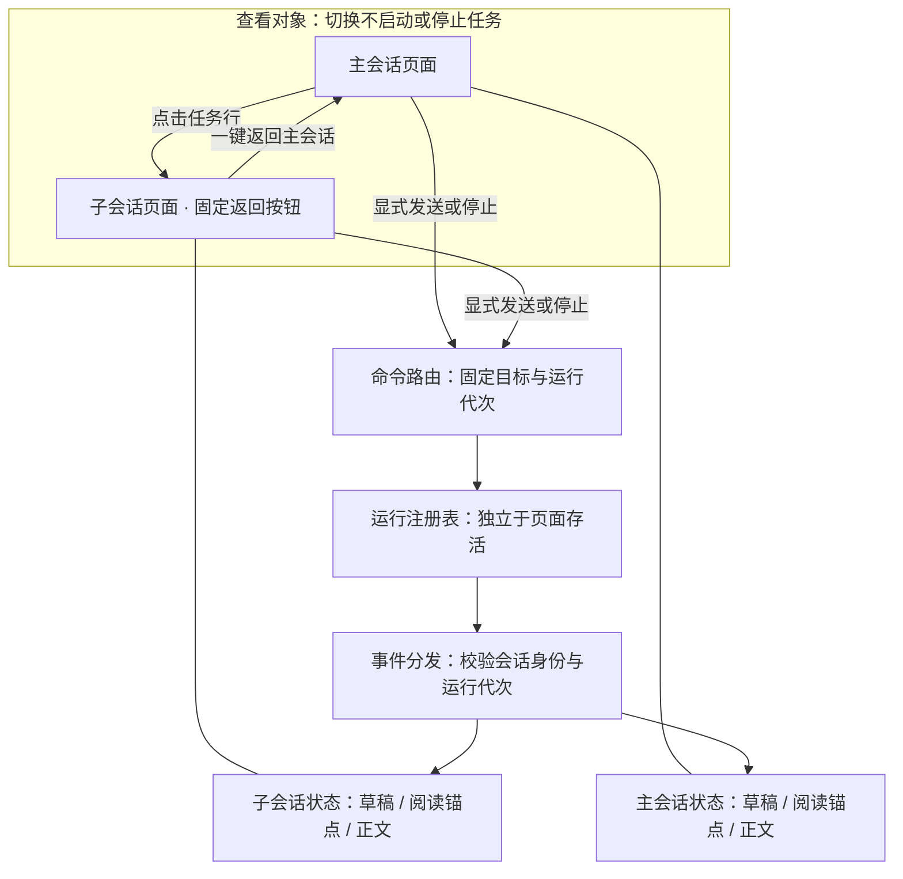

# 子代理会话导航与独立交互设计

状态：首个 Codex 版本已实现导航、原生历史、实时事件、独立编辑与定向控制，定向集成回归已通过。日期：2026-11-20。其他引擎按已确认能力降级；原生探针、自动化验证和真实窗口验收分别记录于第 11 节。

目标：从主会话的子代理列表进入对应子会话，复用正常聊天的正文和输入体验，在引擎能力允许时发送消息、继续对话和停止当前子任务。**子会话顶部始终提供「返回主会话」按钮，一次点击回到所属主会话；进入、返回和来回切换均保留双方会话状态。**

本方案承接[聊天正文与子代理 UI](chat-content-and-subagents.md)，独立于该文档的视觉收尾。现有会话和存储规则见[会话与存储](../sessions.md)，引擎接入约束见[CLI 适配器](../cli-adapters.md)。

## 1. 范围与必须成立的约束

| 编号 | 约束 | 可观察结果 |
| --- | --- | --- |
| N1 | 导航只切换查看对象 | 点击进入、返回、切到其他标签都不发送、停止、重启或重新派发任务，不销毁运行时 |
| N2 | 一键返回始终可用 | 子会话正文加载中、失败、运行中、等待审批或已结束时，顶部返回按钮仍可操作；不依赖网络响应或保存完成 |
| N3 | 主子会话状态分别保留 | 草稿、附件、输入光标、阅读位置、跟随输出偏好、折叠状态、队列及待处理问题各自归属；切回来能继续原来的操作 |
| N4 | 后台会话继续更新 | 离开页面后消息仍接收、保存，运行仍计时；完成与审批通过状态标记提示，不抢当前页面或输入焦点 |
| N5 | 操作绑定明确目标 | 发送、停止、审批及异步回执绑定发起时的会话和运行代次，不随当前页面变化而改投其他目标 |
| N6 | 能力真实且可解释 | 缺历史、无独立控制或无法确认身份时明确提示；不把任务摘要呈现为完整记录，不把停止主运行当作停止单个子任务 |

“两边会话状态不受影响”指**导航不产生业务副作用、不覆盖另一侧状态**。正常运行产生的新消息、完成、错误及父子间的任务反馈继续生效；查看子会话不冻结主会话。用户明确停止子任务后，主代理可能收到停止结果，这是任务协议的正常反馈。主子任务也可能共享工作区文件，本方案不承诺文件系统隔离。

首个完整版本包括导航、真实历史、实时消息、单引擎定向发送与停止、独立草稿及返回恢复。其他引擎按能力逐步接入。独立弹出窗口、批量停止、改变父子关系、把子任务复制为新主会话，以及手机端新增子会话控制入口暂不纳入；已有主会话远控继续保持明确的目标语义。

## 2. 现有实现与可复用部分

| 位置 | 当前能力 | 本方案需要补充 |
| --- | --- | --- |
| [`src/app/subagents.rs`](../../src/app/subagents.rs) | 子代理列表、详情、任务复制、当前/历史切换 | 任务行导航、独立详情开关、返回入口 |
| [`src/subagents.rs`](../../src/subagents.rs) | 按本地 run 与 agent ID 保存摘要；文本有 8192 字节上限 | 可信的原生子会话关联；摘要不能充当完整正文 |
| [`src/domain.rs`](../../src/domain.rs) | `SessionRecord` 已有 `native_id`、`is_subagent`、消息及 Transcript 引用 | 父子关系与摘要到正文的关联；复用现有子记录 |
| [`src/app/sessions.rs`](../../src/app/sessions.rs) | 子记录被排除在普通标签与回退选择之外 | 独立的子会话查看路由，保持主会话标签归属 |
| [`src/app/composer.rs`](../../src/app/composer.rs) | `ComposerTarget` 按工作区与会话定位附件，现由 `selected_session` 生成 | 改为解析当前可见会话；补齐独立输入状态及异步目标校验 |
| [`src/app/runtime.rs`](../../src/app/runtime.rs)、[`src/app/state.rs`](../../src/app/state.rs) | 按会话管理运行、审批、发送保存门闩与原生 ID 互斥 | 将父运行内托管的子会话纳入互斥和定向命令路由 |
| [`src/cli_adapter.rs`](../../src/cli_adapter.rs)、[`src/chat_runtime.rs`](../../src/chat_runtime.rs) | 每轮适配器、事件流与整轮取消 | 子会话能力发现、历史读取、事件归属、定向发送和中断 |

已有 `is_subagent` 正文记录可以作为读取来源，但当前列表没有通用的身份关联和独立交互闭环。实施时先复用能精确关联的记录，再补原生历史与实时事件；不另建一套重复的正文存储。

## 3. 界面与导航

### 3.1 从列表进入

- 总标题继续展开/收起整个列表；「查看历史」继续切换批次范围。
- 任务行的标题与主要内容区域改为「打开子会话」；单击或键盘 Enter/Space 进入。右侧保留独立的详情开关，仅展开任务、活动、结果摘要。
- 导航、详情和复制分别为可聚焦控件；不嵌套按钮，不让复制或详情点击冒泡触发导航。名称分别表达「打开子会话：标题」「展开/收起任务详情」「复制任务」。
- 无法取得完整记录时，仍可进入该任务的查看页，显示已保存摘要和「暂无法读取完整子会话」说明；不能伪造消息列表或启用无目标的发送操作。

### 3.2 子会话页面

子会话使用当前主会话标签内的聊天区域，第一版不新增普通侧边栏条目或独立顶层标签。主会话标签保持所属关系，页面标题明确标出子代理名称。

```text
[← 返回主会话]  子代理 · 检查文件链接          运行中
所属主会话：修复聊天界面                     有新消息 / 待确认
────────────────────────────────────────────────────
子会话正文：用户消息、回复、公开思考、工具、审批与错误
────────────────────────────────────────────────────
发送给：检查文件链接
[该子会话自己的草稿和附件]
                         [发送 / 追加消息] [停止当前子任务]
```

**返回按钮固定在正文滚动区域之外，位于页面左上角，保留文字标签。** 窄窗口或高 DPI 时优先截断标题与次要信息，不能把返回入口挤入菜单。返回动作不弹出确认、不清空草稿、不等待子任务结束；通过 Tab 可到达，Enter/Space 可激活。

有孙级子代理时，「返回主会话」始终直达根主会话；面包屑可以额外提供「上一级」，不能替换一键返回入口。所属主会话有新消息、完成或等待处理时，只更新轻量提示；点击返回后展示该主会话的最新状态。子页面提供同批代理切换入口，按任务身份选择 A/B，不新增顶层标签；切换入口与返回、正文选择分别处理。

不新增全局 Esc 行为：它继续处理输入补全、弹层等已有操作。按钮快捷键限定在自己的焦点上下文，不匹配聊天发送或停止快捷键。主会话发送快捷键在子页面必须解析到当前子会话，不能落回根会话。

### 3.3 进入与返回的具体规则

| 操作 | 页面结果 | 状态处理 |
| --- | --- | --- |
| 主会话 → 子 A | 显示 A；首次进入加载其历史 | 保留主草稿、阅读锚点及运行；A 首次默认定位最新消息 |
| 子 A → 返回主会话 | 立即显示所属主会话 | 恢复主草稿、焦点位置和阅读策略；A 继续运行并保留自己的状态 |
| 主会话 → 再次打开 A | 恢复 A 的阅读位置与草稿 | 不再次派发任务、不重复创建会话、不重复订阅 |
| 子 A → 子 B | 显示 B | A、B 状态独立，仍可一键回到根主会话 |
| 子页面 → 其他工作区/标签 → 原主会话标签 | 恢复该标签上次的主/子查看对象 | 不更改任务目标；明确点击主会话侧栏条目则回到主页面 |
| 返回时主会话仍在输出 | 显示持续更新后的正文 | 原来跟随底部则继续跟随；原来阅读历史则恢复锚点，并提示有新消息 |

根会话处于归档状态时仍返回该原会话，不自动取消归档。正常删除流程应拦截存在活动后代、未保存草稿或待提交操作的根会话。若外部变更导致根记录已不存在，保留子页面和已保存草稿，返回按钮切换至“主会话已不可用”的恢复页并提供工作区入口；不把无关会话当成原主会话。

## 4. 视图状态与运行状态分离

导航路由、正文数据和运行所有权分别管理。下图中的箭头表示状态读取/路由，不表示创建或销毁运行。图源见 [`subagent-conversations.mmd`](../diagrams/subagent-conversations.mmd)。



以下名称是拟议内部契约，实施时可按现有模块命名调整，但不得削弱 N1–N6。

| 概念 | 设计 |
| --- | --- |
| `ConversationRoute` | 保存根主会话 ID 与当前查看的本地会话 ID；缺少可信映射时指向只读任务摘要。每个主标签独立保存最后查看对象 |
| `ChildBinding` | 保存根会话、直接父会话、来源 provider、来源命名空间、原生子会话 ID、关联任务和本地正文 ID |
| `ConversationViewState` | 每个本地会话保存输入实体/编辑状态、附件、阅读锚点、是否跟随输出、折叠状态、搜索定位及焦点来源 |
| `ChildRunBinding` | 保存实际拥有连接的运行、运行代次、原生回合 ID、能力快照及待确认命令；不拥有父运行的销毁权限 |

### 4.1 现有字段与动作入口的迁移契约

- `selected_session` 保留根会话/主标签身份，不临时改成子会话来复用发送函数。查看路由按根会话保存；正文目标、编辑目标和运行连接所有者分别解析。
- 路由显式区分任务摘要与已关联正文；没有正文 ID 不等于新聊天或根会话。摘要路由使用 `(root_session_id, run, agent_id)`，禁止缺省回退到主会话发送。
- 连接所有者唯一持有 `ChatRuntime`。子视图只引用所有者与代次，不复制运行句柄，不取得父运行取消权。父回复完成、子任务完成与连接已释放是不同状态。
- 发送、停止、重试、重新生成、命令、队列、审批和正文菜单中的写操作全部接受能力检查。浏览版本关闭全部未验证的写入口；不能仅隐藏发送按钮。消息回调捕获会话 ID、稳定消息键、必要的原生回合和运行代次，不能只传下标并在回调时读取当前会话。
- 桌面动作的保护不得拦截已明确指定根会话的 remote、通知审批和后台队列。页面可见性不改变这些显式目标。
- 主标签重新打开恢复其子路由；显式点击主侧栏条目返回主页面。关闭/删除时分别处理查看关系与会话数据，不通过页面销毁清理进程。

### 4.2 输入、订阅与缓存边界

完整浏览批次使用按会话持有的输入实体/编辑状态，保留撤销、选区、光标和附件；输入订阅携带会话与实体身份。隐藏输入的变化只更新自己的草稿，不能刷新其他会话的补全或抢焦点。IME、附件选择与补全的迟到结果还须校验原输入代次。

首个导航批次不提供子输入框，保持根输入实体原样存活，并将焦点移到子页面；返回时重新聚焦根输入，不调用 `set_value` 重建它。此中间状态不能宣称已完成独立子草稿能力。正文虚拟列表和滚动状态按任务查看目标保存，不借用主会话的列表游标。当前子正文必须进入驻留保护；主运行仍独立接收消息。

### 4.3 会话身份与互斥

- 本地会话 ID 是 UI、草稿和存储的稳定键；原生会话身份由 provider、实际连接/数据源命名空间及原生 ID 共同确定。不能仅凭任务标题、昵称或显示顺序关联。
- 当前摘要的 `(root_session_id, run, agent_id)` 是任务快照定位键，原生 child conversation ID 是跨轮次续聊的身份，原生 turn/task ID 是某次运行的身份；三者不能混用。Claude 的 tool-use ID 也不能直接当作可恢复的会话 ID。
- 不以工作区路径不同作为绕过现有“同引擎同原生会话只允许一个写入运行”的理由；来源命名空间无法证明独立时继续保守互斥。
- 只有可信协议父子关系、原生历史元数据或已验证映射才能建立可写绑定。无法确认的旧记录仅供查看。
- 同一原生子会话的实时发现与历史导入应归并到同一个本地正文记录；多次父任务派发可以关联它的不同回合，历史任务摘要保留各自结果。打开旧任务先定位对应回合，界面明确发送面向该子会话的当前状态，不修改历史回合。

### 4.4 状态保留矩阵

| 状态 | 所有者与切换要求 |
| --- | --- |
| 正文与流式位置 | 归属会话/消息键；隐藏时继续接收并保存，不混入其他会话回复 |
| 草稿、附件、撤销栈、输入光标与选区 | 归属会话输入状态；切换不能通过清空再异步回填覆盖新编辑；返回后继续编辑 |
| IME 组合输入 | 组合事件绑定原输入实体；导航不得模拟 Enter 或把迟到输入写入新目标；原生组合处理完成后恢复对应输入状态 |
| 阅读位置 | 保存稳定消息键与块内偏移，辅以列表位置；正文增长不把历史阅读者拉到底部，锚点失效时定位最近有效内容 |
| 跟随输出、折叠、搜索 | 分别归属各会话；读取后台新消息不擅自改变这些偏好 |
| 正文文字选择 | 按会话保存逻辑范围，不让隐藏正文参与当前 Ctrl+C；内容未变时恢复，内容已变导致范围失效时安全清除 |
| 队列、发送保存回执 | 绑定发起时会话与请求 ID；导航不触发队列派发，也不把回执应用到另一侧草稿 |
| 审批、问答与填写中答案 | 绑定原运行、子会话与票据；切换后仍待处理，批准/拒绝仅作用于该票据 |
| 模型、服务、权限及工作区 | 归属实际会话/运行；查看子页面不改主会话默认值，也不隐式提升子任务权限 |
| 运行与状态 | 由运行注册表和真实事件维护；任何页面卸载、缓存淘汰和列表收起均不能调用取消 |

复用现有正文驻留预算与后台读取调度，不为每个子代理永久保留全部渲染实体。当前视图、带未保存编辑的输入、活动运行和待保存正文受保护；可卸载已落盘正文与布局缓存，但先保留恢复用状态。运行句柄必须由注册表持有，避免页面释放触发 `ChatRuntime::drop` 的取消行为。

## 5. 完整历史与实时事件

1. 进入时先解析可信映射，读取已有 Transcript；不足部分通过引擎适配器查询历史。摘要页明确展示缺失范围，不把任务和结果拼成假历史。
2. 每次历史读取携带会话 ID、读取代次和起始数据版本。用户切走后结果可以填充原会话缓存，不能改当前路由；旧读取不能覆盖更新后的正文。
3. 订阅与初次历史读取必须形成可核对的基线：有服务端游标则按游标补齐，没有游标则先接收事件、合并快照，再去重和补查；读取期间的消息不能丢失或重复。
4. 标准化事件携带来源运行、目标原生会话、原生回合/任务、item/block 身份及增量或最终快照语义。显示层沿用 `ChatItem`，主子流分别维护消息游标和公开思考/工具状态。
5. 迟到的旧运行完成、历史快照或控制回执不能终止新一轮任务。无法确定归属的事件进入有界诊断，不追加到当前可见页面。
6. 切换页面不重复创建监听；注册表按会话和连接复用观察者。加载失败允许重试；正文缺失/损坏不能当作空记录继续发送或覆盖保存。

当前工作区历史扫描会跳过新发现的子代理正文；已有 `is_subagent` 记录仅是可选来源。完整浏览批次须新增按身份读取正文的入口，不能通过重新显示普通侧栏子条目代替。当前子代理轮询取得的最近回合/摘要不代表完整历史；标准化正文事件须在解析层保留目标会话，再进入已有正文归并器。

只有引擎实际公开的消息进入记录。公开思考、工具结果、文件链接、代码复制和 Markdown 沿用现有规则。子会话用量保留原始归属；主面板可汇总展示，但总账不能因主子两处显示而重复累计。

## 6. 发送、停止与审批

### 6.1 能力模型

按连接、CLI 版本和具体子会话发现能力，至少区分：读取历史、实时观察、空闲续聊、运行中追加输入、定向中断、原生恢复、审批/问答响应。默认均为未确认；每项可携带不支持或暂不可用的原因。

| 子会话状态 | 输入与动作 |
| --- | --- |
| 空闲，已确认可写 | 编辑独立草稿，发送新一轮消息 |
| 运行中，支持定向追加 | 显示「追加消息」，绑定当前原生回合；停止按钮明确标为「停止当前子任务」 |
| 运行中，不支持定向追加 | 保留可编辑草稿并说明需等待；只有完成了目标绑定的队列能力才允许显式入队，不因导航隐式排队 |
| 等待审批/问答 | 展示该子会话的请求与已有答案草稿；不能把普通输入误作审批回复 |
| 已完成、失败或停止 | 原生会话可恢复且确认无其他写入者时允许继续对话，否则显示只读原因 |
| 状态未知、断连或无控制能力 | 保留历史和草稿，禁用无依据的发送/停止；只读刷新不得创建新运行 |

第一版沿用父任务已确定的服务、模型和权限配置；只有引擎明确支持独立配置时才开放子会话设置。附件、命令补全等复用输入 UI 的功能同样需要验证目标能力，不支持时保留草稿并解释原因。

### 6.2 发送流程

发送按钮和键盘动作共用入口：捕获当前子会话 ID、正文版本、草稿版本、命令 ID、来源运行代次和预期原生回合；随后校验能力、归属、权限、连接及互斥。

沿用现有“先保存、后启动/写入”的门闩。保存失败保留原草稿及附件；保存完成时再次校验目标和运行代次。写入后的状态区分等待确认、已接收、失败和结果未知。确认只能更新原会话，清除草稿须比对所发送的草稿版本，不能清除用户之后输入的内容。

同一原生子会话只有一个命令写入归属。父运行仍拥有连接时，经该连接定向发送；不能另启一个 CLI 抢占同一原生会话。父运行结束后，只有确认原生会话可恢复且旧所有者已释放，才允许建立独立续聊运行，并保持返回主会话的关系。

父代理也可能同时派发任务，应用本地互斥不足以约束原生调度器。适配器必须使用可验证的预期回合或等效一致性机制，处理忙碌、冲突和任务换代；未验证该机制的引擎在父任务占用期间不开放直接写入。传输结果未知时不自动重发，先查询原生命令/消息状态；没有幂等能力时保留待核对状态，避免重复执行。

### 6.3 停止流程与范围

子会话停止请求携带精确的原生子会话、回合/任务和运行代次。点击后显示「正在停止」，只有原生终态事件或权威查询确认后才显示停止。超时显示“停止结果未确认”，保留连接与互斥；迟到回执不能停止后续新任务。

**子页面的停止操作不得调用父 `ActiveRun::cancel()`、取消父 `ChatRuntime` 或终止共享 Windows Job。** 引擎没有独立停止能力时禁用该按钮并说明原因，不降级为停止整个主任务。原生接口若会连带停止目标的后代，必须在能力说明和按钮提示中明确该范围，不能影响兄弟任务。

主会话中的显式整轮停止保留现有进程树清理语义，可能影响其托管子任务；这与返回页面的导航动作严格分离。主回复完成也不等于销毁连接：仍有活动子任务、未完成控制或审批时，运行所有者须继续存活，直到完成清理或明确交接。

### 6.4 审批与通知

审批票据由实际连接所有者统一管理，正文按目标子会话展示；主面板保留待处理数量与入口。同一票据在两处展示时共享处理结果，过期票据拒绝执行，不能重复批准。子页面的“允许”不改变父会话权限默认值。

通知保存根会话和目标子会话身份。显式点击通知可以定位对应页面，普通后台事件只更新提示。子会话打开文件、搜索定位和复制使用实际任务工作区/工作树，不借用当前其他标签的路径。

## 7. 引擎接入边界与验证门槛

下表是基于当前仓库适配代码的实施顺序，**不是各引擎独立控制已通过验证的能力声明**。接口和命令需在协议探针阶段按本机版本确认；不能把另一种 SDK 的能力直接视为当前 CLI 已支持。

| 引擎 | 当前可利用的线索 | 开放交互前必须验证 |
| --- | --- | --- |
| Codex | 已识别所属子线程、回合状态及轮询；可优先实施 | 子线程完整历史、定向续聊/追加/中断、父运行仍活动时的并发约束与审批归属 |
| Claude Code | 已关联任务生命周期、tool-use ID，子消息与主消息隔离 | 任务到真实子会话的映射、完整记录来源、当前 CLI 的定向输入/停止及结束后的恢复；任务 ID 不等同会话 ID |
| OpenCode | 已有认证旁路查询子会话、状态和最近消息 | 完整历史、认证范围、子会话写入/中断、父运行结束后的服务所有权 |
| 其他引擎 | 按真实元数据降级 | 未验证前仅展示可得信息，不显示可用的控制操作 |

每个引擎的结果记录版本、支持项、不可用原因、离线协议夹具和显式集成测试证据。能力失败只影响该子会话的对应操作，返回按钮和主会话浏览始终保持可用。

## 8. 持久化、兼容与生命周期

- 完整正文复用 Transcript 的发布顺序、引用和租约机制；先持久化正文，再保存关联它的元数据。子记录、恢复草稿、附件和待确认操作都必须进入存活引用计算。
- 父子绑定采用可兼容读取的字段；旧记录缺字段时保留原文和草稿、按只读降级。若需要变更存储格式，先更新版本与迁移方案；本设计阶段不修改当前 v4 格式。
- 现有导入/子代理历史迁移不得删除已保留正文、用户新增消息或草稿。精确原生身份匹配后建立关联；无法匹配时不按相似标题合并。
- 浏览状态在进程内切换时完整恢复；正常退出/更新时持久化各会话草稿与附件、路由和可恢复阅读锚点。原生焦点句柄、渲染实体和撤销栈不直接序列化；重启后恢复正文与草稿，不承诺恢复 OS 输入组合态。
- 重启时未确认结束的任务显示状态未知，重新校验原生状态与能力；不自动重发待确认消息，不因恢复上次子页面而启动 CLI 或续聊。只读观察可恢复，写入需明确动作。
- 关闭标签只释放查看关系，不能取消运行或丢弃草稿。删除根/子记录前检查活动后代、别名、未提交发送和保存租约；实际应用退出沿用现有显式清理和恢复流程，不与页面关闭混为一谈。
- `remote` 现有请求按原会话/运行 ID 路由，不得因桌面正在看子页面而改投子会话。新增子会话远控需另行显式暴露身份与能力。

## 9. 实施批次

| 批次 | 交付 | 完成门槛 |
| --- | --- | --- |
| A：契约与协议探针 | 确定身份、能力、事件归属和命令一致性；先验证一个引擎 | 可证明读取的是目标子会话，能区分目标中断与父运行取消；不支持项有明确结论 |
| B1：只读导航 | 列表进入、固定返回、同批切换、可信的已保存正文或明确摘要页、根输入原样保留、写入口保护 | 导航不发送/停止；返回与缺失状态可用；明确正文为已保存记录，不冒充完整实时历史 |
| B2：完整浏览 | 按身份读取原生历史、主子实时事件合并、独立子草稿/附件/阅读状态、最小退出恢复与引用保护 | N1–N4、N6 成立；快速切换与迟到输入不串线；正常退出不丢草稿；旧数据兼容 |
| C：单引擎发送与停止闭环 | 优先 Codex，接入保存门闩、定向发送/中断、审批、并发与未知结果处理 | N1–N6 全部成立；原生运行验证通过，且停止不影响父与兄弟运行 |
| D：多引擎与恢复增强 | 逐个接入 Claude/OpenCode 的已确认能力，完善断连重连及运行恢复；基本持久化和退出恢复已在 B2 完成 | 每个引擎独立验收；不能以一个引擎通过代表其他引擎可用 |

批次 B1/B2 可先交付浏览能力，但不能据此宣称“与普通会话一样可发送/停止”。批次 C 的运行所有权和原生并发验证未完成前，不开放生产写入入口。

拟涉及模块：`app/subagents` 与聊天壳负责入口/返回；`session_controller` 和会话导航管理路由/绑定；composer、queue、update/recovery 管理独立编辑与恢复；runtime、cli_adapter、protocol 管理定向控制与事件；domain、store、transcript、history 管理兼容持久化；通知和 remote 调整目标归属。既有消息渲染器继续复用。

## 10. 验收矩阵

下列均为待执行验收，不代表已经通过。离线测试使用假适配器记录命令和可控事件，不发送真实模型请求；实际 CLI 集成测试显式运行，并记录版本和运行归属。

| 场景 | 必须满足的结果 |
| --- | --- |
| 主会话运行中进入子会话，再一键返回 | 没有因导航新增 send/start/cancel；原运行身份不变，主子输出持续，双方草稿不变 |
| 主/子各有不同草稿、附件与光标 | 来回切换后各自恢复；选中、复制与撤销不跨会话 |
| 主会话阅读历史，后台持续追加 | 返回仍定位原消息与偏移，出现新消息提示；原来跟随底部的会话继续跟随 |
| 子 A、子 B、根会话及其他标签快速切换 | 正文、选区、折叠、搜索及输入不串线；晚到历史只更新原目标 |
| 子会话加载中、失败或无完整记录 | 固定返回按钮始终可用；缺失状态明确，不能用摘要冒充完整对话 |
| 键盘进入、详情、复制和返回；IME 正在组合 | 控件动作独立；Enter/Space 不误发送；组合输入不丢失、不写入另一侧 |
| 子 A 输入/补全后切至 B，A 的回调随后到达 | 只更新 A；B 的正文、草稿、光标及候选列表不改变 |
| 子页面触发重试、重新生成、命令及键盘停止 | 未验证能力全部拒绝；根会话不被修改、发送或停止 |
| 历史读取时同时收到增量与最终快照 | 消息完整、顺序可解释、无重复；最终快照按原消息更新 |
| 子会话发送后立即返回主会话 | 保存/发送回执只更新子会话；主草稿和焦点不变；新编辑的子草稿也不被清除 |
| 保存失败、发送断线或回执未知 | 保留草稿/附件或待核对记录；没有静默重复发送和虚假成功 |
| 停止子 A，父和子 B 仍运行 | 仅出现 A 的定向停止请求，无父取消/共享进程树终止；兄弟输出继续 |
| 停止超时、旧回执到达、父代理又派发新任务 | 不把超时当终态，旧回执不影响新回合，未确认期间不释放错误的互斥 |
| 父代理与用户同时向同一子会话发起操作 | 通过原生一致性机制处理冲突；不启动第二个写入者，不混合两轮结果 |
| 子审批未处理时切换；从主通知再打开 | 答案草稿保留；仅处理该子票据，结果在两处同步，不改变其他会话权限 |
| 主回复结束但子任务仍运行，或仅关闭页面 | 连接和事件监听保留，子任务继续，重新进入不创建重复运行 |
| 完成后续聊；应用重启；旧原生 ID 别名 | 保留历史、准确建立新回合；重启不自动发送；同一原生会话仍只有一个写入者 |
| 旧数据迁移、历史导入、正文缓存淘汰与回收 | 不丢正文/草稿/附件；过期读写不覆盖新状态；缺失正文不被空内容替换 |
| 850×500 至 1600×1000、明暗主题、100%–200% DPI | 返回按钮和发送目标始终可辨识，长标题不挤掉操作；真实窗口验证焦点与滚动 |
| `remote`、主会话命令/队列和文件导航回归 | 桌面子路由不改变远控目标；主会话已有行为及工作区路径归属保持正确 |

实施验证按批次先跑受影响的导航、输入、运行时、协议和存储回归，再执行[核心检查与真实窗口验收](../testing.md)。文档变更检查相对链接、图源和 `git diff --check`；代码批次执行对应回归，不能把已有 UI 测试结果算作本功能验收。

## 11. 实施记录

2026-11-20：补齐路由/运行/动作目标契约、独立输入订阅、正文来源和批次边界。已实现 A 的本地路由契约与 B1 只读导航；协议探针、完整原生历史、独立子草稿、持久化路由与定向控制仍需后续验证和实施。B1 不新增子编辑状态，应用重启回到根会话；进程内保留各主标签的子查看路由。

B1 实现范围：任务行和详情分别操作；固定返回、同批前后切换、每主标签路由；仅按已知父子链及唯一原生 ID 关联同工作区已有 Codex/OpenCode 子正文，Claude 保留摘要页；正文异步读取及错误重试沿用 Transcript，当前子正文受缓存保护；发送/停止/命令/重试/重新生成的桌面入口在子页面关闭，显式根目标控制不改投。根输入实体不重建；B1 清除正文文字选择以防隐藏内容参与复制，完整选择恢复仍属 B2。

验证：子代理专项 6 项，以及队列、正文缓存、命令、保存回执、通知、跨会话并发与历史迁移 51 项，共 57 项通过；最终 Clippy（all-targets、ui-tests、零 warning）、全仓格式、i18n 和差异检查通过。为避开共享测试程序占用，最终使用独立输出的测试文件；身份和逐项结果保存在 `target/subagent-navigation-final-results.json`。首次失败与构建冲突日志仍保留于 `target/subagent-navigation-*.log`。未据此宣称全量核心套件通过；B1 验证时尚未执行真实窗口验收及 CLI 协议探针，后续结果见 11.1。


### 11.1 Codex 历史与独立交互

实现位置：`app/subagents/navigation/{history,editor,controls}.rs`、`cli_adapter/child_history.rs`。`Store.child_bindings` 保存根/原生/父/数据源关联，`child_commands` 保存未决命令；旧数据通过 serde 默认值兼容。完整历史沿用 `SessionRecord` 与 Transcript，子记录仍不进入普通工作区列表。

- 只读历史使用独立进程，核对父子身份和工作区，分页获取全部回合；单次上限 64 MiB / 10000 回合 / 45 秒，最多两路读取。预算或协议不满足时整次失败，不把截断内容标为完整历史。轮询与原连接实时事件按原生 turn/item 身份合并，最终快照替换增量；缓存布局在同长度文本变化时重新测量。
- 子编辑器按所属根与原生子 ID 保存独立 Textarea 实体和订阅；文件选择回调绑定原编辑器，剪贴板附件参与引用保护。退出恢复含子草稿、附件、输入选区、标签路由及阅读偏移；页面布局缓存淘汰时保留阅读位置。缺失附件继续显示且阻止发送，避免恢复后悄悄漏掉文件。草稿同时保存根原生身份与数据源；身份或来源变化后保留内容并禁用发送，恢复原来源后才能继续。输入撤销/IME 状态由进程内实体保存；跨重启不恢复操作系统的 IME 组合状态或撤销历史。
- 活动子任务的能力由原连接 `thread/read` 的 `canAcceptDirectInput` 确认。追加与中断要求当前 run 和真实 turn 匹配，写入前经过保存门闩和二次校验。等待审批时不把普通草稿作答案提交。工具审批、问答及取消使用原有票据 broker，不建立第二套审批生命周期。
- 传输超时/断连视为结果未知，持久化未决命令，保留草稿，禁用自动重发；页面提供核对后解除入口。控制回执不切换页面，也不能清除后续新编辑的内容。父连接释放且历史确认空闲后才允许独立续聊；子独立运行期间根会话重新启动和删除均被互斥保护；未发送子草稿、附件或待核对命令也阻止删除根记录。已有原生子记录若来源不匹配则拒绝重新绑定，不生成重复记录；删除已空闲主会话时释放子导航、独立草稿和只读历史读取器。
- 其余引擎不推测控制能力。已关联的 OpenCode 正文可读，Claude 仍使用任务摘要；均保留独立草稿。额外引擎控制、崩溃后的 CLI 运行接管属于 D。

本机原生验证：Codex CLI 0.170.0。`scripts/probe-subagent-protocol.py --codex <绝对可执行文件路径>` 在隔离的 CODEX_HOME、合成父子会话和本地 HTTP 响应端点上运行；实际调用原生 spawn、分页历史、定向 steer/interrupt、resume/start，断言旧回合被拒绝、正确回合可写以及停止子任务后父任务仍可追加。未使用真实模型服务或用户会话。证据默认在 `target/subagent-protocol-probe/`。

自动化回归：最终独立测试程序运行 126 项不同用例通过、0 失败，1 项真实用户历史扫描按设计忽略。覆盖子导航、协议、分页历史、保存门闩、队列、正文缓存、命令、退出恢复、通知、审批、问答及跨会话隔离；含草稿身份变化、缺失附件、来源冲突拒绝重复建档和子运行或尚有草稿时禁止删除根记录。测试程序路径、SHA-256 与逐项日志保存在 `target/subagent-delivery-results.json`。这不是全量核心套件通过声明。

真实窗口的 IME/DPI/主题及视觉验收仍需单独执行，不能以自动化测试代替。
