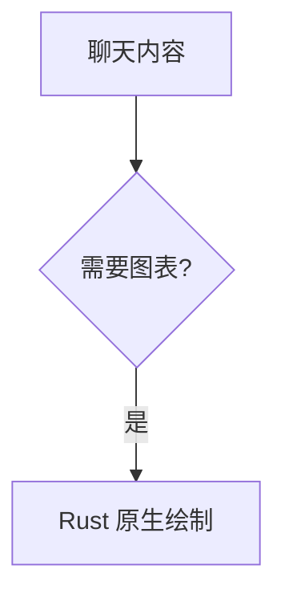

# 文件与内容预览

文件树、源文件、Markdown 与 Git Diff 共用主区标签；预览只读，打开文档保留所属工作区。文件路径、链接和附件在使用时重新校验，不因曾经选中过就跳过存在性、大小、编码或工作区边界检查。

## 文件引用

### 输入与选择

输入区支持文件拖入、剪贴板文件粘贴、原生文件选择器和 `@` 工作区文件搜索，共用路径校验、引用卡片、会话草稿与发送前复验。搜索候选支持键盘和鼠标选择，选中后显示为附件卡片，发送时由 CLI 读取对应路径；尚未实现正文内的原子引用 token。

### 交互

- 在行首、空白或左括号等边界输入 `@` 唤起；输入文件名、相对路径进一步过滤，匹配不区分大小写，支持模糊匹配和 Windows 反斜杠。邮箱、`@@`、转义的 `\@` 不触发。文件名含空格时，可输入不含空格的片段后选择候选。
- 候选显示文件图标、文件名与相对目录，完整路径可通过悬停查看。优先展示文件名精确、前缀、包含匹配，再展示路径与模糊匹配；每次显示前 6 项，继续输入可缩小范围。
- `↑ / ↓` 循环选择，`Enter / Tab` 确认，鼠标可直接点击；选择保留输入焦点，将当前光标前的 `@查询` 转成文件卡片，前后正文保留。文件被删除、不可读、为二进制或超限时显示现有校验提示，保留查询与草稿。
- 候选加载中或无结果时，`Enter` 不发送消息。关闭候选后，恢复原有 Enter 发送和 Ctrl/Shift+Enter 换行。中文输入法有预编辑文本时，确认、导航与关闭操作不添加文件或发送消息。
- `Esc`、点击弹层外部、移开光标或输入空白可关闭；Esc 后重绘不会重新打开相同查询，修改查询或离开后重新输入可再次唤起。切换会话或工作区后，旧查询结果不能被确认到新草稿中。
- 拖入、粘贴、选择器与 `@` 共用校验和按规范化路径去重；发送前再次检查引用文件。只传递路径，文件内容仍由 CLI 读取。

### 搜索范围与性能边界

使用 `ignore` 库在后台遍历当前工作区，遵循 `.gitignore`、`.ignore` 等规则，包含未被忽略的隐藏文件；跳过 `.git` / `.hg` / `.svn`、`node_modules`、`target`、`.venv`，不跟随符号链接。工作区外文件和忽略项仍可通过附件按钮添加。

单次扫描最多 100,000 个目录项、64 层深度，并在遍历期间检查 4 秒预算；不对单次阻塞的文件系统调用提供硬超时。访问失败、达到预算或目录项读取出错有相应提示，不把不完整结果当作全量结果。搜索只读取路径，选中与发送时才复用现有文本/大小校验。

索引仅保留最近一个工作区，缓存 30 秒；缓存到期后下一次查询重新扫描。搜索采用 60 ms 防抖，排序在后台执行，UI 只绘制最多 6 个候选；请求序号丢弃被后续查询取代的结果。弹层按光标定位，使用组件库的翻转与视口约束，不占用聊天布局高度。

## 文件内查找

每个文件标签独立保存查询、精确/模糊模式、匹配位置与滚动状态。Ctrl+F 打开或关闭查找栏；单行选区可填入查询，多行选区忽略。默认模糊、忽略大小写，输入框尾部按钮切换精确/模糊；Enter/F3 下一项，Shift+Enter/Shift+F3 上一项，Esc 关闭并返回预览焦点。

查找在后台防抖执行，结果携带请求与文档身份；快速输入、切换、刷新或关闭后不应用过期结果。源文本和查询均未变化时，关闭再打开可以复用已完成结果；重新加载使旧结果失效。高亮覆盖源代码、Markdown、带行号代码块和图表源码；输入框复制行为独立于文档选区。

查询保留前后空白，限制原始 256 个字符；匹配器与界面采用相同限制，并处理 UTF-8 边界及大小写展开。空、超限、无匹配及加载状态有明确反馈，导航不能误发聊天或跳到其他标签。

## Mermaid

助手回复里的 `mermaid` 围栏使用纯 Rust 渲染：`mermaid-rs-renderer` 负责解析、布局与 SVG 生成，GPUI 现有的 `SvgRenderer` / resvg 负责栅格化和显示。无需安装其他运行时，不启动 Node.js、Chromium、Edge 或 WebView，不调用在线图表服务。

渲染依赖关闭默认的 CLI 和 PNG 功能，SVG 与字体栅格化复用应用已有依赖；具体版本以 `Cargo.toml` 和 `Cargo.lock` 为准。

### 使用

````markdown

````

代码块结束后在后台生成图表；输出过程中保留可查看的源码。图表块使用固定的预览高度，解析中、滚出后重建及完成渲染都保持相同布局，不改变聊天行高度。支持源码/预览切换、复制源码、点击图片打开放大视图，以及深浅主题。聊天预览和放大视图默认水平、垂直居中。

两处都提供 `−` / `+` 图标按钮和比例按钮，缩放范围为默认尺寸的 25%–800%；点击比例恢复默认尺寸并居中。聊天预览的默认尺寸会适配可用空间，弹窗默认使用图表原始逻辑尺寸。

聊天内放大后，可按住左键拖动查看超出视口的部分；拖动不会触发弹窗，普通单击仍打开放大视图。聊天区域的普通滚轮保留为会话滚动。放大视图可左键拖动、普通滚轮平移，双击居中；两处均支持 `Ctrl + 滚轮` 围绕鼠标位置缩放。

启用代码行号不会接管 Mermaid 块。用户消息仍按已有规则展示。

### 首版范围

开放流程图（`flowchart` / `graph`）、时序图、类图、状态图、ER 图、饼图和思维导图。使用的是 Mermaid 语法的 Rust 实现，不能保证与官方 JavaScript 实现的全部语法、配置指令、HTML 标签、布局或像素效果一致。未开放的图表类型、解析失败和超限图表会提示原因并保留源码。

中文字体使用系统字体回退。初次生成可能涉及字体加载；渲染工作在后台进行。主题变化后按新主题重新生成。生成图片仅存内存，原始聊天记录仍保存 Markdown。

源代码限制为 16 KiB / 256 行，图模型限制为 128 个节点、256 条边、32 个子图。输出图片限制约 400 万像素，最长边 4096 像素。最近结果缓存最多 12 项且图片预算 32 MiB（可见视图另持有正在显示的图片）。源码、主题变化或视图销毁后丢弃过期任务的结果；已进入 Rust 布局函数的调用会在后台执行到返回，不提供强制线程终止。

## 实现与验证

文件引用入口为 [file_ref.rs](../src/file_ref.rs)、[file_search.rs](../src/file_search.rs)；预览查找在 [app/file_preview/](../src/app/file_preview/)。图表渲染与查找分别覆盖过期结果、Unicode、无效内容和容量边界。

人工验证需要真实中文输入法、不同 DPI、宽长图、窄窗、鼠标拖动与滚动锚点。GPUI 事件测试不等于原生像素或输入法验收，见[测试与验收](testing.md)。
