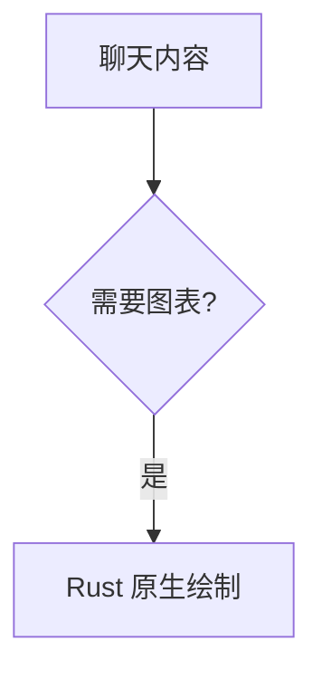

# 原生 Mermaid 聊天预览

助手回复里的 `mermaid` 围栏使用纯 Rust 渲染：`mermaid-rs-renderer 0.3.1` 负责解析、布局与 SVG 生成，GPUI 现有的 `SvgRenderer` / resvg 负责栅格化和显示。无需安装其他运行时，不启动 Node.js、Chromium、Edge 或 WebView，不调用在线图表服务。

依赖关闭了默认的 CLI 和 PNG 功能，新增 Cargo 包仅为 `mermaid-rs-renderer`、`json5`、`ucd-trie`；SVG 与字体栅格化复用已有依赖。

## 使用

````markdown

````

代码块结束后在后台生成图表；输出过程中保留可查看的源码。图表块使用固定的预览高度，解析中、滚出后重建及完成渲染都保持相同布局，不改变聊天行高度。支持源码/预览切换、复制源码、点击图片打开放大视图，以及深浅主题。聊天预览和放大视图默认水平、垂直居中。

两处都提供 `−` / `+` 图标按钮和比例按钮，缩放范围为默认尺寸的 25%–800%；点击比例恢复默认尺寸并居中。聊天预览的默认尺寸会适配可用空间，弹窗默认使用图表原始逻辑尺寸。

聊天内放大后，可按住左键拖动查看超出视口的部分；拖动不会触发弹窗，普通单击仍打开放大视图。聊天区域的普通滚轮保留为会话滚动。放大视图可左键拖动、普通滚轮平移，双击居中；两处均支持 `Ctrl + 滚轮` 围绕鼠标位置缩放。

启用代码行号不会接管 Mermaid 块。用户消息仍按已有规则展示。

## 首版范围

开放流程图（`flowchart` / `graph`）、时序图、类图、状态图、ER 图、饼图和思维导图。使用的是 Mermaid 语法的 Rust 实现，不能保证与官方 JavaScript 实现的全部语法、配置指令、HTML 标签、布局或像素效果一致。未开放的图表类型、解析失败和超限图表会提示原因并保留源码。

中文字体使用系统字体回退。初次生成可能涉及字体加载；渲染工作在后台进行。主题变化后按新主题重新生成。生成图片仅存内存，原始聊天记录仍保存 Markdown。

源代码限制为 16 KiB / 256 行，图模型限制为 128 个节点、256 条边、32 个子图。输出图片限制约 400 万像素，最长边 4096 像素。最近结果缓存最多 12 项且图片预算 32 MiB（可见视图另持有正在显示的图片）。源码、主题变化或视图销毁后丢弃过期任务的结果；已进入 Rust 布局函数的调用会在后台执行到返回，不提供强制线程终止。

## 验证

```powershell
cargo test --locked mermaid
cargo test --locked --features ui-tests mermaid -- --test-threads=1
```

人工验收建议：检查中文标签、宽图/长图、窄窗口、深浅主题、流式未闭合围栏、无效语法、放大、源码复制，以及长会话滚动位置。
