**手机操控会话：调研与评估 · 2026-11-10**

状态：技术与产品方案，尚未实现。基线为 Conduit 0.3.3、Git `8c96c10`；本次通过 CodeGraph、仓库文档和官方网页核对，没有运行手机原型或竞品。仓库中的其他并行修改不属于本次调研交付。外部能力以查阅当日页面为准，不承诺账户、套餐、地区和已安装 CLI 版本均支持。

**建议立项做一个轻量手机控制台：电脑上的 Conduit 继续持有会话和执行进程，手机通过浏览器/PWA 查看进度、发送下一条消息、处理审批与问题、停止指定运行。** 首版采用应用内网关，优先验证私有网络中的 HTTPS 访问；需要外网时，可用用户自行配置的 Tailscale 网络。原生手机 App、自建公网中继和独立后台服务分别评估，不作为首版前提。

本次将“手机操控”理解为离开电脑后继续管理已有会话。网络偏好尚未限定，因此同时评估局域网与外网；“电脑关机仍继续执行”“关闭 Conduit 后继续执行”“远程访问完整桌面”属于额外目标。

**已有产品说明需求可行，但不能直接替代 Conduit 的会话入口。**

| 官方参考 | 已核实能力 | 对 Conduit 的意义与边界 |
| --- | --- | --- |
| Claude Code Remote Control [S1] | 手机或浏览器接续本地 Claude Code，会话仍在本机运行；官方服务负责远程连接；终端关闭会结束对应远程入口 | 可参考二维码、审批和本地执行体验。文档中的终端/官方应用接入流程，不能据此推定能附着到 Conduit 当前持有的 stream-json 子进程 |
| Codex / ChatGPT Remote connections [S2] | 当前手机配对指南从 ChatGPT 桌面应用开始，要求主机在线并使用相同账户/工作区；手机可发送、审批与查看结果 | 官方 Codex 用户可获得远程入口；当前手机配对文档明确不从 CLI/IDE 开始，不能将其他文档中的 CLI remote-control 命令等同于手机接入保证，也没有证明能接管本项目的 stdio 运行 |
| Codex App Server [S3] | 提供线程、轮次、流式事件和审批协议；文档列出 stdio 及 WebSocket，后者标为实验性 | 可以作为协议设计参考。Conduit 已使用 app-server stdio；不应为手机另起第二个运行实例控制同一原生线程，也不应直接把原生 RPC 作为公开手机 API |
| OpenCode Web [S4] | 当前网页与 TUI 共用服务；`opencode pair` 生成配对链接，`opencode pair --remote` 经 OpenTunnel 远程配对 | 网页端与配对值得借鉴；本项目普通会话通过 ACP 接入，是否能直接附着、共享审批所有权仍需专门实验。不能将旧版本的 `opencode web` 教程直接作为当前唯一接入流程 |
| Happy [S5] | 当前主产品已转为多引擎桌面应用，手机端兼容桌面和旧 CLI；旧 CLI 进入维护模式。官方声明设备间端到端加密，旧 CLI 文档说明了手机与中继架构 | 与本项目的产品方向接近，可参考配对、同步和移动交互。旧 CLI 架构不应直接视为当前桌面实现；直接集成仍需核对进程所有权与状态映射，本次未审计加密实现或代码复用条件 |

这些资料证明已有相似交互，不等于已经验证 Conduit 用户的使用频率。建议用实际离桌场景衡量价值：等待审批的时间是否减少、多少任务能在手机完成一次有效干预、是否经常需要回电脑补充上下文。

**当前代码具备可复用的执行基础，但尚未形成远程服务边界。**

| 现有基础 | 代码证据 | 对手机接入的影响 |
| --- | --- | --- |
| 会话状态集中管理 | `SessionController` 持有 runs、队列保存、版本；`session/session_mut` 按会话 ID 定位 [R1] | 可以生成统一摘要。当前版本号用于内存刷新/导入，不是持久化远程事件游标 |
| 每会话/原生身份互斥 | `session_busy`、`start_turn` [R2] | 手机操作应走相同门控，继续遵守 Git 写操作与聊天的仓库协调规则 |
| 发送先保存再启动 | `start_turn`、`PendingTurn`、`poll_pending_sends` [R2][R3] | HTTP 收到请求、保存成功、CLI 开始、任务完成必须是不同状态，不能收到请求就显示“已执行” |
| 已有一条待发送消息 | `enqueue_message`、`dispatch_queued_message` [R4] | 首版复用“当前轮结束后发送下一条”，队列满时明确拒绝，不承诺任意长度队列或实时插入当前轮 |
| 审批精确绑定 | `ApprovalBinding` 绑定 session/runtime/request，`submit_approval` 防重复提交 [R2][R5] | 可复用票据机制；远程入口仍要重新核验设备授权、运行身份和票据有效性 |
| 问答与允许/拒绝分离 | `Approval::questions`、`user_input_response`、`ChatRuntime::answer` [R6] | 手机上要渲染真实问题和可用选项，不能将所有等待输入简化成两个审批按钮 |
| 有界事件与异步持久化 | `event_queue`、`Persistence` [R7] | 适合作为基础，但原事件队列是运行时向 UI 交付的通道，不是可让多个手机竞争消费的广播接口 |
| 桌面状态和运行协调仍有耦合 | `poll_streams`、`poll` 依赖 `Window/Context`，排队保存捕获 `SentComposer` [R3][R4][R8] | 手机不能通过切换桌面会话/改输入框来发消息；需要新增明确来源的命令入口和独立状态投影 |
| 正文按需加载 | 现有冷正文读取、驻留预算与保存租约 [R9] | 手机列表只读摘要；打开聊天按需读取。API 分页不能被描述为已解决底层完整正文加载峰值 |
| 网络入口尚缺 | 本次检查未发现面向手机的会话 HTTP API、配对和设备撤销实现；现有部分 socket 属于引擎旁路或测试 [R10] | 网关、手机前端、认证、重连和兼容性均为新增工作 |

当前注册/文档覆盖 Claude Code、Codex、OpenCode、Qoder；手机操作应根据实际运行能力显示，而不是假设四者支持完全相同的审批、表单、命令和取消方式。[R6][R10]

**三条技术路线中，建议从应用内网关开始。**

| 路线 | 覆盖范围 | 主要投入/限制 | 判断 |
| --- | --- | --- | --- |
| 引导用户使用各引擎官方远程功能 | 对应引擎的官方会话 | 开发少，但已有 Conduit 会话的接管、审批与排队同步没有保证；用户需要在不同入口切换 | 可作为补充说明，不能算本功能交付 |
| Conduit 内置网关 + 手机 Web/PWA | Conduit 管理的各引擎会话 | 新增有限 API、状态投影和手机界面；应用退出后不可使用 | **首版推荐：对现有代码改动范围相对可控** |
| 独立后台服务 + 桌面/手机共同连接 | 后台服务拥有会话，桌面成为客户端 | 需要迁移存储唯一写入者、进程/审批生命周期、IPC、更新与崩溃恢复 | 有长期价值，等“关闭窗口仍执行”的需求明确后推进 |

原生 iOS/Android App 可以改善系统集成，但不会消除上述会话边界工作。首版先验证浏览器/PWA 是否足够；如果锁屏推送、后台交互或系统文件分享成为主要使用场景，再评估原生客户端。

**建议架构：桌面应用继续作为唯一的会话状态写入者。**

图源：[mobile-session-control.mmd](diagrams/mobile-session-control.mmd)。图中命令、状态投影与网络网关均为拟新增边界，不表示已经有可运行服务。

手机请求通过网络线程进入有界命令队列，由应用线程校验并调用现有会话逻辑；执行结果通过独立、可重放的事件流返回。手机与桌面可以同时观察，状态变更由应用线程统一排序，不让网络处理器直接操作 GPUI 对象或写 `state.json`。

建议新增 `src/remote/` 承载传输、认证、DTO 和事件缓冲，`src/app/remote.rs` 承载应用桥接，`mobile/` 承载前端；这些只是候选模块位置。可评估 Axum/Tokio 等成熟 HTTP 组件，但具体依赖、版本、二进制体积和运行时集成应在技术探针后确定，本次不增加依赖。

第一阶段保留现有 UI 事件消费路径，在状态合并后发布远程投影。不要让手机从原 `Receiver` 直接取事件，否则可能让桌面漏收。慢连接应断开后恢复快照，不能反向拖住 CLI 输出或保存线程。

需要特别调整以下边界：

1. **命令按目标和来源执行。** `SendMessage/QueueMessage/CancelRun/ResolveApproval/AnswerQuestion` 显式携带会话标识和来源设备。复用 `start_turn`、保存回执和审批逻辑；不要调用依赖当前输入框、焦点和选中会话的 UI 包装方法。
2. **桌面草稿保持独立。** 当前 `enqueue_message` 会捕获 `sent_composer`，需要抽出与 UI 无关的排队逻辑。手机请求保存完成后，只确认手机的 operation，不能清除桌面恰好相同的草稿、附件或切换桌面标签。
3. **新会话稍后开放。** `prepare_session` 仍受桌面选择配置影响。首个探针只操作已有会话；需要手机新建时，再设计明确的工作区、引擎、模型和权限配置，不借用桌面正在选择的状态。
4. **停止绑定当前运行。** 除 session ID 外传 `run_id`；旧手机页面的停止请求不能取消后来启动的新一轮。显示“停止中”和清理失败，直到现有运行时确认进程树退出。[R2][R10]
5. **退出由本机掌握。** 首版要求应用和电脑运行。最小化/锁屏期间是否正常消费命令和事件必须实机验证，不能从存在后台线程就推断已支持；关闭应用、升级、机器休眠/重启明确转为不可用。[R8][R9]

**首版功能以一次完整的远程干预为边界。**

| 能力 | 首版要求 | 验收重点 |
| --- | --- | --- |
| 配对/设备管理 | 桌面主动开启、扫码配对、本机确认设备、可撤销、显示连接状态 | 过期二维码不可再配对；撤销后现有流连接和后续写请求都失效 |
| 会话列表 | 授权工作区内的会话、引擎、运行/等待输入/失败/结束状态 | 默认优先展示待处理项，不扫描全部历史正文 |
| 会话阅读 | 用户消息、回复、工具摘要、当前计划与错误；详情按需展开 | 断线恢复不重复追加文本；大输出不会撑满页面或服务内存 |
| 发送与排队 | 纯文本发送；运行中最多排一条；返回保存和执行状态 | 双击、超时重试只产生一次有效操作；已有队列不被覆盖 |
| 工具审批 | 展示命令/路径/请求详情和现有能力允许的决定 | 桌面已处理、CLI 已撤销或运行已更换时不能再次授权 |
| 用户问答 | 支持实际引擎输出的选项、自由文本及已支持表单 | 复用服务端验证；不支持的格式明确提示回电脑处理 |
| 停止任务 | 停止指定运行并展示清理结果 | 不取消其他会话，不把发出取消等同于进程已退出 |
| 重连 | 前台恢复、网络切换后重新鉴权和同步 | 不依赖手机后台长连接一直存活，不自动发送离线积压命令 |

首版暂缓：手机新建任意目录/工作区、完整终端、Git 写操作、文件上传与编辑、会话分叉、复杂 Diff 审查、远程切换完全访问权限、多用户协作、自动化任务配置。后续可优先补充只读 Diff 和已有工作区中新建会话。

界面建议只保留“会话列表 → 会话详情 → 审批/问答”三个主要层次。输入区保持可见，工具输出默认折叠；连接中断时保留本机草稿并显示最后同步时间，恢复后让用户明确发送。手机端渲染的 Markdown、工具输出和链接均按不可信内容处理。

**网络接入与消息传输应分开设计。**

| 接入方式 | 使用体验/依赖 | 首版建议 |
| --- | --- | --- |
| 局域网 HTTPS | 无公网中继，但需要可信证书、可达地址及防火墙配置 | 可支持；“同 Wi-Fi”本身不能替代设备认证，证书安装体验需验证 |
| Tailscale + Serve | 电脑和手机加入私有网络，Serve 将本地服务通过 tailnet 内的 HTTPS 提供访问 [S6] | 推荐作为个人外网试点；Conduit 网关只监听 loopback，外层私网与应用配对都保留 |
| 用户配置 Cloudflare Tunnel + Access | 可由公网浏览器访问，需要隧道、域名/访问策略及服务商账户配置；Tunnel 使用出站连接 [S7] | 可选部署方式；必须验证身份门禁、流式转发及代理信任边界，不能当作默认匿名公网链接 |
| 自建配对与中继服务 | 有机会做到扫码即用、减少网络配置 | 需持续承担设备认证、可用性、流量和滥用控制；若要求中继看不到内容，还需端到端加密，另立项目 |

Tailscale Serve 的私网暴露与 Funnel 的公网暴露是不同选择。[S6] 基于云隧道的传输也不自动具备设备间端到端加密；是否允许第三方终止 TLS 应作为产品部署选项明确说明，而不是仅用“本地运行”概括数据边界。

首选评估 **HTTPS POST 命令 + SSE 事件**，适合文本和状态流；如果后续增加终端或中继统一双向通道，再考虑 WebSocket。SSE/WS 都需要自行设计命令去重、应用级游标、资源上限和恢复语义。

Cloudflare 官方明确说明 Quick Tunnels 不支持 SSE，因此不能用临时 `trycloudflare.com` 隧道作为该方案的正式验收路径；具名隧道也仍需实际验证流式行为。[S8] PWA 的 service worker 依赖安全上下文；手机访问电脑普通 HTTP 局域网 IP 不能当作完整 PWA 部署方案。[S10]

iOS/iPadOS 的 Web Push 对加入主屏幕的 Web App 有特定支持和授权条件。[S9] 首版承诺前台更新与回到前台后的恢复，锁屏推送单独验收；推送载荷优先只包含“某会话需要处理”，进入页面后再取正文与票据。

**协议应从第一版就定义失败语义。** 下列为候选契约，不是已有 API：

| 接口/对象 | 建议语义 |
| --- | --- |
| `GET /api/v1/sessions` | 分页摘要和每项允许的操作；工作区授权在服务端过滤 |
| `GET /api/v1/sessions/{id}` | 会话快照、当前 run、审批/问题、快照对应游标；正文加载中明确返回状态 |
| `GET /api/v1/events` | 单个设备连接复用多个订阅，携带 `epoch + seq` 恢复；超出保留范围返回重新取快照的信号 |
| `POST /api/v1/operations` | 类型化命令，附 `request_id`、session ID、必要的 run/ticket/version；仅返回已受理及 operation ID |
| `GET /api/v1/operations/{id}` | 查询 `received/persisting/queued/running/finished/failed/unknown_after_restart` 等明确结果，具体状态按操作类型约束 |
| 审批/问答 | 用 `(server_epoch, session_id, run_id, ticket_id)` 核验，不接受客户端任意原生 wire JSON |
| ID 与版本 | `u64` 对外编码为字符串；业务状态版本与文本流序号分开，避免每个 token 更新导致发送请求永远冲突 |
| 错误 | 区分未授权、目标消失、会话忙、队列已满、票据过期、正文未加载、保存失败、应用正在关闭；保留客户端草稿 |

`request_id` 应绑定设备、操作类型和规范化载荷摘要；同键不同内容拒绝，同键相同内容返回原结果。去重记录需要有界并与发送保存链路协调：如果只做内存去重，重启后仍可能重复。遇到“保存完成但执行结果未知”的崩溃窗口，显示待核对，不能宣称跨进程实现了绝对 exactly-once，更不能自动补发可能修改文件的任务。

快照和事件游标应在同一个状态序列中捕获。重连时要么从该序号回放，要么整页替换新快照；不能先读取快照再无条件订阅“之后的事件”，造成间隙漏消息。重启改变 epoch，客户端丢弃旧运行操作。慢客户端超过事件预算后重新同步，不为每台手机长期保存完整对话副本。

正文响应分页首先限制网络与前端占用；当前存储仍可能为单个冷会话组装完整正文，因此需要单独测量内存峰值，不能把 API 的 `limit` 参数当成存储优化完成。[R9]

**设备授权是功能的一部分。** 远程发送提示可能触发本机 CLI 的工具操作，所以配对必须形成可撤销的设备授权，并清楚显示会话已有权限等级。

- 网关默认关闭；本机启用时限定工作区和“查看/发送/审批/停止”等能力。控制台不自动放宽现有 CLI 权限；完全访问会话也不会因为在手机使用就自动变为逐项审批。
- 配对凭证采用密码学安全随机数、短时有效和一次消费，本机确认新设备。不要把永久设备凭证放入普通 URL 参数、日志或二维码历史。
- 同源 HTTPS 下使用安全会话机制，限制 Host/Origin、校验 CSRF，避免通配跨域；浏览器认证策略应同时覆盖 SSE 建连和写操作。只信任已配置代理传来的身份信息。
- DTO 只返回授权会话需要的字段，不整包序列化 Store、CLI 配置或环境变量。已有对话/工具输出本身也可能包含敏感内容，需要按授权呈现，不能声称一律脱敏。
- 请求、连接、事件和详情响应均有大小/速率预算。Markdown 禁止执行脚本，限制外链与任意文件路径读取；首版不提供通用 shell/RPC 转发接口。
- 撤销设备立即阻止新写入并终止其订阅；已开始的 CLI 任务是否停止应由独立、明确的操作决定。审计记录设备、会话、操作和结果，避免记录密钥与完整提示词。

**工程投入：值得做技术探针，再决定正式交付范围。** 以下为一位熟悉本项目、能完成 Rust 与 Web 开发的工程师的粗估，包含合理回归，不是已测量工期；置信度中低，主要受 UI 耦合、移动浏览器与证书体验影响。

| 阶段 | 可交付结果 | 粗估人日 |
| --- | --- | --- |
| 技术探针 | 隔离数据目录、一个已有会话：手机读取、发消息、处理一个审批、停止与重连；验证最小化和锁屏 | 3–5 |
| 命令和状态边界 | 来源隔离、保存回执关联、运行/票据校验、去重、事件投影与恢复 | 5–8 |
| 手机 Web/PWA | 列表、聊天、问答表单、工具详情、草稿、移动键盘与状态提示 | 4–6 |
| 配对与接入 | 设备授权/撤销、同源认证、HTTPS 部署路径、桌面设置与连接状态 | 3–5 |
| 故障与兼容验收 | 多引擎、桌面并发、弱网、重启、超长会话、真机回归与文档 | 3–5 |
| **首个可用内测版合计** | **已有会话 + 私网/用户配置网络，含探针** | **18–29 人日，约 4–6 个工作周** |

以上不包含自建公网中继、原生手机 App、独立守护进程、账号体系、多用户协作或可靠锁屏推送。若要求无需安装 VPN、无网络配置且面向公众扫码即用，应重估为一个有持续运维投入的子产品。

技术探针通过条件：手机发送保留桌面正在编辑的草稿；同一操作重试不重复执行；手机/桌面抢答同一票据仅一次生效；旧页面不能停止新一轮；网络中断恢复后状态一致；最小化和锁屏期间命令消费不依赖窗口重绘。前三项若需要大范围改动 UI 状态，应先完成命令边界整理再继续前端。

**正式验收必须覆盖这些失败场景，而不仅是演示扫码。**

| 场景 | 必须观察到的结果 |
| --- | --- |
| 手机重复发送、响应丢失后重试 | 一条消息、一个有效运行/队列项，可查询原操作结果 |
| 桌面和手机同时审批；请求撤销后点击旧按钮 | 一个有效决定；另一端显示已处理/已过期 |
| 手机处理会话 A，桌面输入会话 B | B 的草稿、附件、选中标签与焦点保持正确 |
| 保存失败、取消后迟到保存回执 | 不启动未确认任务，不清空手机草稿或误发下一轮 |
| 队列满、同原生身份的别名会话、Git 写操作冲突 | 与桌面一致的互斥，显示准确原因 |
| Wi-Fi/蜂窝切换、手机后台再返回、事件缓冲过期 | 重新鉴权，快照/事件一致，无重复正文或离线自动执行 |
| 电脑锁屏、最小化、休眠、应用退出/更新/崩溃 | 可用性和操作结果真实显示，未知操作不盲目重放 |
| 运行取消清理超时 | 保留运行互斥并显示故障，不错误允许下一轮 |
| 冷正文损坏、超长对话、大工具输出、慢设备 | 有界传输，加载失败明确可见，不抢占桌面所需资源 |
| 设备撤销、过期配对、越权工作区、跨域写请求 | 全部在服务端拒绝，已建立的访问也按撤销策略失效 |
| iOS Safari/主屏幕 PWA、Android Chrome | 中文输入、软键盘、滚动、表单、前台恢复均通过真机验收 |

先用离线适配器夹具验证命令、票据与故障恢复，再按项目约定显式选择真实 CLI/账户测试。真实模型调用、外网连通性、iOS/Android 真机、Windows 锁屏/休眠以及第三方隧道均未在本次调研中验证。

**建议决策：先做 3–5 人日探针，验证现有会话的完整控制链路；内测目标选择 PWA + 应用内网关 + 私网 HTTPS。** 产品优先级建议为 P1：使用价值明确、基础可复用，新增的远程状态与认证工作也足以构成独立迭代。探针完成后再选择局域网交付、Tailscale 外网试点或面向公众的中继产品。

**本地依据**（行号对应本次读取，后续修改可能移动）：

| 编号 | 文件与定位 |
| --- | --- |
| R1 | [SessionController](../src/app/session_controller.rs)，第 8、52 行；[会话访问](../src/app/sessions.rs)，第 61 行 |
| R2 | [运行入口](../src/app/runtime.rs)：`session_busy` 第 79 行，`start_turn` 第 348 行，保存/启动门闩第 566 行附近，`submit_approval` 第 938 行 |
| R3 | [发送保存](../src/app/runtime/saves.rs)：`SentComposer` 第 9 行、`PendingTurn` 第 16 行、`clear_saved_composer` 第 76 行 |
| R4 | [排队](../src/app/queue.rs)：`enqueue_message` 第 33 行、`dispatch_queued_message` 第 108 行 |
| R5 | [通知审批](../src/app/notifications/approvals.rs)：`ApprovalBinding` 第 6 行、运行核验第 133 行；[审批队列](../src/approval.rs) |
| R6 | [协议问答](../src/protocol/user_input.rs)、[桌面问答](../src/app/user_input.rs)、[ChatRuntime](../src/chat_runtime.rs)，`answer` 第 367 行；[适配器说明](cli-adapters.md) |
| R7 | [事件队列](../src/event_queue.rs)，第 15 行起；[持久化](../src/persistence.rs)，`submit_confirmed` 第 84 行 |
| R8 | [流事件合并](../src/app/stream_events.rs)，第 4 行；[应用轮询/退出](../src/app/runtime.rs)，第 753 行 |
| R9 | [会话与存储](sessions.md)、[正文加载](../src/app/transcripts.rs) |
| R10 | [架构](architecture.md)、[CLI 适配器](cli-adapters.md)、[依赖](../Cargo.toml)、[OpenCode 旁路](../src/protocol/opencode.rs) |

**外部来源**（2026-11-10 查阅官方正文；OpenAI 文档采用读取时的实际 `learn.chatgpt.com` 地址）：

| 编号 | 资料 | 地址 |
| --- | --- | --- |
| S1 | Anthropic — Remote Control | `https://code.claude.com/docs/en/remote-control` |
| S2 | OpenAI — Remote connections | `https://learn.chatgpt.com/docs/remote-connections` |
| S3 | OpenAI — App Server | `https://learn.chatgpt.com/docs/app-server` |
| S4 | OpenCode — Web CLI | `https://opencode.ai/docs/cli/web/` |
| S5 | Happy — Current product / Original CLI documentation | `https://happy.engineering/`；`https://happy.engineering/docs/`；`https://happy.engineering/docs/how-it-works/` |
| S6 | Tailscale — Serve | `https://tailscale.com/docs/features/tailscale-serve` |
| S7 | Cloudflare — Tunnel | `https://developers.cloudflare.com/cloudflare-one/networks/connectors/cloudflare-tunnel/` |
| S8 | Cloudflare — Quick Tunnels | `https://developers.cloudflare.com/tunnel/get-started/quick-tunnels/` |
| S9 | WebKit — Web Push for Web Apps on iOS and iPadOS | `https://webkit.org/blog/13878/web-push-for-web-apps-on-ios-and-ipados/` |
| S10 | MDN — Service Worker API | `https://developer.mozilla.org/en-US/docs/Web/API/Service_Worker_API` |
