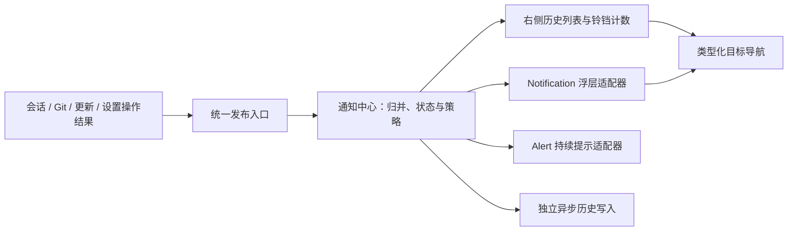

# 通知中心与右侧历史面板评估

评估日期：2026-11-04。依据：当前工作区源码（基准提交 `96f681c`，包含已有未提交修改）、项目锁定的 GPUI Kit 源码及官方文档。第 1–7 节保留实施前的调研与设计依据；实施结果见第 8 节，桌面验收及后续修复见第 9 节。

实施进展（2026-11-05）：应用内通知中心、独立历史文件、铃铛面板、Alert / Notification 适配器和主要业务来源已落地，使用方式见[通知使用说明](usage.md#通知)。下文保留实施前的评估与验收约定；具体实现采用右上角标题栏铃铛、完整本地时间提示、显式标读和类型化跳转；会话跳转同时校验创建时间及已有 CLI 会话标识，工具详情按钮仍位于标签栏。系统桌面通知和屏幕阅读器实机验收仍在首版范围之外。

**建议实施：应用持有统一通知中心，右侧增加铃铛历史面板；使用用户提供的 GPUI Kit Alert 展示即时、持续性提示，首版默认使用 Notification 展示短暂浮层。** 通知中心负责历史、未读、归并、持久化和来源跳转，组件负责呈现。首版覆盖应用内通知，保留系统桌面通知的后续接入位置。

## 1. 现状与改动入口

| 领域 | 当前源码证据 | 对方案的影响 |
| --- | --- | --- |
| 右侧内容 | [state.rs](../src/app/state.rs) 的 `DetailView` 仅有 `Tool`；[dock.rs](../src/app/dock.rs) 的 `render_detail_dock` 内部直接构建工具详情 | 抽出公共侧栏容器，再增加 `Notifications` 内容；工具选中状态与通知筛选状态分别保留 |
| 入口位置 | [sessions.rs](../src/app/sessions.rs) 的 `detail_toggle` 是工具详情按钮；[files.rs](../src/app/files.rs) 的 `document_tab_bar` 将它放在 suffix | 新铃铛需要不依赖活动会话、文件或文档标签的公共入口 |
| 页面与布局 | [shell.rs](../src/app/shell.rs) 的 Git 分支管理分支不渲染会话标签栏，且直接禁止整个右侧 dock；普通宽屏侧栏可拖宽，宽度小于 1100 px 时变为浮层 | 必须同时调整入口和 dock 显示条件，Git 分支管理下也能打开通知；复用当前宽窄屏行为 |
| 一般提示 | [app.rs](../src/app.rs) 的 `message: Option<String>` 以及 [shell.rs](../src/app/shell.rs) 中的红色提示块 | 只有当前一条字符串，无法保留来源、级别或历史；正常提示也可能被画成错误样式 |
| 更新提示 | [update.rs](../src/app/update.rs) 的 `UpdateUi`、`poll_updates`、`update_notice` | 更新状态仍由更新模块持有，只把用户需要知道的状态变化投递到通知中心 |
| 会话事件 | [stream_events.rs](../src/app/stream_events.rs) 的 `poll_streams` 处理审批、完成、失败，并维护 `unread_completed` | 在应用消费事件时形成通知；CLI 协议事件、聊天记录和通知历史保持各自语义 |
| Git / 设置反馈 | [git_ui.rs](../src/app/git_ui.rs) 的 `poll_git_actions`、[git_state.rs](../src/app/git_state.rs) 的反馈状态、[settings/extensions.rs](../src/app/settings/extensions.rs) 的 `feedback` | 逐个迁移有价值的操作结果，保留表单就地反馈和后台任务状态 |
| 保存 | [store.rs](../src/store.rs) 使用 `state.json`；[persistence.rs](../src/persistence.rs) 的 `submit` 克隆整个 Store，异步合并写入 | 通知频繁标读不宜反复复制、写入全部会话；推荐独立的有界历史文件 |
| 主窗口 | [main.rs](../src/main.rs) 调用 `gpui_kit::init` 与 `gpui_kit::open_window`；设置由 [settings.rs](../src/app/settings.rs) 的模态 dialog 展示 | 已有组件 Root 的通知层基础；无需再嵌套 Root。设置打开时不自动关闭模态框或抢焦点 |

这里的“统一通知”是用户可感知的应用反馈，不是 `cx.notify()` 的重绘通知，也不是 CLI / MCP 协议中的 JSON-RPC notification。当前 [插件评估](ui-plugin-extensibility-evaluation.md) 与[阶段设计](plugins/README.md) 仍是拟议方案；通知功能无需等待插件框架实现。

## 2. Alert 与 Notification 的实际适用范围

[Cargo.toml](../Cargo.toml) 与 [Cargo.lock](../Cargo.lock) 锁定 GPUI Kit `11345ec002d9f182a266b5d5dd3a217090700a87`，包版本为 `0.8.0`。官方站点当前默认展示 v0.9.0 文档；本次直接检查了本机 Cargo 缓存中项目锁定提交的源码，以确认实际可用的 API。该版本已有所需组件和 `icons/bell.svg`，不需要为此更新依赖。

| 能力 | 锁定版本核实结果 | 建议用法 |
| --- | --- | --- |
| `Alert` | 支持 Info / Success / Warning / Error、标题、图标、尺寸、`banner()`、`visible()` 与 `on_close` | 统一错误、警告与持续提示的视觉；关闭状态由应用管理 |
| Alert 横幅 | `banner()` 隐藏标题；没有专用的操作按钮 builder | 横幅正文须独立完整；“查看详情 / 重试”等按钮放在外部容器 |
| Alert 无障碍 | 渲染时固定 `Role::Alert`，公开 builder 没有 role 覆盖入口 | 历史记录默认使用普通列表行，复用配色与图标；避免把大量旧记录直接挂成 Alert。实际播报效果仍需 Windows 屏幕阅读器验收 |
| `Notification` | 支持级别、标题、内容、点击、操作按钮、关闭回调及 `id1::<T>(key)` 替换 | 用作应用内浮层；只允许统一适配器调用 `window.push_notification` |
| 浮层时间 | 自动隐藏路径使用 5 秒；`.action(...)` 默认关闭自动隐藏；该版本没有公开的每条任意时长 builder | 首版沿用 5 秒，无需自造计时器；常驻提示单独控制并限制数量 |
| 关闭含义 | `on_close` 同时覆盖自动隐藏、用户关闭、点击和程序移除 | 仅同步浮层消失，不能直接标为已读、删除历史或解决业务问题 |
| 活动通知列表 | `window.notifications` 对应当前组件实体，生命周期跟随浮层 | 不作为历史数据库；应用自行生成稳定 ID 和记录 |
| Root 集成 | kit 的 `open_window` 创建 base Root，component 初始化注册窗口状态与通知层 | 复用现有主窗口初始化流程 |
| 系统渠道 | 锁定版本包含 `NotificationDelivery::System` / `InAppAndSystem` | 能力已存在，但系统权限、打包、失焦策略和激活回跳仍需独立验证，首版默认 `InApp` |

因此，用户提供的 Alert 组件可以直接用于本功能。历史页则建议用普通记录行承载来源、时间、未读点和动作，视觉与 Alert 的级别样式保持一致。这样既能使用现有组件，也能避免静态历史与即时告警的无障碍语义混在一起。

官方 Notification 页面部分示例与锁定版本并不完全一致，例如源码的 `.action(...)` builder 接收三个参数。实施时以锁定提交的签名为准。

### 2.1 Notification 与历史面板的同步约定

用户补充的 [Notification 组件](https://gpui-kit.com/zh-CN/component/notification/) 作为首版默认浮层实现。业务统一发布一次，由通知中心同步更新历史和铃铛计数，再按显示策略交给组件适配器；不要求业务分别调用历史与浮层两个入口。

| 触发 | 通知中心 | Notification 适配器 |
| --- | --- | --- |
| 发布新通知 | 创建稳定 ID，应用归并与未读规则 | 需要浮层时，以应用通知 ID 作为 `id1` 的 key 展示 |
| 同一通知更新 | 更新原记录及 revision | 使用相同 key 替换浮层，不新增另一条历史 |
| 自动消失或点击关闭 | 保留记录和未读状态 | 只结束该浮层的显示 |
| 点击“查看” | 标读并校验绑定目标，通过后导航 | 关闭对应浮层；失效目标在原记录提示 |
| 在历史中标读或清除 | 按历史规则处理；活动问题仍由业务状态维护 | 移除对应浮层，不清空整个窗口的其他通知 |

适配器回调绑定通知 ID 与显示代次，忽略替换前浮层的迟到关闭回调；已清除的记录不能被回调重新创建。恢复历史只刷新列表与铃铛，不重新向组件投递旧浮层。

## 3. 交互方案

### 3.1 铃铛入口与侧栏

- 在工作台右上方设置公共面板操作区，包含工具详情与 `IconName::Bell`；由 shell 组合，避免仅依附 `session_tab_bar`。普通聊天、文件、Diff、Git 分支管理和空工作区都必须可见。
- 铃铛显示未读数，超过 99 显示 `99+`，辅助标签包含完整数量；不依赖颜色表达未读。没有未读时仍可打开历史。
- 同时最多展开一个右侧面板。点击铃铛切到通知；再次点击关闭；切回工具详情时保留原工具选择、滚动位置与侧栏宽度。
- 原 `details` 可先作为侧栏开关，`DetailView` 增加 `Notifications`。`details_open()` 继续只表示工具详情可见，避免工具卡片高亮错误；公共容器单独判断当前视图。
- 将 Git 分支管理时“隐藏全部 dock”改为按视图判断：工具详情按原页面规则隐藏，通知面板始终允许打开。
- 复用现有默认宽度 340 px、最小宽度 260 px、内容区一半的最大宽度和 1100 px 窄窗切换阈值。窄窗浮层须支持关闭及焦点回到铃铛，不遮住窗口控制按钮。
- 设置模态框打开时仍记录通知，允许组件层按既有规则呈现浮层。通知不得自动关闭设置；用户主动执行跳转时，由宿主按现有关闭流程处理。

### 3.2 历史面板

标题为“通知”，提供“全部 / 未读”筛选、“全部标为已读”和“清除已读”。列表按最近更新倒序，每条显示级别图标、标题、简短说明、来源、发生时间、未读点及重复次数；相对时间提供完整本地时间的提示文本。

首版默认展示全应用通知，记录里带工作区 / 会话信息，切换工作区不会隐藏其他工作区的未读。工作区筛选、全文搜索、按来源静音可后续增加。

打开面板不直接把所有历史标为已读。显式点击记录、执行“标为已读”或“全部标为已读”才改变已读状态；批量标读作用于点击时存在的全部记录，新到记录仍保持未读。关闭浮层、读过记录、业务问题已解决是三个独立状态。

“清除已读”只删除已读且非活动问题的历史；单条删除采用同样规则。保存故障、待审批等活动问题的提示由业务状态决定，不能靠删除历史解除。空状态说明当前没有通知；重启恢复记录时不重新弹出旧浮层。

点击“查看会话 / 查看工作区 / 打开设置”使用发布时绑定的稳定目标。先验证目标是否仍存在，再执行导航；目标失效时原记录显示“目标已不存在”，不触发会话创建，也不跳到当前恰好选中的工作区。

### 3.3 哪些事件进入中心

| 场景 | 历史与提醒建议 | 迁移规则 |
| --- | --- | --- |
| 后台会话完成 | 一条成功记录；后台或未显示该会话时可弹浮层 | 绑定 workspace、session、run；前台正常回答完成默认保持安静 |
| 会话失败 / 启动失败 | 一条失败摘要；不在对应上下文时弹浮层 | 与聊天内错误共享关联标识；不把完整对话、工具输出复制进历史 |
| 等待审批 / 用户输入 | 一条活动通知；提供“查看会话” | 同一请求归并；处理或取消时解决活动记录；历史按钮不直接批准或重放请求 |
| 用户主动取消任务 | 默认保留原就地状态 | 不制造错误浮层；若先前存在活动通知则更新它 |
| Git 提交、推送、分支操作结果 | 有意义的成功 / 失败入历史，必要时弹浮层 | 使用操作提交时的仓库路径，不读取完成时的 selected workspace |
| CLI / MCP 连接测试、Skill 导入 | 用户发起的结果入历史；表单就地显示详细结果 | 后台轮询、自动扫描的重复成功不逐条发布 |
| 新版本、更新准备完成、更新失败 | 更新同一版本对应的记录；失败按需提醒 | 下载百分比、检查中不持续新增记录；进度保留在更新模块 |
| 状态文件损坏、保存失败 | 活动错误记录 + 持续 Alert；恢复后更新为已解决 | 避免每次 poll / 每次重试新增；历史写入错误不能递归触发自身写入 |
| 空输入、缺少工作区、文件选择无效 | 保留表单 / 输入区反馈，可统一 Alert 视觉 | 不把所有 `message = ...` 机械迁移到历史 |
| Token、工具 delta、常规自动刷新、复制成功 | 不进入历史，必要时使用原本的轻量就地反馈 | 不订阅高频流作为通知来源 |

该分级参考 VS Code 官方通知指南：优先显示与用户相关、可采取动作的信息，限制提示噪声。它是本方案的交互参考，不代表 Conduit 已采用同样的行为。

## 4. 统一入口与数据模型



建议新增 `src/notifications.rs` 管理纯数据与规则，`src/app/notifications.rs` 管理 GPUI 显示和操作绑定；由应用统一持有中心。侧栏列表可以使用独立 Entity，仅在通知 revision 改变时更新，避免每个聊天 token 都重建历史列表。

首版沿用各模块现有后台任务和结果队列：结果回到 UI 线程并通过上下文校验后，再调用统一入口，不额外建设一套跨线程事件总线。业务模块不持有 Alert / Notification 实体，不直接调用组件浮层 API；后续插件或其他线程需要发送时再增加受控的 sender 适配器。

以下为拟议接口，不是已存在 API，也不是可直接编译的补丁：

```rust
// 业务通过应用持有的服务发布；不要求调用者持有 Window。
fn publish_notification(&mut self, request: NotifyRequest) -> NotificationId;
fn update_notification(&mut self, id: NotificationId, patch: NotificationPatch);
fn resolve_notification(&mut self, key: &NotificationKey);

// 显示适配器在现有 UI 调度中消费效果，统一接触 WindowExt。
fn poll_notifications(&mut self, window: &mut Window, cx: &mut Context<Self>);
```

`publish` 返回应用生成的稳定 ID，先更新中心，再排队显示效果。渲染函数只读取状态，禁止在 `render` 中发布或写文件。`poll_notifications` 还需覆盖启动与退出阶段：启动可先记录，首帧可用后再展示必要的新提示；退出时停止新的浮层投递。

| 字段 | 建议语义 |
| --- | --- |
| `id` | 独立递增的通知 ID，随历史保存 `next_id`；不复用 session ID 或组件 `TypeId` |
| `level` | Info / Success / Warning / Error，与显示渠道独立 |
| `source` | Session / Git / Update / Settings / Persistence / App 等稳定枚举 |
| `title`、`message` | 用户可读摘要；首版两者合计最多 4 KiB，按 UTF-8 边界截断展示文本，key 与跳转目标不随正文截断 |
| `created_at`、`updated_at` | UTC 时间戳，显示时转本地时间 |
| `read_at` | 是否已读；不会被浮层自动消失修改 |
| `lifecycle` | Recorded / Active / Resolved；普通操作结果为 Recorded，需要跟踪的活动问题可被解决 |
| `key`、`event_id`、`occurrences` | key 标识同一问题或操作，event_id 做投递幂等；次数只统计新的真实发生，不统计重绘或进度刷新 |
| `target` | 类型化的会话、工作区或设置目标；使用发布时的绝对工作区路径、session ID 与可选 message key |
| `presentation` | HistoryOnly / ToastAndHistory / BannerAndHistory 等策略，不由级别直接决定 |

历史只保存可序列化内容和类型化目标，不保存闭包、GPUI Entity、原始命令或密钥。业务模块把错误转成面向用户的摘要后发布；展开更多详情时优先跳转到原有上下文。

归并规则应明确区分三类变化：

1. **同一次事件再次投递**：相同 event_id 完全幂等，不重复计数或再弹浮层。
2. **同一任务的状态变化**：相同 key 更新记录，下载进度不会增加次数或反复变为未读；完成、失败等用户需要知道的实质变化可以重新标为未读。
3. **新的失败或新一轮操作**：新的操作 / run 身份产生新记录；持续性故障在同一故障周期内归并，恢复后再次失败开启新周期。避免仅凭错误字符串合并不同仓库的问题。

建议同屏最多 3 个浮层，短时间突发超过显示额度时合并为“还有 N 条通知，查看通知中心”，符合策略的原始记录仍进入有界历史。历史的已读、清除和归并由中心完成；组件 `id1` 只负责对应浮层的替换。

`session_control.unread_completed` 继续表达会话自身的未查看状态。通知标读不顺带清除会话状态；只有真正打开会话，才通过既有导航逻辑处理该状态，避免两个徽标互相误清。

## 5. 持久化与恢复

建议新增 `Store::path().with_file_name("notifications.json")`，继承 `CONDUIT_DATA_DIR`，采用独立 schema version、后台写入和临时文件原子替换；不复用目前只能写整个 Store 的 `Persistence::submit`，也不为通知首版引入数据库。

| 选择 | 收益 | 代价 / 判断 |
| --- | --- | --- |
| 放进 Store / state.json | 字段兼容可用 serde default，复用现有保存通道 | 标读、删除会触发整份 Store 快照及保存；通知错误与主存储错误耦合，不建议作为正式首版 |
| 独立有界 JSON 文件 | 历史与会话隔离，容量小，重启可恢复；无需新运行时依赖 | 需要独立写入确认、合并与错误处理；推荐 |
| SQLite / 无界追加日志 | 方便大量检索及长期查询 | 当前有限历史没有此需求；数据库依赖存在不等于已有通知存储，可后续按真实规模评估 |

建议初始保留最多 200 条、最多 30 天，任一阈值到达即清理；优先淘汰已读且非活动记录，达到硬上限后仍需淘汰最旧历史，不能无界增长。当前仍有效的故障 / 待处理状态由业务与活动提示状态维护，即使相应旧历史被淘汰，也不能解除持续提示。历史不是审计日志，不承诺永久保留全部事件。

写入可合并约 500 ms 内的变化，正常退出做有期限的异步收尾；崩溃时可能丢失尚未确认的少量通知，不能宣称每条已持久化。不要把通知保存成功与否纳入聊天发送或更新安装的必要条件。

恢复时加载历史、已读与计数，不重放 Toast 或历史动作。Active 记录需与当前业务状态重新核对；进程退出前的审批不得在重启后继续执行，可显示“原请求已结束”并保留来源跳转。

异常规则：文件缺失视为空历史；损坏或不支持的 schema 保留原文件，切换内存历史并提供一次诊断，不以空列表覆盖。只读模式继续显示、可在内存标读，但不写盘。历史写入失败只更新内存诊断状态，禁止通过“发布通知 → 保存失败 → 再发布”形成循环；恢复后再合并持久化。

独立文件需要明确单写者：同一数据目录的通知写入锁未取得时，本进程使用内存历史，不能让多个进程共享固定临时文件并互相覆盖。恢复缺失、损坏、只读与写锁冲突均需使用隔离测试目录验证。

## 6. 实施拆分与验收

| 阶段 | 主要改动 | 完成条件 | 估算 |
| --- | --- | --- | --- |
| A：中心与历史 | 新增纯数据中心、规则、独立持久化与恢复 | 幂等、归并、未读、容量、文件故障行为可测 | 1.5–2 人日 |
| B：入口与面板 | `state.rs`、`sessions.rs`、`files.rs`、`dock.rs`、`shell.rs` 和通知视图 | 铃铛、计数、列表、跳转、宽窄屏；Git 分支页可用；不抢焦点 | 1–1.5 人日 |
| C：显示与来源接入 | Alert / Notification 适配器；会话、Git、更新、保存故障、设置显式操作 | 所有约定来源走统一入口；原有业务状态和就地校验正常 | 1.5–2.5 人日 |
| D：回归与体验 | GPUI 测试、异常恢复、主题与无障碍检查 | 下列关键场景通过，更新使用文档 | 1–2 人日 |

合计约 **5–8 人日**，以熟悉该项目的单人实施估算，未通过原型验证；复杂的页面焦点、通知读屏行为或来源迁移可能增加时间。现有未提交改动较多，应按模块合并并重新核对行号和布局。首版不依赖插件平台，也不包含系统通知、全文检索或复杂订阅设置。

关键验收：

- 同一完成事件重复到达只保留一条；不同仓库、不同 run 的同文案失败不会被错误合并。进度更新不增加未读或浮层数量。
- 后台会话完成后铃铛更新，输入框焦点和当前会话不变；点击目标再按既有逻辑导航。
- 审批结束、会话删除、工作区删除、更新版本变化后，历史操作正确失效，不执行过期动作。
- Toast 自动消失、手动关闭、程序替换都不删除历史或误标已读；活动错误读过后仍可持续提示。
- 点击“全部标为已读”后再到达的记录保持未读；“清除已读”不会解除未解决的业务状态。
- 普通聊天、文件、Diff、Git 分支管理、空工作区与设置 dialog 期间均可接收通知；宽窄窗切换、工具侧栏切换和关闭焦点正常。
- 重启保留历史与未读，不重弹旧消息；容量 / 过期清理、损坏文件、写盘失败和只读模式不影响聊天存储。
- 多条通知突发仍可输入和滚动，隐藏面板不跟随 token 刷新；历史中的旧记录不导致连续告警播报。此项需要实际 UI 与读屏验证。

实施后的检查沿用 [CONTRIBUTING.md](../CONTRIBUTING.md)：`cargo fmt --all --check`、`cargo clippy --locked --all-targets -- -D warnings`、`cargo test --locked -- --test-threads=1`，再运行通知相关的 `ui-tests` 筛选。纯规则测试重点覆盖状态语义与故障，不为静态图标添加镜像实现测试。

## 7. 调研来源与本次验证范围

- 用户提供的 [GPUI Kit Alert 官方文档](https://gpui-kit.com/zh-CN/component/alert/)：组件用途与展示能力。
- 用户补充的 [GPUI Kit Notification 官方文档](https://gpui-kit.com/zh-CN/component/notification/)：浮层入口与交互能力；API 以锁定源码为准。
- [GPUI Kit 锁定提交](https://github.com/longbridge/gpui-kit/tree/11345ec002d9f182a266b5d5dd3a217090700a87)：本机缓存直接核对组件 API 与图标。
- [VS Code 官方通知交互指南](https://code.visualstudio.com/api/ux-guidelines/notifications)：通知相关性、操作性与减少干扰。
- 仓库证据见第 1 节及各段文件链接；现有插件文档仅用于兼容方向，不作为已实现能力。

调研阶段仅新增评估并更新文档索引，验证范围为源码 / API 核对、文档引用与差异检查。之后实施与桌面预验的结果分别记录于以下两节。

## 8. 实施验证（2026-11-05）

- `cargo fmt --all --check` 与 `git diff --check` 通过。
- `cargo clippy --offline --locked --all-targets --features ui-tests -- -D warnings` 通过。
- `cargo test --offline --locked --features ui-tests --bin conduit notifications:: -- --test-threads=1`：14 项通过，包含 6 项 GPUI 界面测试和 8 项规则 / 存储测试。
- `cargo test --offline --locked --features ui-tests --bin conduit app:: -- --test-threads=1`：154 项通过。此前文件预览回归的失败在当前工作区复测通过。
- 常规全量测试中，主程序 286 项通过、16 项按配置忽略，更新库 9 项通过；随后更新助手测试可执行文件因 Windows 错误 740（需要提升）未能启动，因此不将该命令记录为整体通过。

验证覆盖通知不抢焦点、浮层自动消失后的未读保留、宽窄布局和 Git 分支页面、设置模态框共存、来源删除及会话编号重用、持续故障恢复、历史损坏保留和多进程写锁。没有进行系统桌面通知或屏幕阅读器实机验收。

实际业务入口为 `ConduitApp::notify_user(Notice, cx) -> u64`；该入口无需 `Window`，返回稳定记录 ID。`Notice::new(source, level, title, message)` 默认请求浮层，可通过 `.presentation(Presentation::History)` 仅留历史，或 `.active().presentation(Presentation::Banner)` 表达需要持续显示的问题。`.target(...)` 绑定会话 / 工作区 / 设置 / 更新入口；会话目标使用 `session_notice_target` 获取，避免手动拼接身份。`.key(key, event)` 分别提供归并键与一次事件的身份；业务问题解决时调用 `resolve_notification(&key, cx)`，不能用关闭浮层、标读或删除历史代替解决。后台结果应先回到现有 UI 调度、通过业务上下文检查后再发布。

## 9. 桌面预验与可访问性修复（2026-11-05）

使用 [通知验收脚本](../scripts/notification-acceptance.ps1) 生成独立的合成工作区及通知历史，实际启动 Debug 程序，由 Windows UI Automation 调用按钮、`PrintWindow` 截图并逐张目检。每个场景通过正常关窗退出，再读取落盘 JSON 核对状态；重新启动场景复用同一隔离目录。数据与截图均位于 `target/notification-acceptance/<时间与随机标识>/`，不使用日常应用数据，也不运行真实模型任务。

本轮发现 GPUI 锁定版本的视图缓存会重放绘制与输入处理器，但不保留可访问性子树：面板视觉正常，后续帧中 UI Automation 只能找到铃铛与关闭按钮，无法找到筛选及记录操作。通知视图现在在 `window.is_a11y_active()` 时使用普通 Entity 渲染，其余情况下仍复用缓存。历史提供 `List` / `ListItem` 语义，正文、来源、空状态和失效目标提示使用普通文本节点，时间按钮具有完整日期与时区名称；普通历史不使用 `Alert`，避免作为实时告警重复播报。历史损坏提示继续使用组件 `Alert`，其外围语义组补充可访问名称，解决该版本组件在 Windows 中正文可见却没有可读名称的问题。

复现方式：

```powershell
cargo build --offline --locked --bin conduit
powershell -NoProfile -ExecutionPolicy Bypass -File scripts/notification-acceptance.ps1
# 也可单独执行一个场景，例如：
powershell -NoProfile -ExecutionPolicy Bypass -File scripts/notification-acceptance.ps1 -Case restart
```

脚本覆盖宽窗、窄窗、浅色主题、连续英文与中文长文本、空工作区、来源会话跳转、来源失效、标读后重启与清除、损坏历史保护。窄窗请求 850×500，在本机实际获得含非客户区的 866×508 外框，截图和元数据记录实际尺寸。

本轮完整运行 **9 组场景通过，共 11 次正常启动与退出**，证据位于 `target/notification-acceptance/20261105-011442-0cf0d8ed/out/`：

| 场景 | 结果与核对点 |
| --- | --- |
| 宽窗 / 窄窗 / 浅色主题 | 通过；铃铛、筛选、记录按钮均可访问；打开历史不标读 |
| 长文本 | 通过；连续英文和中文换行，没有横向越出面板；滚轮可到达长记录下方的操作按钮 |
| 空工作区 | 通过；仍能打开面板，显示并可访问“暂无通知” |
| 来源跳转 | 通过；从当前会话切到绑定的另一个会话，只将对应记录标读 |
| 失效来源 | 通过；显示可访问的“目标已不存在”，未创建会话 |
| 标读 / 重启 / 清除 | 通过；正常关窗落盘，重启后筛选为空，清除结果再次落盘 |
| 损坏文件 | 通过；提示可见且可访问，正常退出后原损坏文件逐字节保留 |

`cargo build --offline --locked --bin conduit` 与全仓库格式检查通过；带 `ui-tests` 的全目标 Clippy 在本轮曾复测通过，但随后工作区并行改动后的最终检查未通过（见下）。通知源码格式、差异空白与两个 PowerShell 脚本的语法检查通过。最终通知专项测试 **14 项通过**。复测期间并行新增的会话正文测试因通配导入了 GPUI 的 `test` 宏，发生递归展开；仅将 `src/app/transcripts/tests.rs` 改为显式导入后恢复编译，未改变测试逻辑。损坏文件场景额外使用 SHA-256 比对退出前后的文件，复测通过。

最终全目标 Clippy 在并行插件接入改动中报错：`src/app/plugin_ui.rs:56` 的渲染函数指针要求 `&ConduitApp`，侧栏渲染需要 `&mut ConduitApp`；`src/app/files.rs:756`、`:758` 的文件树渲染也出现不可变引用下的可变借用错误。以上属于当前共享工作区的集成待处理项，未修改这些并行改动；桌面预验使用本轮已成功构建的程序，不能将其视为最终工作区全量编译通过。

导入修复后的会话正文测试额外运行了 5 项，其中 4 项通过，`missing_body_has_error_retry_and_blocks_send_without_looking_empty` 在 `errors.contains_key(&2)` 断言失败。这是当前并行会话正文工作中的待处理项，本轮没有改动其业务行为，也不将全仓库测试记为通过。

共用 [UI 验收脚本](../scripts/ui-acceptance.ps1) 新增 `-CloseNormally`，关闭超时或异常退出会使验收失败；按钮查找优先精确名称，避免“未读”误命中铃铛。截图日志包含列表项等语义节点，能够发现此次缓存回归。该自动预验仍不等同于屏幕阅读器、真实中文输入法、多屏或不同 DPI 的人工验收；本轮也未接入系统桌面通知。

## 10. 续做记录（2026-11-05）

今天暂停。通知中心首版与隔离数据桌面预验已完成；明天（2026-11-06）从**当前共享工作区**继续，不要重做已通过的 9 组 UI 场景或通知专项测试，除非相关代码再次变更。

续做顺序：

1. 先查看最新 `git status` 与相关 diff，识别其他并行改动；保留他人未提交内容。
2. 处理 / 协调当前全仓库集成阻塞：插件导航渲染函数签名不匹配（`src/app/plugin_ui.rs:56`），以及 `src/app/files.rs:756`、`:758` 文件树在不可变 `self` 下执行可变加载。
3. 复核 `src/app/transcripts/tests.rs` 正在进行的正文缓存改动。通配导入导致 GPUI `test` 宏递归的问题已通过显式导入规避；目前 5 项中 4 项通过，`missing_body_has_error_retry_and_blocks_send_without_looking_empty` 仍在 `errors.contains_key(&2)` 断言失败。
4. 集成阻塞解除后，重跑 `cargo fmt --all --check`、`cargo clippy --offline --locked --all-targets --features ui-tests -- -D warnings`、通知专项 14 项和 `app::` 测试；若未改通知实现，无需再次跑完整桌面场景。
5. 保留剩余人工验收项：真实屏幕阅读器、IME 输入焦点、多 DPI / 多屏。系统桌面推送属于首版之外，不要默认扩大本次范围。

本轮本地新增 / 修改的交付文件为 `src/app/notifications.rs`、`src/app/transcripts/tests.rs`、`scripts/notification-acceptance.ps1`、`scripts/ui-acceptance.ps1` 与本文；仓库内还有多项并行未提交文件，修改归属需以明天的最新 diff 为准。隔离验收截图和数据在 `target/notification-acceptance/20261105-011442-0cf0d8ed/out/`，不需要纳入版本控制。
