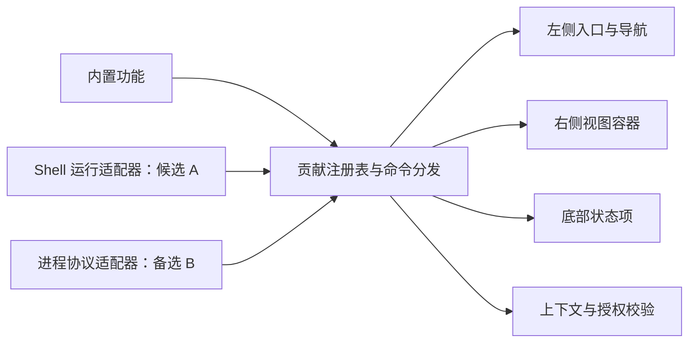

# 工作台插件分阶段设计

最新进度：[G5 独立重跑](p2-g5-rerun-2026-11-06.md)完成 dev / release 共 66 个测量进程、120 次启停、3 项资源探针及各 48 项桌面回归，全部检查通过；历史普通路径超时本次未复现，仍未定位。release 长会话开销继续超出参考预算，G5 生产准入与 P3 状态不变。

前序进度：[G5 命令绘制修复与故障诊断](p2-command-diagnostics-2026-11-06.md)新增逐阶段 JSONL 和真实测试根绘制计数，修复成功命令结果收尾的无条件宿主重绘，保留错误状态变化的反馈。普通路径截止时间故障继续追踪；生产准入和 P3 状态不变。

前序进度：[G5 分项测量](p2-breakdown-probe-2026-11-06.md)已接入独立 `--phase breakdown`，修正 GPUI 测试自动绘制混入 dispatch 的计时边界。同源码、同工具链的 dev / release 各完成 9 个进程、2,700 个稳态分项样本和 9 次首次打开，45 项常规回归分别通过，Python 校验 18 项通过。简单命令同步分发约 0.3ms，主要耗时位于更新副作用与绘制；一次 dev 截止时间故障已保留，复测成功但原因未定位。下一步定位该故障并区分重复绘制和长会话布局成本；G5 生产准入仍未通过。

前序进度：[release 界面回归适配](p2-release-ui-regression-2026-11-06.md)解决 18 项 release 失败；[G5 stress 测量](p2-stress-probe-2026-11-06.md)已有长会话、20 包注册、3 个活动 VM、故障隔离与启停内存曲线，dev / release 各完成 18 个 stress 进程并通过常规回归，历史报告保持不变。[G4 输入、焦点与主题回归](p2-input-focus-2026-11-05.md)已有自动化交互验证，真实 Windows IME 和原生视觉验收仍受连接不可用阻塞。

设计版本：0.13；日期：2026-11-05；状态：P1-1 至 P1-5 原生贡献已接入，G2/G5 宿主控制、G1 Fast 兼容、G3 定向命令及 G6 浮层清理已有候选补丁，P2-A 开发加载器已接入真实桌面验证入口；Shell 生产准入和 P2 后端决策仍未完成。本文将[扩展性评估](../ui-plugin-extensibility-evaluation.md)细化为三个阶段，并纳入 [GPUI Shell 复用评估](gpui-shell-reuse-assessment.md)。已实现部分以对应进度记录为准，其余接口、模块和协议仍为拟议设计；上游已有能力与尚未打通的公开接口在复用评估中分别列出。

**当前建议：P1 建立统一贡献机制；Shell 已完成清单绑定、开发快照加载、资源控制、定向命令、真实桌面开发接入和浮层清理，下一步完成 G4 输入与焦点、G5 性能及其余生产准入；P3 完成安装管理。** 不把两套外部运行时同时实现作为首版要求。

可运行工程见 [Shell 原型](../../tools/shell-prototype/README.md)，实际构建、测试与 G1–G6 结论见[原型验证记录](shell-prototype-validation.md)。G2 / G5 的公开宿主控制补丁、验证和下一步契约见[本轮进度](p2-host-controls-2026-11-05.md)。常规测试通过不等于所有准入条件通过；Fast 原型全目标类型检查已通过；完整应用资源边界、Fast 成品运行及正式集成仍需验收。

最新实现见 [G6 浮层所有权与停止清理](p2-overlay-cleanup-2026-11-05.md)：按运行时撤销 dialog / sheet / toast / HUD / tooltip，保留其他插件及宿主浮层，修复焦点恢复链，并接入停用、关闭和更新准备的同步清理。前序的[真实桌面开发接入](p2-desktop-integration-2026-11-05.md)使用独立验证二进制与实验 lockfile，正式发布依赖尚未启用。前序契约见 [G3 定向命令与统一停止](p2-targeted-commands-2026-11-05.md) 和 [P2-A 开发加载适配器](p2-development-loader-2026-11-05.md)。下一步为真实 IME / 浮层焦点和 G5 性能测量；未来插件存储写入屏障仍待实现。

P1 当前进度：身份、原子注册、命令校验、上下文和选择回退已实现为 `conduit::plugins`，见 [P1-1 实现记录](p1-registry-validation.md)。左侧导航已通过注册表生成入口和分发动作，补齐了滚动溢出菜单与 UI 集成测试，见 [P1-2 进度与验证](p1-2-progress-2026-11-05.md)。右侧工具详情与通知已接入通用容器，见 [P1-3 进度与验证](p1-3-progress-2026-11-05.md)。底栏、统一命令与三处联动示例已接入，见 [P1-4 进度与验证](p1-4-progress-2026-11-05.md)。通用有界缓存、异步结果校验、独立摘要视图与原生清理已实现，见 [P1-5 进度与验收](p1-5-progress-2026-11-05.md)。后续继续 P2 开发适配与后端决策；原生贡献自动化验收不等于 Shell G1–G6 全部通过。

| 阶段 | 设计文档 | 可交付结果 | 前置条件 | 预算状态 |
| --- | --- | --- | --- | --- |
| P1 | [界面贡献与内置适配](phase-1-contributions.md) | 三处共用注册表、内置示例及 Shell 选型记录 | 现有行为回归基线 | 原贡献改造 6–10 人日；另列复用验证 2–3 人日时间盒 |
| P2-A | [Shell 插件运行时](phase-2-shell-runtime.md) | 本地 JS 贡献原生视图，复用 Shell 执行与宿主模块机制 | 复用评估 G1–G6 通过 | 依照原型缺口重估，仍为候选 |
| P2-B | [独立进程运行时备选](phase-2-local-runtime.md) | 本地可执行程序、stdio 协议、有限原生模板 | P1 完成且选择进程路线 | 原估算 10–16 人日 |
| P3 | [安装管理、存储与发布验收](phase-3-management.md) | 安装、信任、启停、升级回退、保存与开发文档 | 已选择的 P2 后端及完整清理屏障 | 原进程路线 5–8 人日；Shell 路线重估 |

P2-A / P2-B 是同一阶段的互斥方案。原 21–34 人日总计只适用于进程路线，不含新增 Shell 验证，也不代表 Shell 路线预算。工期估算和正式应用性能目标仍未验收；原型结果不代表生产 SLO。公开市场、自动在线更新、WebView、WASM、操作系统沙箱、任意停靠与主编辑区扩展不在本轮范围。

## 共同范围与约定

左侧扩展包括图标入口及关联导航页；右侧沿用现有侧边栏与窄屏浮层，一次展示一个视图；底部仍属于中间内容区，开放左右状态项。数据作用域与物理位置分别定义。Shell Dock 的 bottom 面板不等同本需求的底部工具栏。

外部插件首版只接受用户明确信任的本地包。宿主 `writable = false` 时禁止外部激活并停止已有实例；这与 CLI 会话 `PermissionLevel` 不同。Shell 的进程内能力限制与可执行插件的宿主 API 权限也不同，应使用对应后端的信任说明，不能统一声称提供操作系统沙箱。

| 共同决策 | 具体约定 | 负责文档 |
| --- | --- | --- |
| 扩展身份 | PluginId、ViewId、CommandId、ActivityItemId、StatusItemId 独立；贡献 ID 以 pluginId 加点为前缀 | P1 / 所选 P2 |
| 内置命名空间 | `conduit.*` 仅由宿主内部注册；示例为 `example.workspace-overview` | P1 |
| 注册与执行分离 | 安装、发现、启用、恢复布局只读取声明；首次显式打开或执行才激活 | 所选 P2 / P3 |
| 原生绘制 | 外框和状态项由宿主控制；Shell 通过 ScriptView 提供内容，进程路线通过有限模板提供内容 | P1 / 所选 P2 |
| 命令边界 | 执行时验证 owner、作用域、上下文、授权和业务条件；保留用户动作与后台更新区分 | P1 / 所选 P2 |
| 工作区身份 | 内部 WorkspaceKey 使用规范化绝对根路径身份；对外提供不含路径的稳定字符串 | P1 |
| 视图作用域 | global、workspace、session；路径变化视为新工作区，v1 不承诺目录迁移跟随 | P1 |
| 公开版本 | Conduit 清单、宿主 API、运行后端版本分别管理；JSON-RPC protocolVersion 仅属 P2-B | 所选 P2 / P3 |
| 布局持久化 | `UiSettings.plugin_layout` 只保存隐藏、排序、选中视图及宽度，字段有默认值 | P3 |
| 安装持久化 | `plugins/registry.json` 是版本、启用和授权的唯一持久化来源 | P3 |
| 插件数据 | 宿主按插件 / 工作区管理数据与版本代次；Shell 首版关闭独立 localStorage | P2-A / P3 |

工作区身份沿用宿主路径语义，不简单将完整路径转小写，不在 render 中同步访问文件系统。工作区重排、会话和文件标签切换不改变同一工作区 ID。只有会话确属当前工作区时才提供会话上下文，否则为 null；当前文档与当前会话分开保存。

`contextVersion` 在工作区、会话、活动文档或可写状态切换时递增；主题和摘要使用另一个数据修订号。`generation` 表示每次外部运行实例的代次，进程与脚本都适用。异步结果须同时匹配 generation、contextVersion 和 ViewInstanceKey，不能因新上下文到来而更新旧实例。

## 实现分层

图中的 A / B 在选型后只实现一个。`src/plugins/` 的贡献、身份、授权、安装和存储模型保持纯数据；ShellRuntime / ScriptView 等 GPUI 对象已由 `src/app/plugin_ui/plugin_shell.rs` 适配。`plugin_ui.rs` 管理 UI 接入，进程路线的 `plugin_views.rs` 才承担自定义模板渲染。外部脚本或进程均不能直接取得 ConduitApp / Window 引用。

“工作区概览”始终贯通三处：左侧摘要、右侧详情、底栏打开动作，只读取宿主已有工作区及会话元数据。P1 与所选 P2 示例使用同一 PluginId，互斥登记；不能以两份不同插件绕过同插件多实例和命令路由验证。

## 当前代码接入依据

| 现有位置 | 当前职责 | 接入要求 |
| --- | --- | --- |
| [files.rs](../../src/app/files.rs)、[sidebar.rs](../../src/app/sidebar.rs) | 固定导航与导航缓存 | 提取视图身份；保留文件 / Git 业务对象 |
| [dock.rs](../../src/app/dock.rs)、[tool_details.rs](../../src/app/tool_details.rs) | 通用右侧容器与独立工具内容，已接入 Registry | 保留布局和工具原生业务状态；通用实例缓存见 P1-5 |
| [toolbar.rs](../../src/app/toolbar.rs)、[shell.rs](../../src/app/shell.rs) | 状态栏与三列布局 | 保持中间底栏、限宽与窄屏浮层 |
| [main.rs](../../src/main.rs) | Kit 初始化和组件窗口根 | Shell 桌面验证入口已组合组件 Root / ShellRoot |
| [app.rs](../../src/app.rs)、[runtime.rs](../../src/app/runtime.rs) | 实体、轮询和退出 | 已接原生和 Shell 实例停止及按运行时撤销浮层 |
| [update.rs](../../src/app/update.rs) | 更新空闲判定与安装准备 | 开发入口已验证更新前停止 Shell；插件写入屏障仍待 P2 |
| [child.rs](../../src/child.rs)、[event_queue.rs](../../src/event_queue.rs) | CLI 进程及有界队列 | 仅 P2-B 借鉴进程与队列；不改现有 CLI 环境语义 |
| [store.rs](../../src/store.rs)、[persistence.rs](../../src/persistence.rs) | 数据目录与后台保存 | 布局、安装及数据代次分开 |
| [settings/navigation.rs](../../src/app/settings/navigation.rs) | 设置页身份与顺序 | 增加应用插件，不改变 Skills / MCP 页身份 |

源码包含已有未提交修改，实施时按符号复查行为与测试，不机械使用旧行号。Shell 不需要接管整个工作台；当前任务也不要求把宿主应用改写成 JavaScript。

## 阶段推进与完成定义

1. P1 贡献改造可独立完成并用于内部功能。复用验证要记录 G1–G6 的事实、实测、未覆盖项和需要的上游改动；尚未验证不等于通过。
2. P2 开始前选定一个后端并冻结对应契约。Shell 优先验证；接口或资源缺口未解决时，保留进程备选。停止、异常和退出不能推迟到 P3。
3. P3 实现安装与持久化闭环。Conduit 自有 API 可按验收结果版本化，但不能因此声称上游实验脚本 API 已稳定；SDK 必须记录已测试 Shell rev。
4. [贡献指南](../../CONTRIBUTING.md)要求的格式、Clippy、测试及相关 UI 回归在实现时执行。Shell 原型、注册层及三处 UI 接入的实际检查分别记录在各自验证文档中；这些结果不代表正式外部运行时或生产性能目标已验收。

界面身份以 P1 为准；运行细节以选定的 P2 为准；安装与持久化以 P3 为准。初始评估与 P2-B 的历史协议不覆盖 P2-A。后续变更应同步更新本总览和受影响阶段。
