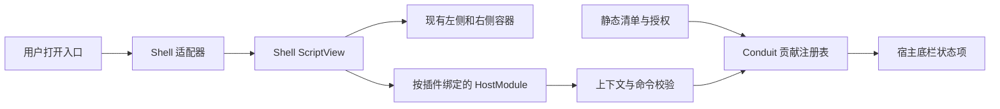

# P2-A：GPUI Shell 插件运行时候选设计

设计版本：0.3；日期：2026-11-05；状态：独立原型已实现，生产接入仍为候选。前置：[P1 界面贡献](phase-1-contributions.md)、[共同约定](README.md)与[Shell 复用评估](gpui-shell-reuse-assessment.md)。本文定义采用 Shell 时的目标和准入条件；其中 Conduit 类型、清单和 API 均为拟议接口。上游缺失的接口必须先通过原型或明确补丁解决。

## 选择条件与交付

只有复用评估 G1–G6 全部有验证结果，且构建、隔离、三处交互、退出与性能条件通过，才选择本方案。否则保留 P1 的贡献机制，评审上游补丁成本或选择 [P2-B 独立进程](phase-2-local-runtime.md)。两份 P2 互斥，不要求同时实现。

选用后，插件由本地 JavaScript 文件交付，视图通过 Shell 构建原生 GPUI 元素；Conduit 提供功能入口、右侧容器、底栏状态项和有权限边界的宿主模块。安装及启用只读取清单，用户首次打开入口或执行命令才加载代码。P3 提供普通用户安装流程，本阶段只提供显式开发加载。

界面首版允许脚本组合原生内容，不沿用进程方案仅有 list / keyValue / markdown 三种模板的限制。宿主仍约束外框、图标、状态项、可见作用域和调用权限。任意顶层窗口、整窗 Dock 替换、文件 / 网络 / 子进程访问、动态远程依赖和自动运行不在本阶段范围。

## 依赖与最小原型

第一轮原型已位于 [tools/shell-prototype](../../tools/shell-prototype/README.md)，使用 Conduit 固定 Git rev、独立 workspace 与 lockfile。下列依赖已在原型默认后端中编译；实际 manifest 还包含同提交的 `rquickjs` patch，并锁回兼容的 RSA / PKCS1 版本。具体构建范围与 G1–G6 缺口见[验证记录](shell-prototype-validation.md)，不等于已纳入正式应用。

```toml
# 原型依赖；完整 patch / feature / lockfile 见原型工程。
gpui-shell = { git = "https://github.com/longbridge/gpui-kit.git", rev = "11345ec002d9f182a266b5d5dd3a217090700a87", default-features = false, features = ["quickjs", "components"] }
```

Conduit 现有 `gpui-fast` 开关需同时传给 Shell，避免 GPUI Entity / Window 类型来自不同后端。默认路径和 Fast 路径各自构建验证；Windows debug 与 release 均须记录结果。原型以新增最小集成入口进行，不改写整个产品布局；缺少公开 API 时记录需要上游增加的接口，不复制私有引擎实现进入 Conduit。

至少验证如下端到端流程：点击左侧入口 → 首次加载脚本 → 获取经过过滤的工作区摘要 → 左侧页与右侧页同时可见 → 底栏命令只作用于正确插件和当前工作区 → 停用清空视图与异步任务 → 应用关闭完成。仅运行官方 standalone 示例不满足该条件。

## 两份清单与静态贡献

Shell 的 `gpui-shell.json` 是身份、入口及系统能力请求的唯一来源。Conduit 增加拟议 `conduit-plugin.json`，只存宿主 API 兼容、三处贡献、业务权限和激活声明，不能复制另一份插件 ID / 版本 / Shell 系统权限。两份文件一起纳入包摘要，任意一份不合法都拒绝登记。

Shell 文件示例按锁定源码字段编写，**不是可以直接安装到当前 Conduit 的插件**：

```json
{
  "id": "example.workspace-overview",
  "name": "工作区概览",
  "version": "0.1.0",
  "shell-version": "0.8.0",
  "entry": "main.js",
  "capabilities": {
    "storage": false
  }
}
```

此处 `shell-version` 为 Shell 的最低兼容版本字段，与 Conduit API 的 semver 范围不同。M0 的最低版本声明不能单独证明未来 Shell 版本兼容；宿主还要记录经验证的精确运行时提交及自身兼容范围。

| Conduit 清单内容 | 约定 |
| --- | --- |
| `schemaVersion` / `hostApi` | 拟议 Conduit 清单版本与宿主 API 范围；不等同 Shell 版本或应用发行版本 |
| `permissions` | 初版仅 `workspace.metadata.read`、`session.summary.read`；P3 扩展存储权限 |
| `contributes` | 复用 P1 的 commands、activityItems、views、statusItems 结构与 owner / ID 规则 |
| 视图实现 | 绑定包内脚本入口与 ViewId；实现绑定的最终字段在 G3 原型后冻结，不把 JS 函数写入 JSON |
| `activationEvents` | 仅显式 `onView` / `onCommand`，覆盖全部可访问贡献；默认从静态贡献派生 |
| 静态状态项 | 提供默认文本和命令目标；显示入口本身不触发脚本执行 |

两份清单各限制为 256 KiB，未知宿主字段、无效作用域、非法图标、跨 owner 引用、保留 ID 或不兼容版本均拒绝。空工作区不实例化 workspace / session 视图。Shell 的 dependencies 首版必须为空，所有本地脚本都位于已核验包内；入口路径沿用 P3 的规范化与越界检查。

静态清单只描述“哪里有入口、以何种身份打开”；脚本实现内容与交互。不要让启动脚本再次注册同一份静态入口，也不能执行脚本来生成安装预览。P2-B 的 `.exe`、模板 renderer 和 protocolVersion 不适用于本方案。

## 宿主适配层



建议划分数据层和 UI 适配层：`src/plugins/` 继续承载纯数据清单、贡献、授权、上下文、安装和存储；拟新增 `src/app/plugin_shell.rs` 持有 ShellRuntime / ScriptView / GPUI 实体。不能把“plugins 全部不依赖 GPUI”的约束解释为 Shell 适配器也必须位于纯数据层。

宿主适配器需要以下能力；这些是 Conduit 的目标契约，不是上游现有方法签名：

| 能力 | 必须保证的行为 | 当前缺口 |
| --- | --- | --- |
| 按 owner 激活 | 执行模块前绑定该插件已批准的 Policy 与 HostModule | manager 未暴露 Policy 注入 |
| 按 ViewInstanceKey 挂载 | 同一插件的左、右视图独立持有 scope / 状态，可同时存在 | manager 当前只有一个入口 view；公开多实例接入须验证 |
| 定向命令 | 从底栏或菜单送到指定 owner / instance，无需先使该视图获得焦点 | ShellAction 不能独立提供此保证 |
| 刷新上下文 | contextVersion 更新，旧结果拒绝；依赖数据变化时调用 ScriptView 刷新 | 不得仅调用 GPUI notify 后继续复用旧 Snapshot |
| 完整停止 | 停止新命令、取消所有该 Policy 的任务、撤销视图与回调、等待宿主写入 | 只释放 Entity 不证明 owner-less 任务全部取消 |
| 限额与诊断 | 有界执行、堆内存和日志；错误归属到插件 / 实例 | 锁定版公开资源配置不足 |

**不能通过全局 `set_default` 来回切换权限作为多插件方案。** 加载、init、await continuation、timer、回调和 unload 都必须携带同一插件身份。按插件 VM 是可评估的隔离粒度，但多个 VM 仍在同一 UI 线程，不能据此跳过 G2 / G5。

## 宿主 API 与命令

`HostModule` 接收和返回 HostValue 纯数据。它适合暴露 `getContext`、`getWorkspaceMetadata`、`getSessionSummary`、`requestOpenView`、`updateStatusItem` 等宿主能力；这些名字为拟议 Conduit API，最终声明在 G3 后冻结。不通过 HostModule 传递 GPUI Entity、JS 函数、Window 或任意文件句柄。

模块按插件授权组装，owner 来自宿主闭包而非脚本传入的 pluginId。每次调用重新验证运行代次、contextVersion、scope、权限及 `writable`。只读查询尽量使用宿主已缓存摘要；耗时工作通过异步函数进入后台，不能让同步 HostModule 阻塞 UI。

`requestOpenView` 只允许相同 owner 的合法目标。用户动作来源必须由宿主可验证的事件桥确认；脚本后台任务不能自行制造用户令牌或抢焦点。`updateStatusItem` 只能更新该插件声明过的状态项，按 P1 的宽度、优先级与溢出规则绘制。

跨越宿主 / 脚本的命令和视图事件需要独立验证，不能把现有 `.on_action` 的焦点路由当作任意插件命令分发，也不能设计一个上游无法表达的 `registerCommand(id, callback)` HostModule。若需要上游提供定向事件或带 Policy 的多视图接口，应先明确补丁范围及测试。

## 生命周期、根节点与清理

状态沿用 Registered → Activating → Active / Failed → Stopping → Registered 或 Disabled；停止未确认时保持 StopFailed，并阻止升级交接。generation 改为运行实例代次，不限定为进程 PID；卸载后迟到结果必须失效。

运行时启动、加载与执行均受用户显式动作约束。热重载仅用于明确开启的开发会话；普通安装包不 watch，修改脚本需走重新快照、授权与版本替换流程。加载时使用 `set_editor_files(false)`，防止类型文件写入已核验包；开发类型输出单独管理。

原型候选根结构为 Base / 组件 Root → ShellRoot → ConduitApp。需要保留现有组件弹窗与主题，验证 Shell dialog / sheet / toast 与组件浮层的叠放、焦点恢复、Esc、输入法及标题栏行为。可先让宿主承担全部窗口级操作，但不能把尚不可用的脚本浮层作为已经支持的 API 对外发布。

隐藏视图按 P1 缓存策略处理；宿主停止主动推送无关变化并避免无意义 refresh。脚本自设计时器或异步循环不能因视图隐藏而自动假定已停止，须纳入挂起 / 取消原型和资源检查。主题变化刷新对应脚本描述；正常帧继续使用 Shell Snapshot 缓存。

停止次序为：拒绝新激活 / 命令 → 撤销用户动作与订阅 → 取消该插件 Policy 下的脚本任务并阻止后续调用 → 完成已接受的宿主存储写入 → 释放视图 / 模块 / runtime 句柄 → 确认清理。取消与释放的确切公开接口在 G2 / G6 验证。不得依赖脚本执行 deactivate 才能停止。

普通退出和应用更新使用同一个屏障。[runtime.rs](../../src/app/runtime.rs) 的清理必须在更新 preparing / exiting 的早返回之前执行；[update.rs](../../src/app/update.rs) 在运行与写入均确认结束后才进入安装交接。

## 权限、资源与数据

初版不授予 Shell 的文件、网络、进程执行、退出、持久存储能力，也不额外开放敏感环境变量。空 Policy 与 manifest 默认请求的语义不同，授权必须由宿主显式构建。只读 `writable = false` 时禁止脚本激活，并停止已有外部实例。

这是进程内受限脚本环境，信任说明与可执行程序方案不同；不能声称有操作系统沙箱或独立进程故障边界。正常 JS 异常可以由 Shell 呈现，但原生崩溃、主线程长任务和内存耗尽仍需在发布评估中处理。

锁定版看门狗 2 / 5 / 10 秒是死循环保护，不是本项目响应目标。以下约束必须在原型中给出可执行方案：每运行实例可设置堆限额、脚本调用预算、累计主线程占用、日志上限、连续失败后的停用；还需区分 JS 堆、Rust Snapshot / 原生组件状态与整个宿主内存。若只有上游私有构造器能配置，视为未解决，不写成已经有的宿主开关。

宿主命令结果及状态更新使用有界数据并按 owner 公平合并；不能直接照搬 P2-B 的 JSON-RPC 消息数 / 1ms 管道预算作为全部脚本开销。P3 相对基线交互 p95 目标继续有效，另外记录脚本描述耗时、原生物化、同步 HostModule 时间、异常恢复及宿主总内存。

P3 的 `storage.read` / `storage.write` 通过 Conduit HostModule 提供，保留 namespace、CAS、配额和写入确认。首版关闭 Shell localStorage，避免同一插件的两份数据源。Shell 临时 sessionStorage 不作安装 / 启用 / 信任的持久化来源，也不作为恢复保证。

## 验收与阶段退出

| 工作项 | 可审核产物 | 验证重点 |
| --- | --- | --- |
| P2-A1 公开集成与依赖 | Windows 构建记录、feature / 补丁清单、确认的公共 API | 无私有 API 依赖，常规与 Fast 后端一致 |
| P2-A2 清单与激活 | 两份清单校验、开发快照、静态贡献、显式启动 | 安装 / 扫描 / 启用均不求值 JS；无依赖联网或包内写入 |
| P2-A3 视图与命令 | 同插件双视图、底栏动作、按权限 HostModule | 两插件权限不同、两工作区快速切换、焦点在聊天框时正确路由 |
| P2-A4 资源与停止 | 限额配置、故障视图、可恢复停止及更新屏障 | 无限循环、内存增长、延迟 Promise、无 owner 任务和连续重载清理 |
| P2-A5 发布准备 | 示例 JS 包、生成类型、测量与未覆盖清单 | 与 P1 相同三处交互，保持已有导航 / 工具详情 / 设置回归 |

原型必须包含普通错误、模块求值失败、异步 init 失败、跨 owner 调用、旧上下文返回、隐藏视图定时任务、缺失资源、数据写入失败，以及关闭 / 更新期间仍有后台任务的场景。限额测试在可控环境中运行并记录恢复结果，不以“有异常捕获”代替验证。

完成条件：公开 API 路径可编译并运行；示例无需重编宿主可替换；三处贡献、权限、上下文和多实例一致；正常关闭与更新清理通过；异常脚本受可验证限制；留下实际性能数据。无法满足时不发布 Shell 后端，转入有记录的补丁评审或 P2-B。

工期待 G1–G6 后重估。初始进程方案的 10–16 人日不是本方案承诺；官网性能结果也不作为本项目验收数据。版本、公开 API 和缺口的官方证据集中在[复用评估](gpui-shell-reuse-assessment.md)中。
