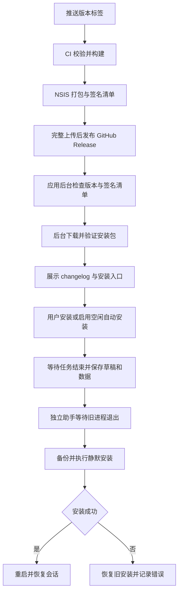

# 发布与应用更新

目前支持 Windows x64、按当前用户安装的 NSIS 安装版。开发构建允许手动检查，未配置公钥时会说明原因；安装与重启仅在有效安装目录中执行。旧安装包没有 `conduit.install` 和更新助手，需要手动安装一次带更新功能的新安装包。

## 流程



## 功能

- 启动约 30 秒后检查，之后每 6 小时检查；设置 → 数据与更新可以关闭。
- 关于 → 检查更新：显示版本、发布时间、Markdown changelog、下载进度、取消、重试、跳过版本、安装并重启。发布时间转换到本地时区，格式为 `yyyy-MM-dd HH:mm:ss`；旧版纯日期补零点，无法识别的时间显示“未知时间”。
- 检查更新的元数据请求遇到短暂网络故障、408、429 或 5xx 时最多尝试 3 次，间隔 0.5 秒、1 秒；单次请求使用 45 秒总超时。GitHub API 受限（403/429）或网络/服务暂时不可用时，回退到官方 Latest 清单并从清单版本对应的发布下载签名，仍强制校验公钥、签名、平台、版本和固定安装包地址。无效数据或签名校验失败不会触发回退。
- 默认后台下载并验证签名与 SHA-256，不自动重启；可开启“空闲时安装并重启”。
- 安装请求会等待 CLI、Git、终端、命名、版本探测和历史导入结束。准备重启时禁止新任务，保存聊天/工作区草稿、Git 提交草稿、附件和选择位置。
- 更新助手嵌入 `asInvoker` 执行权限声明，按当前用户权限运行；NSIS 同样使用 `RequestExecutionLevel user`。助手从缓存运行，等待旧进程句柄释放，获取安装目录独占锁后静默执行 NSIS；其他数据目录的实例仍在运行时放弃安装并尝试打开旧版本。
- 安装失败时还原 exe、DLL、卸载器和版本标记，并恢复卸载信息中的版本；日志/备份位于数据目录的 `updates/handoff-*`。
- 新版本首次启动显示对应 changelog。聊天历史与配置不由安装器覆盖，升级前另存 `state.before-update.json`。

已安装的旧版本助手不会因下载新安装包而改变；若旧版本在启动助手时提示“请求的操作需要提升”，需要手动运行包含修复的新安装包完成一次覆盖安装。

## 配置签名密钥

GitHub 仓库使用 `release` Environment：

| 类型 | 名称 | 值 |
| --- | --- | --- |
| Variable | `CONDUIT_UPDATE_PUBLIC_KEY` | Base64 编码的 Ed25519 公钥，32 字节 |
| Secret | `CONDUIT_UPDATE_PRIVATE_KEY` | Base64 编码的 Ed25519 私钥 seed，32 字节 |

本地生成示例（`target/` 已被 Git 忽略；不要把私钥提交到仓库）：

```powershell
$null = New-Item -ItemType Directory -Force target
$taskKeyPath = Join-Path (Resolve-Path target).Path 'release-signing-key.txt'
cargo run --locked --bin release-manifest -- keygen $taskKeyPath
# 标准输出仅为公钥；私钥写入指定文件，已有文件不会被覆盖。
# 将公钥填入 Environment Variable，将私钥文件内容填入 Environment Secret。
```

私钥应另行安全备份。客户端只内置公钥，下载与执行前必须验签；没有公钥的构建不会启用定时检查，也不会执行未签名更新。不在源码中预置开发者私钥，不在日志中打印私钥。首版只有一个公钥，换钥需要先用旧密钥发布支持新密钥的过渡版本，不能直接替换 CI 密钥使旧客户端失去更新能力。

本地打正式包时也要设置相同公钥：

```powershell
$env:CONDUIT_UPDATE_PUBLIC_KEY = '<Base64 公钥>'
./scripts/package-windows.ps1
```

## 发布

1. 先合并/提交功能与版本号变更，更新 `Cargo.toml` 和 `Cargo.lock`，运行项目验证。
2. 创建并推送与 Cargo 版本完全一致的稳定标签，格式为 `vX.Y.Z`。推送后的标签不可移动；构建失败时修复代码并提升版本号发布新标签。
3. `Release Windows` workflow 并行验证标签提交和构建安装包。验证只复用该提交在本仓库 `ci.yml` 中由分支 push 触发的最新 CI：已成功则跳过重复检查，尚未结束则最多等待 60 分钟，失败或取消则阻止发布；没有对应 CI 时通过 `scripts/check-core.ps1` 补跑相同的核心检查。手动发布旧标签也按标签实际提交查询，不使用主分支最新提交的 CI 结果。
4. 打包 job 在 `windows-2025` 上使用 Rust 1.99.1 构建，安装 NSIS，打包主程序、更新助手及 MSVC CRT，并预编译清单签名工具。验证和打包均成功且提交一致后，发布 job 下载本次运行的构建产物，生成 Release notes，签名清单，再将安装包、SHA-256、`update.json`、`update.json.sig` 上传到 draft Release。
5. 所有资产上传并通过大小校验后，才发布并设置 Latest。失败保留 draft；可手动指定同一标签重跑。已经发布的版本不能被此 workflow 覆盖，修复请使用新版本。

Release notes 根据 `.github/release.yml` 的 PR 标签分类。没有 PR 记录时，尚无已发布版本的首版使用 README 功能简介，后续版本使用上一个已发布版本标签以来的提交记录。仅有失败构建的标签不算已发布版本。预发布标签目前会被拒绝；首版只支持稳定版，不做 beta 通道或差分包。仓库必须允许 Actions 发布 Release，并为 `release` Environment 配置所需权限。若配置了 Environment 审批，GitHub 会在发布 job 前等待维护者审批。

普通 CI、发布补充验证和打包使用相同的 Rust 缓存共享键，并在失败时也保存依赖缓存。默认分支生成的缓存可供标签运行恢复；不同标签之间的缓存不能直接互用，且开发/测试缓存不等于已有正式版编译产物，因此首次正式构建仍可能较慢。默认分支 CI 完成一次新配置后才能供后续标签复用缓存。构建中间产物保留 3 天；最终发布资产继续保存在 Release 中。`release` Environment 同时用于打包 job 读取更新公钥及发布 job 读取签名私钥，若启用环境审批，这两个 job 都受审批规则约束。

下载地址固定为 `Leo-Lee-j/conduit`。Fork 必须同步修改协议仓库常量和发布校验。客户端使用匿名 GitHub API，请使用可公开读取的 Release；私有仓库需要额外设计更新源授权，不能在客户端打包 PAT。

## 验证

```powershell
./scripts/check-core.ps1
./scripts/smoke.ps1 -View settings
```

发布前应在独立 Windows 测试环境中完成 A → B 的真实签名升级演练，覆盖中文及空格安装路径、有任务/草稿/附件、其他实例运行、网络取消、损坏包、磁盘不足、安装失败恢复。`release-manifest` 会在签名时检查公私钥匹配，并使用客户端验证器复验生成结果。

## 恢复与边界

`updates/handoff-*/error.txt` 保存助手错误，`backup/` 保存被替换前的安装文件。安装失败会自动恢复；若机器在安装过程中断电或助手被强制结束，自动恢复无法得到保证，保留备份供人工恢复/重新运行安装包。需要严格抗断电事务或新版本逻辑故障自动回滚时，应采用版本目录切换等后续设计；当前不会把新程序能启动等同于健康检查通过。

自动更新不包含 Authenticode 证书签名、断点续传、镜像和系统代理自动探测；自动重试或官方清单回退后仍然失败时，可手动重试。签名验证保护更新来源，Windows SmartScreen 信誉仍需通过正式代码签名和分发积累。成功交接目录中的备份暂时保留，以便排查；长期使用可在确认升级正常后手动清理旧的 `updates/handoff-*`，不要删除正在更新的目录。

CLI 引擎自身的安装更新见[设置与 AI 连接](settings.md#cli-检查与安装更新)；通用开发检查和人工验收见[测试与验收](testing.md)。
