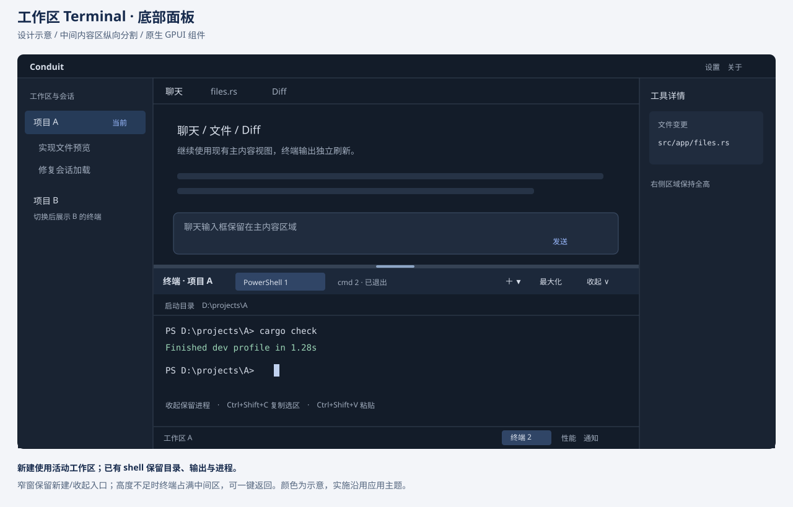
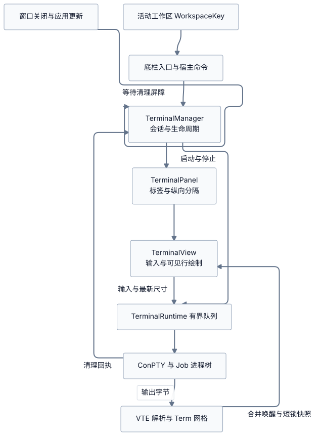

# 工作区 Terminal 功能评估与落地设计

日期：2026-11-06。审查起点：`a121358`（0.1.9）；GPUI Kit 固定 revision：`11345ec002d9f182a266b5d5dd3a217090700a87`。本轮期间工作区有其他并行变更，本文代码结论限所列接口的核对状态，不覆盖其他任务的验收。

状态：**首版已接入，自动化验证已通过；实机验收待完成**。第 1–10 节保留原设计评估和验收目标，第 11 节记录当前实现、测试证据和差异。容量、耗时和排期表中的数字仍是目标，除非明确标为实测。

## 1. 建议与范围

建议新增**中间主内容区底部 Terminal 面板**：底栏按钮或快捷键打开，在当前工作区创建或恢复终端；不同工作区拥有独立会话。同一工作区支持多个终端标签，收起面板保留进程。

技术路线采用 **GPUI 原生视图 + `alacritty_terminal` 解析/网格 + Windows ConPTY + Job Object**。优先迁移 `src/legacy/` 原型，复用 GPUI Kit 的按钮、菜单、标签、纵向分隔、主题、焦点和输入接口，进程通用部分与 `child.rs` 对齐。原型不能直接启用发布：绘制锁竞争、轮询、选区、输入背压和退出屏障需要改造。

首版包括：PowerShell/cmd、准确初始目录、工作区隔离、多标签、调整大小、滚动回看、选择复制、粘贴、中文 IME、常见 ANSI/VT 和 TUI 输入、退出状态、终止子进程树、深浅主题及应用关闭/更新协调。首版不包含任意停靠/拆分、跨重启恢复进程、远程/WSL/Git Bash 专项适配、shell integration、自动执行工作区脚本、AI 自动写入命令或插件 PTY API。

| 决策 | 设计 |
| --- | --- |
| 默认目录 | 直接取点击时 `selected_workspace_path()`，包括选中的 Git worktree；不替换为 Git 公共仓库根或应用目录 |
| 作用域 | `WorkspaceKey → TerminalId[]`；不用可变数组下标或聊天会话 ID |
| 切换工作区 | 切展示，不改变已有 shell 的 cwd，不注入 `cd`；新工作区无终端时显示空态 |
| 隐藏与关闭 | 收起只隐藏；终止操作结束该 Job；运行项不参与标签/LRU 自动淘汰 |
| 输出 | PTY 字节只进入终端解析器，不经过聊天协议、Markdown、会话存储或插件 JS |
| 高频刷新 | 通知独立 `TerminalView`，不按输出包通知整个 `ConduitApp` |
| 发布门槛 | 路径、真实 IME/TUI、压力性能与 Windows 清理验证通过 |

## 2. 现状与复用清单

| 资产 | 当前能力 | 复用方式与限制 |
| --- | --- | --- |
| [活动工作区](../src/app/git_ui.rs)，`selected_workspace_path()` | 从 `selected_workspace` 获取 `Workspace.path` | 直接调用；无需提前重构 Git 模块 |
| [WorkspaceKey](../src/plugins/context.rs) | 沿用 Store 的绝对路径身份，不访问文件系统或折叠大小写 | 作为会话 key；不在 render 中 canonicalize |
| [legacy/pty.rs](../src/legacy/pty.rs) | ConPTY、管道、挂起启动、绑定 Job 后恢复、resize、进程数和退出码 | 迁移为终端专用后端；补路径/环境、失败清理与线程完成回执 |
| [legacy/runtime.rs](../src/legacy/runtime.rs) | `Term`/VTE、5,000 行历史、禁用 OSC 52、输入队列和状态 | 复用解析器接法、状态和测试素材；重做唤醒、预算与快照 |
| [legacy/terminal.rs](../src/legacy/terminal.rs) | GPUI canvas、按键编码、组合输入接口、ANSI 色、滚动、bracketed paste | 复用输入接口；补选区/TUI 鼠标、行/run 绘制及主题字体 |
| [child.rs](../src/child.rs) | 参数引用、`normalized_dir`、独立 Unicode 环境块、Job | 复用或小范围提取纯函数/Job RAII；stdio `Child` 不能直接充当 PTY，也不能照搬其 `CREATE_NO_WINDOW` 组合 |
| [shell.rs](../src/app/shell.rs)、[toolbar.rs](../src/app/toolbar.rs) | 中间主区、34px 底栏、左右独立区域，已有 ResizableState | 中间区增加纵向分割，保留左右区域全高 |
| [内建贡献](../src/plugins/builtins.rs)、[原生命令](../src/app/plugin_ui/commands.rs) | 状态贡献、命令验证与原生处理器 | 复用入口和分发；当前无 Bottom 面板契约，不能仅注册 view 完成布局 |
| GPUI Kit 固定版本 | `v_resizable`、`resizable_panel`、`ResizableState`、`TabBar/Tab`、Button、PopupMenu、Tooltip、Alert、Dialog、FocusHandle | 直接使用；检查的 component/base 公共接口没有可直接嵌入的 Terminal 控件，网格仍需应用实现 [U7] |
| [字体](../src/app/typography.rs)、[设置](../src/store.rs) | 代码字体/字号、主题和持久化 | 沿用代码字体与 `mono_font_family` 回退，不造独立字体选择器 |
| [workspace_busy](../src/app/runtime.rs)、[移除工作区](../src/app/sessions.rs)、[更新](../src/app/update.rs) | 聊天/Git/保存任务屏障 | 增加终端清理状态；不能仅发停止标记就退出/安装 |
| [性能审查](performance-design-review-2026-11-05.md)、[采样](../src/performance.rs) | 有界队列、局部失效及主进程采样边界 | 增加终端专属指标，不把 view build 当成完整帧耗时 |

最初评估时 `main.rs` 未声明 legacy 模块，`Cargo.toml/Cargo.lock` 未包含 `alacritty_terminal` 或 `portable-pty`。下列原型问题描述迁移前状态，当前实现和验证见第 11 节。

原型必须改造的具体问题：

1. `TerminalView::render` 持 `screen` 锁遍历网格并逐字符 shaping/paint，解析线程争用同锁；布局还重复测量字体。应短锁复制快照，解锁后绘制。
2. reader 每 5ms `PeekNamedPipe`，owner 每 20ms 轮询，writer 每 50ms 检查；多个空闲终端会叠加无效唤醒。
3. 输入 `sync_channel(128)` 仅限制条数，1MiB 粘贴会累积大队列；`send` 的 `try_send` 失败不向调用方返回接受结果。解析器自动回复也需有界、可靠地送出。
4. resize 队列容量 1，满时丢新尺寸；需要 latest-wins，拖动最后尺寸必达。
5. `copy_visible` 复制整屏而非选区，鼠标仅聚焦，未实现终端鼠标报告；组合输入接口仍待真实 Windows IME 验收。
6. 固定 `Consolas`、14/20px 和深色，不能直接满足现有主题与字号。
7. reader/writer detach，终态未等待所有线程；Drop 停止标记不代表资源释放。迁移还需修正旧模块导入路径。

## 3. 技术方案比较

| 方案 | 收益 | 成本 | 结论 |
| --- | --- | --- | --- |
| 外部 Windows Terminal/PowerShell | 开发量小，输入/TUI 由系统终端负责 | 无应用内输出、标签和进程管理；受安装/profile/外部单实例行为影响 | 若仅需“在目录打开终端”可独立交付，不能替代本文集成目标 |
| GPUI + Alacritty 网格 + 现有 ConPTY | 复用最多，沿用原生主题/Job | 补选区、输入、绘制与清理 | **推荐** |
| Alacritty 自带 `tty`/EventLoop + GPUI | 同库含 PTY/事件循环，可减少平台代码 [U4] | 必须验证挂起绑定 Job、全树清理、环境与取消契约 | P0 对照候选，满足相同验收且明显减少维护时替换后端 |
| `portable-pty` + Alacritty + GPUI | 跨平台 PTY 抽象 [U5] | 新增依赖；UI 仍需做，Windows Job 仍需验证 | 当前仅 Windows，暂不引入 |
| xterm.js + WebView | 成熟浏览器终端生态 | WebView/资源打包、焦点/IME/主题桥、跨边界字节传输和额外进程，仍需 PTY [U6] | 当前架构成本偏高 |
| 抽取其他编辑器 terminal crate | 可借鉴成熟行为 | 各自 GPUI fork、工作区/动作/设置与许可耦合 | 参考行为，不整体搬入 |

实现固定使用 `alacritty_terminal 0.25.1` 的版本化 API，已核对 selection、damage、renderable content、`osc52/scrolling_history` [U3/U4]；**不声称它是最新版本**。依赖已写入 `Cargo.toml/Cargo.lock`，只引入解析与网格能力，不引入 Alacritty 应用，也不升级 GPUI Kit。传递依赖、许可和包体积仍需单独核对。

## 4. 活动工作区与目录契约

| 场景 | 行为 |
| --- | --- |
| 点击底栏/`Ctrl+反引号` | 收起时展开，有会话则恢复最后标签，无会话则创建默认 shell；已展开且网格聚焦时收起 |
| 面板展开、焦点在聊天/文件 | 同一快捷键先聚焦终端，不立即收起 |
| `+` / `Ctrl+Shift+反引号` | 在点击时的活动工作区新建；超容量给出释放入口 |
| A→B 工作区切换 | A 继续运行，展示 B 的标签或“新建终端”空态；不因选择事件启动 shell |
| 回到 A | 恢复标签、滚动和选区，不强制滚到底部 |
| A 启动返回时已切到 B | 仍归 A，不抢焦点；若 A 已移除或创建已取消，则清理返回进程 |
| 切聊天/文件/Diff，工作区不变 | 不重建终端；文档切换导致工作区变化时遵循 A→B |
| 收起/进入设置 | 保留会话，停止不可见绘制；返回不抢焦点 |
| 无工作区 | “选择工作区后打开终端”，不回退 HOME/应用安装目录 |
| 目录无效/不可访问 | 标签显示启动错误与重试，不静默换目录 |
| shell 自己 `cd` / profile 改目录 | 保持行为；界面不显示启动目录副行，不冒充实时 cwd |

UI 点击时捕获 `{workspace_key, initial_cwd, shell_profile, terminal_id, generation}`，后台做目录检查、shell 定位和启动。启动前检查取消，目录在检查后消失则报告真实启动错误。回执按 ID/generation 路由；是否聚焦另外检查当前工作区和发起时的焦点请求。切换工作区不能使 A 的正常后台输出失效。

身份复用 Store 的 `PathBuf`；启动可用 `child::normalized_dir` 处理 Windows 扩展前缀，但不能回写身份。不用 `set_current_dir` 改整个应用目录，不拼接 `cd`/`pushd`/`-Command` 设置 cwd。空格、中文、`&`、单引号/括号均作为 `CreateProcessW.lpCurrentDirectory` 传入。

分别验收 UNC/长路径：shell（尤其 cmd）不能保持 UNC cwd 时明确报兼容性错误并建议 PowerShell，不悄悄落到系统目录；首版不作远程文件系统保证。不能把 `git::worktree_root` 或 `repository_scope` 用作默认 cwd，它们用于其他业务的锁范围。

### 4.1 Shell 选择与环境

自动模式按 `pwsh.exe` → 系统 Windows PowerShell → `ComSpec`/系统 `cmd.exe` 探测。复用 CLI 定位中适用的路径校验逻辑，解析成绝对 exe 路径，不从工作区扫描同名程序。结果缓存，设置改变/显式刷新/exe 消失时失效。显式 profile 失败不自动换另一种 shell。

PowerShell 使用 `-NoLogo`，cmd 使用 `/d /q`；保留用户 PowerShell profile，提供“无 profile 启动”排障选项。参数保存为 `Vec<String>`，exe 独立保存；首版自定义程序限可直接启动的 `.exe`，不用任意字符串 `cmd /c`。

继承应用环境，终端覆盖用独立 Unicode 环境块；不带入聊天 Provider 的密钥/路由覆盖、不修改父进程环境。应用启动后修改的系统 PATH 可能需要重启继承。`TERM` 等只在验证支持后设置，不宣称未实现协议，不改全局 code page、注册表或用户 profile。

## 5. UI 与输入设计

### 5.1 布局及组件

面板位于**中间主内容区内、既有底栏上方**，与聊天/文件/Diff 纵向分割。左导航和右详情/通知继续全高。首版不加侧栏导航页、不重构全局 Dock、不复用会自动淘汰的文档标签模型。



这是设计示意，不是产品实现截图。

- `v_resizable + ResizableState + resizable_panel` 处理分割，优先复用 resize handle；动态上下限若难以表达，再参考现有右侧拖动的轻量适配。
- 初始高度为中间可用高度约 35%，常规范围 180–420 逻辑像素，主内容至少 240px。无法同时容纳时，终端占满中间区并提供“返回主内容”；恢复用上次正常分屏高度。
- 标题约 32px、网格 padding 8px；正常运行时不显示目录副行，其他生命周期状态仍显示提示；不以连续高度动画改变网格。测试 100/125/150/200% DPI。
- 标签复用 `TabBar/Tab`，稳定 key 为 TerminalId，只渲染活动网格；溢出用现有滚动/更多菜单，新建与收起始终可达。
- 标签名为 shell + 工作区内序号；状态同时用文字/图标。退出标签保留输出和“重新启动”；新启动生成新 generation，不重放输入。
- 标题“∨”只收起。各 tab 右侧提供 ×，右侧保留至少 4px 间距；运行项首次点击变为红色 CircleX 确认图标，再点同一位置才终止并关闭，tooltip/可访问名称同步提示第二次确认。点击标签主体、切换工作区或收起可取消。已退出标签直接关闭，关掉最后标签保留空态；不提供下方确认条或独立“终止并关闭”文字按钮。
- 组件沿用 `palette()`/Theme。终端配置深浅 ANSI 16 色，保留应用显式 256/RGB 色；默认前景、选区和光标保持可辨识，不固定深色底。
- 复用代码字体及 mono 回退，按字体/字号/DPI 缓存 cell metrics，CJK/emoji 可回退字体；不启用破坏列对齐的连字。

### 5.2 焦点与快捷键

建立 `ConduitTerminal` key context。应用已有全局 `Ctrl+E/P/M/K`；不能假定 `on_key_down.stop_propagation()` 一定覆盖动作分发，需要显式路由与 UI 回归。

| 输入 | 行为 |
| --- | --- |
| 文字/中文 | `EntityInputHandler` 提交时写 PTY，组合阶段不发送预编辑内容 |
| Enter/Tab/Esc/方向/F1–F12 | 依终端 mode 编码；Tab 不切焦点，Esc 不收起 |
| Ctrl+C | 发送中断控制字节 |
| Ctrl+Shift+C | 复制选区；无选区不复制整屏 |
| Ctrl+Shift+V / Shift+Insert | 粘贴，先检查预算，不能静默截断 |
| Ctrl+W/E/P/K/M/L | 网格聚焦时交给 shell，不触发聊天关闭/搜索/设置/Git |
| Ctrl+反引号 / Ctrl+Shift+反引号 | 宿主保留：聚焦/收起、新建 |
| Ctrl+Shift+PageUp/PageDown | 当前工作区内切终端标签 |
| Ctrl+Shift+F6 | 返回先前内容焦点，提供明确键盘离开路径 |
| Alt+F4 / 系统辅助功能键 | 系统/宿主处理 |

图标按钮具备 tooltip、快捷键、accessibility label 和焦点环。失焦、隐藏、切工作区/弹窗时正确处理 composition，旧输入不能落到新标签。真实 IME 候选窗跟随光标，覆盖滚动、宽字符和 DPI。

普通鼠标支持拖动选区、双击词、三击行和滚轮回看；终端鼠标模式时按协议编码，Shift+拖动保留本地选择。支持备用屏幕和常见 SGR 鼠标；终端滚轮不继续冒泡到聊天。选区复制复用解析库 API，处理软换行/宽字符，不自写 ANSI 正则清洗器。

canvas 的屏幕阅读器支持不能用工具栏标签代替：首版提供可键盘操作的“查看可见文本”只读视图，复用现有可访问文本组件；完整 UIA TextPattern/实时朗读另评估，不作已支持承诺。

### 5.3 状态反馈

启动中立即显示标签/Spinner/取消，失败显示原因及重试/选择 shell；输入队列满显示“终端暂时无法接收输入”并返回失败，不能报告已发送。停止中禁止输入，超时为“清理未完成”并提供重试。shell 退出不自动关标签或抢焦点，后台工作区只改状态计数。仅启动/清理等生命周期错误复用通知，原始输出不逐行生成通知。

## 6. 技术结构与线程模型



可编辑源：[terminal-architecture.mmd](assets/terminal-architecture.mmd)。第 6 节保留实现前的接口草图；实际文件、类型和已落地差异见第 11.1 节。

| 模块 | 职责 |
| --- | --- |
| `src/terminal/mod.rs`、`model.rs` | ID、profile、状态、命令事件、容量；独立于聊天协议 |
| `src/terminal/pty.rs` | 迁移 legacy ConPTY/Job，Win32 单一 owner 和失败回滚 |
| `src/terminal/runtime.rs` | I/O、解析、控制、退出屏障和统计，不持有 GPUI Entity |
| `src/terminal/screen.rs` | Term、选区、damage、可见行快照 |
| `src/app/terminal.rs`、`terminal/view.rs`、`terminal/input.rs` | 管理器/面板、独立 GPUI View、布局/输入/绘制 |
| 既有 `shell.rs/toolbar.rs/plugin_ui/commands.rs/plugins/builtins.rs` | 挂载面板、内建状态按钮和 toggle/new 命令 |
| 既有 `app.rs/runtime.rs/sessions.rs/update.rs` | 初始化、选择/焦点联动、移除/关闭/更新屏障 |
| 既有 `store.rs/app/settings/performance.rs` | 最小设置、兼容默认值和指标 |

```rust
// 设计草图，非已编译接口。
struct TerminalManager {
    sessions: HashMap<TerminalId, TerminalSession>,
    workspaces: HashMap<WorkspaceKey, WorkspaceTerminals>,
}
struct TerminalSession {
    id: TerminalId,
    generation: u64,
    workspace: WorkspaceKey,
    initial_cwd: PathBuf,
    profile: ShellProfile,
    runtime: TerminalRuntime,
}
enum TerminalState {
    Starting, Running, Stopping,
    Exited { code: u32 },
    Failed { message: String },
    CleanupFailed { message: String },
}
```

工作区状态保存标签顺序/选中项，面板保存开闭/正常高度/最大化/先前焦点。**runtime 所有权属于 manager**；view 仅持有句柄，隐藏或缓存淘汰不能停止 shell。只有完整清理后发布终态。

### 6.1 I/O、背压、通知

1. reader 独占输出管道，以阻塞读/可取消等待替换 5ms 探测；初始读取块 16KiB，顺序交 VTE。不可按换行拆包，UTF-8/ANSI 可跨块。
2. screen 短锁解析有界块或复制可见网格；锁内不 shaping/paint/阻塞写/磁盘 I/O。UI 取不到快照保留上一帧并请求下一帧，避免等整个输出突发。
3. writer 独占输入，字节与条数双预算；`try_input` 返回 Accepted/Full/Closed。粘贴接受前预留完整事务预算，分块写且不与后续用户输入交错，避免留下半个 bracketed paste。
4. 设备/尺寸等自动响应走独立预留预算进入同一 writer，parser 锁内不阻塞。响应洪泛超限要明确报错/停止，不能无声丢弃后仍声称正常。
5. resize 为一个最新值槽加唤醒，中间更新约 ≤30Hz，最后尺寸立即刷新；PTY 与网格按同一 generation/geometry revision 应用，失败不能标记成功。
6. dirty/generation 合并唤醒，每帧最多一次可见快照，最高 60Hz；隐藏不生成绘制快照。生命周期状态独立可靠送达，不被内容刷新覆盖。
7. owner 独立处理停止/进程句柄，不依赖 writer 写完；reader/writer 完成回执、ConPTY 释放、Job 活跃数共同组成退出屏障。

使用阻塞 reader 后，synchronized update 的超时不能依赖下一批输出：parser 报告同步更新 deadline，由控制等待注册一次性定时唤醒，到期结束同步并发布 dirty；没有待处理 deadline 时不启动周期轮询。读流、取消和超时路径需专门验证，避免 TUI 停止输出后画面一直不刷新。

隐藏仍 read/parse，维持协议和有界历史，不能停止读导致构建/服务卡住。可以合并刷新，不能随机丢 PTY 字节。解析过慢由管道施加背压，UI 保持可取消；主动中断必须反映为错误。

### 6.2 绘制与持久化

先实现“短锁复制可见网格 → 解锁 → 按行/同样式 run shaping → paint”，保留 cell 列坐标、宽字符/组合字符，不能按比例字体整行排版后假定列一致。缓存 key 含 ID/generation、row revision、列数、字体与主题 revision；resize/滚动/备用屏幕/主题触发整视口失效，选区/光标另行失效。damage API 可用但不能遗漏网格外状态 [U3]。

不使用聊天 ListState 承载终端历史、不将行转 Markdown、不每帧复制整屏到 Store。最大几何初设 500 列×300 行，超限留白且前后端一致。先证明视口绘制足够，再按数据细化行缓存，不提前造 GPU 字形系统。

`UiSettings` 新增 `#[serde(default)] terminal`，只存默认 profile、正常高度等小配置，加载时 clamp。面板开闭、标签/PID、输出、选区、实际 cwd 留内存；重启不启动 shell、不重放输入。拖动结束/防抖后才保存；不新建 transcript 落盘路径。退出标签计入保留预算，由用户关闭释放。

## 7. Windows 生命周期与现有功能协调

### 7.1 进程清理

启动顺序：管道 → ConPTY → 属性/环境 → 挂起 CreateProcess → 绑定 `KILL_ON_JOB_CLOSE` Job → Resume → Running。每步失败清理先前资源，取消与启动完成竞态也要清理后到进程。

保留独立读写线程。Microsoft 明确提醒在同线程服务阻塞通道/控制可能死锁 [U1]。`ClosePseudoConsole` 在 Windows 11 24H2 起立即返回，较早系统可能等待，关闭期间仍有输出；所以不能以其返回证明所有客户端退出，也不能先停 reader 再关闭 [U2]。

停止流程：拒绝输入 → 终止 Job → reader 持续排空 → owner 后台关闭 ConPTY → writer 完成或通过验证过的同步 I/O 取消路径解除阻塞 → reader EOF/完成 → 确认 Job 活跃数 0、线程完成、句柄释放 → Exited/关闭标签。实际 API 顺序在 P0 覆盖新旧 Windows，UI 不 wait/join。

正常 shell 退出也进入清理，遗留子进程按所有权结束，不隐式 detach。目标 3 秒内完成，5 秒后 CleanupFailed 并可重试；超时不等于成功，Drop/Job 关闭仅为最后保护。

### 7.2 协调规则

| 场景 | 处理 |
| --- | --- |
| 聊天运行/取消 | 与手工终端独立，不进入 `session_control.runs`，停止聊天不杀 shell |
| Git UI 写操作 | 不因 shell 存活永久锁住 Git；终端同外部 CLI 可改文件，已有聊天互斥不覆盖它；依 Git 锁/状态重查，不声称能判定 terminal idle |
| 文件/分支变动 | 不自动重启终端；Git/文件按已有刷新或重新获得焦点策略更新，不按输出字节刷新 |
| 移除工作区 | `workspace_busy` 包含 Starting/Running/Stopping/CleanupFailed，提示先终止；清理后才能移除 |
| 关闭窗口 | 存活终端一次性列明将结束的会话/子进程，确认后走现有关闭屏障；失败保持可见并可重试 |
| 自动安装更新 | 活动终端使 `update_idle()` false，显示等待终端关闭 |
| 手动安装 | 提供“终止终端并更新”，清理完成后才交接安装助手；稍后则继续运行 |
| 只读/关闭中 | 禁止创建/重启，允许查看复制和停止；只读不等于 OS 沙箱 |

旧菜单/异步输入按 ID/generation 验证，A 的旧请求不能改写 B。统一命令只处理 toggle/new 等宿主动作；PTY input 走 view 专用句柄。复用插件分发不等于开放进程权限：首版终端处理器要求宿主来源，不能让脚本经通用 dispatch 间接 spawn；不开放 send/kill/read API，不把 PTY 内容写入插件上下文。

## 8. 性能预算与验收口径

以下为**待测目标**。先在同机、同 release 构建、固定窗口/字体下测无 Terminal 基线，再测增量；记录 CPU/核数、DPI、shell/profile、分辨率、系统版本。

| 指标 | 初始预算/目标 | 验证方式 |
| --- | --- | --- |
| 未打开 | 无 PTY、专属常驻线程/定时器 | CPU/线程/句柄对比，依赖体积另测 |
| 并发 | 每工作区 4 个、全局 8 个保留标签，含启动中/退出项 | 批量点击原子预留，超限手动释放，不淘汰运行项 |
| 历史 | 每会话 ≤5,000 行且约 ≤100 万 cells | 宽屏动态降低历史行数，resize/备用屏幕计入，不只按行数声称内存有界 |
| 内存 | 自有模型/队列/缓存可核算量目标每会话 48MiB、全局 192MiB | 超预算先减历史/缓存，再拒绝创建；实测 cell/组合字符/控制串，库无法完整计费必须披露，不称整个 RSS 硬限 |
| 输入 | 事务 ≤1MiB，待写 ≤2MiB/128 项，响应另预留 64KiB | 多次大粘贴、不读 stdin、满队列不阻塞 UI/不静默截断 |
| 输出/快照 | reader 16KiB；最多当前帧/下一帧，合并为最新待消费版本 | 队列不随输出时长增长，终态不被覆盖 |
| 线程 | 活动会话 reader/writer/owner 各一，控制可共享 | 不用 GPUI 线程池承载永久阻塞 I/O；关闭后回归基线 |
| 空闲 CPU | 4 个无 profile 静默 shell，增量平均 <一个逻辑核 1%，60 秒 | 主进程/shell/ConPTY helper 分列；隐藏无绘制/光标动画/短周期轮询 |
| 响应 | 反馈 <100ms；无 profile 首字节 p95 <1s；本地回显 p95 <50ms | 分开 spawn/首字节/首帧，不承诺任意 profile 启动上限 |
| 渲染 | 120×30 常规输出快照+布局+绘制 CPU p95 <4ms；压力下聊天输入 p95 <100ms | 采样事件到画面/回显，不能只测 render 构建 |
| resize | 中间 ≤30Hz，结束后 100ms 内应用最后尺寸 | 连拖/DPI/字体/隐藏恢复，核对 shell 实际尺寸 |
| 稳定性 | 单终端 5MiB/s×60 秒、8 会话混合、100 次创建关闭 | 记录吞吐/背压/内存平台值/泄漏/UI p95；输入目标不是任意 ANSI 组合的吞吐保证 |

新增指标：PTY rx/tx bytes、输入队列 bytes/最老等待、parser batch、screen lock 等待、snapshot 时间/字节、dirty-to-present、隐藏/可见绘制次数、resize revision、历史 cells、cache bytes、cleanup duration 和线程/句柄。关闭性能监控时关闭高频采样，保留容量计数和必要错误。

输出不触发 Store 保存、sidebar/search/plugin context revision；状态栏仅在数量、运行状态和选中工作区变化时更新。压力下可降绘制频率，仍须保持读流、输入和取消。

行数×列数不覆盖超长控制串/组合字符扩展分配。P0 检查锁定库的字符串上限和 cell 计费，加入病态流；必要时在库边界加明确限额/修补版本，不能通过任意丢字节破坏状态机。若实际依赖无法保证预算，要重新定容量并记录实测限制。

## 9. 本地执行与内容边界

终端是用户权限的本机 shell，可改工作区外文件；聊天审批/Provider permission 不代理手工命令，不能展示沙箱隔离承诺。

- 保持 `Osc52::Disabled`，输出不可自动读取/写入剪贴板；复制粘贴由用户触发。
- 粘贴去 NUL、统一换行，按 mode 封装 bracketed paste 并防 ESC 提前闭合；多行提供预览/确认和取消，接受后才排队，不自动补 Enter。
- OSC title 仅受限文字，限制长度/控制字符，不覆盖可信工作区/启动目录。首版不自动开链接，不实现 OSC 文件操作/图片协议。
- 默认日志只记 ID、阶段、错误码/耗时，不记终端字节、环境块或完整命令行；诊断导出由用户触发并说明内容。
- 不从工作区文件生成启动命令；用户 profile 由 shell 自行执行，排障可禁用 profile。

## 10. 分阶段交付与验收

按一名熟悉仓库的开发者估计约 **11–16 个工作日**，另留真实设备验收时间；P0 后重新估算。主要不确定性是 IME/TUI、旧 Windows 清理和 parser 内存计费。

| 阶段 | 交付 | 退出条件 | 估算 |
| --- | --- | --- | --- |
| P0 | 独立 harness 激活 legacy、确定解析库版本、对比自有/库 tty、依赖/许可/性能基线 | 特殊目录正确、取消/退出无残留、基本 TUI、初步压力数据 | 2–3 天 |
| P1 | 原生面板、默认 shell、scope/焦点、输入/选区/粘贴/resize、状态 | 目录准确、快捷键不串扰、关键状态有反馈 | 3–4 天 |
| P2 | 多标签/工作区/容量、关闭/移除/更新、设置/主题、IME/TUI 修正 | A/B 隔离、启动竞态、阻塞写清理与全局回归通过 | 4–6 天 |
| P3 | 快照/缓存调优、压力/泄漏/DPI/无障碍、使用文档 | 预算实测达标或明确修订，无严重缺陷，有真实 Windows 验收记录 | 2–3 天 |

推荐 `terminal::tests`、`app::terminal::tests`，迁移适用 legacy 用例后真正加入 CI。下表是完整验收计划，已执行的子集见第 11 节：

| 类别 | 必测案例 |
| --- | --- |
| 模型/路由 | A/B 切换、工作区重排、无聊天会话、文档带动切换、已删除请求回执、重启 generation、快速点击、容量 |
| Windows | PowerShell/cmd 实际 cwd；中文/空格/特殊字符/UNC/长路径；exe 消失；Job 绑定失败；启动取消；根退出子进程存活；阻塞 stdin；大量输出期间关闭 |
| 协议/输入 | 分块 UTF-8/ANSI、CJK/组合/emoji、真彩色、备用屏幕、设备查询、bracketed paste、鼠标、OSC 52 禁用、超长控制串 |
| GPUI | Enter 不发聊天、Ctrl+C 与复制区分、Ctrl+W/E/P/K 不触发全局动作、Tab/Esc 给 TUI、弹窗焦点恢复、滚轮隔离、选区/隐藏恢复 |
| 实机 | 微软拼音及一种常用中文输入法、候选窗位置、四档 DPI、深浅主题、窄窗/矮窗、PSReadLine/编辑器/分页器/交互程序 |
| 全局 | live terminal 阻止移除、自动更新等待、手动终止更新、关闭取消/确认/失败重试、聊天停止不杀 shell |
| 性能 | 可见/隐藏输出、4 空闲、8 混合、100 次开关、resize、历史上限、大粘贴；输出不增聊天重绘/保存次数 |

实现阶段按仓库要求运行 `cargo fmt --all --check`、`cargo clippy --locked --all-targets -- -D warnings`、默认测试和 `--features ui-tests` 定向回归。真实 CLI/TUI/profile 测试单列，不把未安装软件导致的跳过记录成通过。

以下任一未解决即不默认发布：工作区串线、输入错会话、原始流无声丢失、队列/历史无界增长、中文无法提交、退出/更新留进程树、阻塞写卡 UI。P0 若证明原生方案超计划，可独立先交付“外部终端打开工作区”；不能用只读日志框替代交互终端。若再压缩首版，可延后多标签 UI，但保留每工作区模型和全部输入/清理门槛。

## 11. 本轮交付与资料

### 11.1 已接入能力

依赖固定为 `alacritty_terminal = "=0.25.1"`、`default-features = false`，复用现有 GPUI Kit 和 Windows API 依赖。legacy 文件继续保留为原型参考，产品实现位于以下文件：

| 文件 | 实现 |
| --- | --- |
| [terminal/mod.rs](../src/terminal/mod.rs)、[shell.rs](../src/terminal/shell.rs)、[input.rs](../src/terminal/input.rs) | 生命周期状态、Auto/PowerShell/cmd 选择、终端按键编码 |
| [terminal/pty.rs](../src/terminal/pty.rs) | ConPTY、挂起创建/绑定 Job/恢复、启动目录和子进程清理 |
| [terminal/runtime.rs](../src/terminal/runtime.rs)、[screen.rs](../src/terminal/screen.rs) | 阻塞 I/O、有界输入、解析、快照、resize 和清理屏障 |
| [app/terminal.rs](../src/app/terminal.rs)、[terminal/view.rs](../src/app/terminal/view.rs) | 工作区标签、GPUI 面板/网格、焦点、输入法、鼠标、复制粘贴和主题 |
| [app/shell.rs](../src/app/shell.rs)、[toolbar.rs](../src/app/toolbar.rs)、[plugin_ui/commands.rs](../src/app/plugin_ui/commands.rs)、[plugins/builtins.rs](../src/plugins/builtins.rs) | 主界面挂载、按钮和宿主命令路由 |
| [store.rs](../src/store.rs)、[app/runtime.rs](../src/app/runtime.rs)、[sessions.rs](../src/app/sessions.rs)、[update.rs](../src/app/update.rs) | 偏好默认值、退出/移除/更新屏障 |

入口为底部工具栏或 `Ctrl+反引号`，`Ctrl+Shift+反引号` 新建。新会话捕获当前活动工作区路径，切换工作区不注入 `cd`；每工作区保留最多 4 个标签，全局最多 8 个，已退出项也占名额。收起保留进程，关闭确认后终止 Job 并等待全部清理；退出项保留输出并可重启。停止聊天不结束手工终端。移除工作区、关闭窗口和安装更新均已接入终端屏障。

界面收敛：底栏使用纯终端图标和现有 `Badge` 显示当前工作区的保留数量（零隐藏）；运行时移除目录副行，各 tab 使用 `Tab::suffix` 和现有 Button 提供 × 关闭入口。运行项采用原位两次点击确认，第一次变为红色 CircleX，第二次才停止，取消下方确认条；确认绑定目标 ID，可关闭未选中标签而不切换当前标签。“复制可见内容”入口及产品方法已删除，选区复制保留。终端 UI 回归覆盖按钮边缘留白、原位确认不改变布局、首次点击保活、点击标签取消和第二次点击清理。

复用 `TabBar/Tab`、Button、PopupMenu、Dialog、ResizableState 和既有代码字体/主题。面板高度持久化为 180–800px 范围，窗口高度不足 510px 时改为中间区单面板。不同于原设计的独立 generation 字段，当前用单调递增的会话 ID 和每次新建独立 runtime 防止旧输入复用。

owner 等待 Windows 事件和进程句柄，reader/writer 阻塞等待；resize 合并为最新值、约 30Hz 应用。终端输出通过应用已有 33ms 轮询只通知活动终端 Entity，不保存 Store 或逐字节刷新聊天/插件状态。可见快照采用 `try_lock`，解锁后绘制；ASCII 同样式连续单元合并 shaping，Unicode 保留网格位置。

### 11.2 自动化验证

2026-11-06，在本机 Windows x64 工作区执行：

| 命令 | 结果 |
| --- | --- |
| `cargo fmt --all -- --check` | 通过 |
| `cargo clippy --locked --offline --all-targets --features ui-tests -- -D warnings` | 通过 |
| `cargo test --locked --offline -- --test-threads=1` | 库 33 项、主程序 355 项、发布签名工具 1 项通过；主程序 16 项按既有配置忽略；无失败 |
| `cargo test --locked --offline --features ui-tests --bin conduit terminal -- --test-threads=1 --nocapture` | 19 项通过，其中终端新增/集成覆盖 16 项，另 3 项为名称命中的既有测试 |
| `cargo test --locked --offline --features ui-tests --bin conduit app::update::tests:: -- --test-threads=1` | 6 项通过：更新等待、草稿保存失败、正常退出及更新恢复 |
| `cargo test --locked --offline --features ui-tests --bin conduit app::plugin_ui::status::integration_tests:: -- --test-threads=1` | 5 项通过：命令权限/过期请求、溢出菜单及宽窄/停靠底栏布局 |

末次收尾补充了 IME 的 UTF-16 局部范围与代理对边界处理，以及只读/关闭中禁止重启且保留退出标签的保护；随后终端定向测试和 Clippy 再次通过。默认测试集在这两处修正前完成，两处修正由上述 UI 回归覆盖。文档检查通过 39 个本地链接和 Markdown 代码围栏配对；`git diff --check` 无空白错误。

覆盖实际 ConPTY 的中文/空格/`&` 启动目录、输入输出、最后尺寸、退出码、启动取消、无效目录、会话隔离、子进程树和阻塞 stdin/连续输出时清理；覆盖解析器 UTF-8/ANSI/备用屏幕/查询响应/选区/超长控制串；GPUI 测试覆盖工作区切换、隐藏保活、快捷键隔离、焦点返回、保留聊天草稿、关闭确认、容量、过期宿主命令、更新等待、900×480 与 1200×800 布局，以及 IME 预编辑/UTF-16 范围/Unicode 提交和多行粘贴确认。

解析微基准一次样本：4,325,376 字节约 42.8ms，100 次 160×40 快照约 5.1ms，`Cell` 为 24 字节。样本来自优化的开发测试构建，只测解析/快照，不代表 release 构建的端到端帧、回显延迟或生产吞吐。图示仍为设计示意，不是实现截图。

### 11.3 差异及待完成门槛

- 历史/输入队列/协议回复有界；OSC 串超过 4096 字节拒绝解析，组合字符/链接扩展分配定期检查，失败后停止并排空输出。检查不覆盖所有备用屏幕和库内分配，**未实现每会话 48MiB/全局 192MiB 完整内存计费**，不宣称 RSS 硬上限。
- 当前滚动/选区/选区复制使用非阻塞锁，在输出竞争时可能跳过一次操作；完整鼠标中键/右键/无按键移动、所有光标样式和文字装饰仍需完善。
- 原设计的可访问只读文本替代和完整 UIA 支持尚未完成。无 profile 启动、自定义程序、shell 探测缓存和逐行绘制缓存未纳入本次实现。
- 真实微软拼音及另一输入法、候选窗位置、PSReadLine/编辑器/分页器、四档 DPI/深浅主题视觉检查、UNC/长路径及旧 Windows 清理仍待实机验收。桌面自动化服务连接失败，本轮采用 GPUI 测试和布局断言，未将其视为真实桌面截图验证。
- 仍需同机 release 构建完成空闲 CPU、内存平台值、回显/绘制延迟、8 会话压力和 100 次创建关闭，以及依赖许可/包体积增量核对。第 8 节指标尚未全部实测，不作为已达标承诺。

使用入口和快捷键见[使用指南](usage.md#集成终端)。

外部资料于 2026-11-06 核对；GPUI Kit 以本地 lockfile 对应源码为准。

- [U1] Microsoft：Creating a Pseudoconsole session，通信通道、启动/结束流程。`https://learn.microsoft.com/en-us/windows/console/creating-a-pseudoconsole-session`
- [U2] Microsoft：ClosePseudoConsole，旧系统等待、24H2 行为及排空。`https://learn.microsoft.com/en-us/windows/console/closepseudoconsole`
- [U3] Alacritty Terminal 0.25.1 Term：selection/damage/renderable content。`https://docs.rs/alacritty_terminal/0.25.1/alacritty_terminal/term/struct.Term.html`
- [U4] 同版本 Config / tty：`https://docs.rs/alacritty_terminal/0.25.1/alacritty_terminal/term/struct.Config.html`；`https://docs.rs/alacritty_terminal/0.25.1/alacritty_terminal/tty/index.html`
- [U5] portable-pty 0.9.0 PtySystem：`https://docs.rs/portable-pty/0.9.0/portable_pty/trait.PtySystem.html`
- [U6] xterm.js 官方集成说明：`https://xtermjs.org/docs/guides/security/`
- [U7] GPUI Kit：`crates/component/src/resizable.rs`、`tab/tab_bar.rs`、component/base `lib.rs`；固定源码 `https://github.com/longbridge/gpui-kit/tree/11345ec002d9f182a266b5d5dd3a217090700a87`
