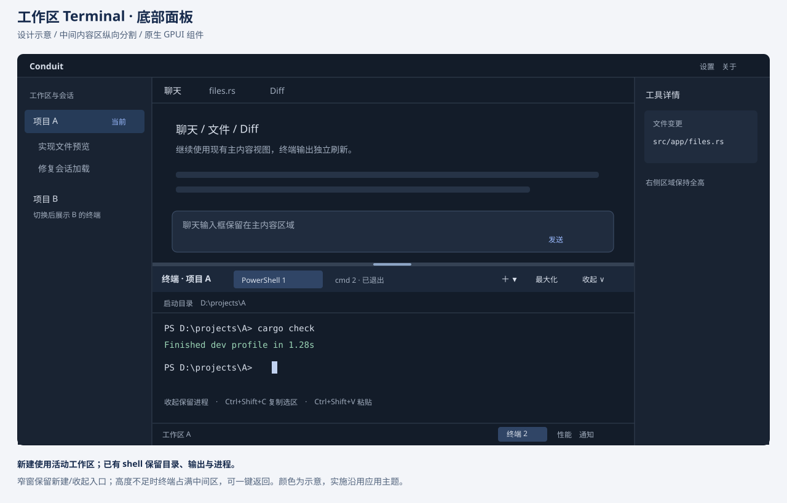
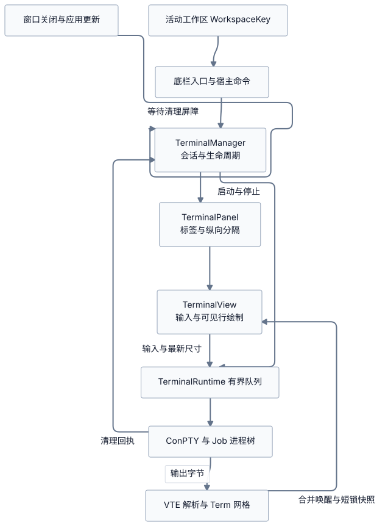

# 集成终端

产品终端采用 Windows ConPTY、Windows Job、固定版本 `alacritty_terminal` 和原生 GPUI 网格，不复用聊天日志作为终端屏幕。操作和默认快捷键见[使用指南](usage.md#集成终端)。

## 工作区与交互

新终端捕获创建时的活动工作区，包括 Git worktree；不要求存在聊天会话。切换工作区显示各自标签，已存在 shell 继续运行，不自动注入 `cd`。shell 中改变目录也不改变应用工作区。无工作区或目录无效时明确报错，不回退到其他目录。

默认 Shell 优先 PowerShell 7，再使用 Windows PowerShell，最后 cmd；显式选择新 Shell 会新建标签并保存偏好。每工作区最多保留 4 个标签，全局最多 8 个，已退出标签也占名额。

收起保留进程；运行标签的关闭按钮采用原位二次确认，确认绑定具体标签 ID。点击标签主体、切换工作区或收起取消确认，关闭未选中标签不切换当前项。退出项保留输出，可重启或关闭。面板支持拖动高度和最大化。

停止聊天不终止手工终端。移除工作区、退出应用和安装更新均检查活动终端；只有进程树清理完成才允许相应流程继续。

## 进程与线程模型

[图源](diagrams/terminal-architecture.mmd)。

`terminal/pty.rs` 创建 ConPTY，挂起创建子进程、绑定 Job 后恢复；启动失败或取消也进入清理。`terminal/runtime.rs` 管理阻塞读写、有界输入和输出解析，`screen.rs` 维护终端屏幕与快照，`app/terminal/` 处理布局、焦点、输入法和绘制。

界面不等待管道写入或进程退出。启动、运行、退出、失败和清理失败分别展示；根进程退出不代表子进程已经清理，未完成清理不能释放忙状态或谎报成功。

## 输入与资源

- Ctrl+C 发送中断控制字节；Ctrl+Shift+C 仅复制选区，Ctrl+Shift+V / Shift+Insert 粘贴。多行粘贴先预览确认。
- 终端焦点下的 Enter、Tab、Esc 和 TUI 按键不得触发聊天或宿主全局命令。离开终端和关闭弹窗恢复正确焦点。
- 支持选区、词/行选择、滚动、备用屏幕和 TUI 鼠标；鼠标报告开启时按住 Shift 进行本地选择/滚动。
- 单次输入上限 1 MiB，普通输入队列字节预算 2 MiB，设备响应独立预算 64 KiB，数量也有界。超限需要反馈，不能无声丢弃输入或阻塞 UI。
- 输出进入终端解析器和有界屏幕/历史，不进入聊天历史或主状态文件；恶意超长控制串会停止会话，OSC 52 不自动写剪贴板。
- IME 预编辑与最终提交分开处理；粘贴、只读和输入焦点都需在实际发送时验证。

## 验证

后端测试使用真实 ConPTY 和临时工作区，覆盖 Shell cwd、空格/中文路径、启动取消、Job 失败、子进程存活、阻塞输入、大量输出、resize、UTF-8/ANSI 分块及清理重试。UI 回归覆盖工作区隔离、容量、二次关闭确认、未选中标签、按键路由和更新屏障。

真实 Windows 仍需验证微软拼音及其他常用输入法、候选窗位置、100%/125%/150%/200% DPI、明暗主题、窄矮窗口、PSReadLine 与实际 TUI。压力测量应包含可见/隐藏输出、4 个空闲/8 个混合标签、连续开关和大粘贴；不要将模拟事件测试写成实机验收。统一命令见[测试与验收](testing.md)。
